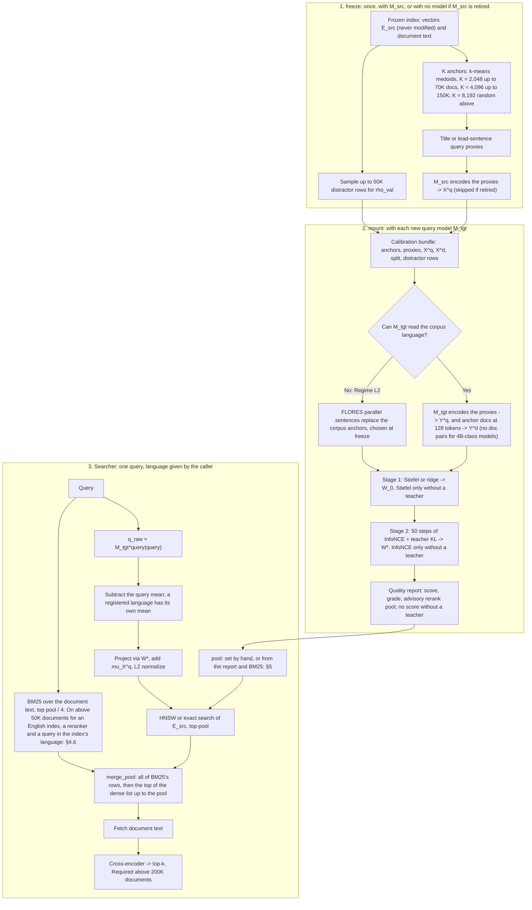

# Technical Design Document (v2.4): `SpaceBridge` Cross-Model Alignment Engine & Benchmark Suite

**Status:** Phase 0 complete (2026-11-01); Phase 1 complete (2026-11-03). Goal: 1M documents; ceiling of the whole project: 8.84M (§2.1)  
**Target Environment:** Local Linux Host (Intel i5-12600K, NVIDIA RTX 5070 Ti 16GB VRAM, PyTorch built for CUDA $\ge 12.8$ / `sm_120`)  
**Scope:** Zero-Reindexing Cross-Model, Cross-Dimension, and Cross-Language Query Alignment, up to 8.84M documents on one machine  

> [!NOTE]
> **Changes since v2.3**
> 1. **Index is never touched:** removed per-document re-centering / re-normalization of $E_{\text{src}}$ (it required rebuilding the ANN index). Document-side centering is now handled implicitly (§4.2).
> 2. **Affine query map:** projected queries add back the source query mean $\mu_X^{(q)}$ so they live where the index expects native queries; Stiefel solver gains a Procrustes scale $s$ (§4.2–4.3).
> 3. **Retention denominators:** targets are now stated against the *ceiling* $\min(\text{M}_{\text{src}}\text{ native}, \text{M}_{\text{tgt}}\text{ oracle})$; oracle retention is still reported (§2.1).
> 4. **Mount budget** split into solver time (any model) and per-model-class end-to-end time; 2 s is not achievable for 4B-class targets (§2.1).
> 5. **Eval/calibration leakage fixed:** Belebele passages are FLORES-200 passages, so Tier 5 now evaluates primarily on `XQuADRetrieval` / `MKQARetrieval`, and FLORES sentences overlapping Belebele are removed from all anchor/shift banks (§7.1).
> 6. **$\rho_{\text{val}}$ defined** against a 50K-document distractor pool, with per-language validation and thresholds to be calibrated empirically (§5, §7.4).
> 7. **Operator D** now compares like with like (both sides against the same reference *documents*); latency corrected to ~1–3 ms (§4.3).
> 8. **Models:** added `microsoft/harrier-oss-v1-0.6b` and `google/embeddinggemma-2` as target query models, `Qwen3-Reranker-0.6B` as second reranker; switched all inference to `bf16` (§7.1–7.2).
> 9. New ablation rows: $M_{\text{src}}$-native ceiling, identity sanity check, mean-strip variant, doc↔doc refinement term (§7.3).
> 10. Wording: "human-translated (no MT)" instead of "native human-authored"; Up-Projection advantage stated as an expectation, not a theorem.
> 11. **No dataset text in the repo:** FLORES (CC BY-SA 4.0, gated) is downloaded at runtime and cached under git-ignored `data/` instead of bundled as static JSON (§4.4, §7.1).

---

## 1. Overview & Motivation

Querying a frozen vector index with a different embedding model, for example after a model upgrade, with a tiny on-device model, or in another language, normally requires re-embedding every document first.

**Positioning (decided 2026-11-01): instant compatibility and migration.** Serve the frozen index right away with the new query model, then re-index in the background if traffic justifies it. It is not a quality upgrade and not a compute saving: at scale a bridged model stays below the old model's own queries in the first stage, and against a re-indexed system with BM25 too it gives up 0.6 to 2.5 points at 1M and 1.9 to 5.5 at the largest sizes (§2.1). Above 50K, BM25 means the rerank pool no longer has to widen with size. So if the re-indexed system would rerank too, per-query compute is no longer a reason to re-index; if it wouldn't rerank, re-indexing pays back within thousands of queries, at lower quality than the bridge with BM25 and a reranker.

**BM25 is part of the same-language product (decided 2026-11-02).** The map loses the detail that picks out the right document, and better calibration can't repair that, so above 50K documents the rerank pool also holds BM25's best matches over the document text (§4.6). That needs no new model and no change to the index, only the text the reranker already reads. It doesn't cross languages.

**Translation (decided 2026-11-02).** The positioning stands for same-language migration, where translation does not apply. For cross-language search, use machine translation while the old query model is available, and the bridge once it is retired: translation needs the old model alive at query time. On Chinese to English, MADLAD-400 3B leads the best plain bridge by 2.5–4 points of `nDCG@5` at pool 60 (`xquad-zh`, `mlqa-zh`). **A later measurement (Phase 1, 2026-11-03) changes that comparison, not yet the decision:** with a translator feeding BM25, the bridge reads 0.861 and 0.733 at budget 60, against 0.849 and 0.694 for the old model on the same translation, and 0.862 and 0.728 for that old model with BM25 too (§4.6). The evidence is Chinese to English only.

**Scale.** The reference deployment is low-traffic, self-hosted, one GPU, HNSW: models, vectors and text are all local, and the index lives in RAM. **1M documents is the goal; 8.84M (MS MARCO's full corpus) is the stretch and the ceiling of the whole project.** Nothing above it is planned or measured. If a goal does not fit this machine, the algorithm is optimized; more hardware is not assumed. §2.1 gives the lines.

**Working hypothesis** (motivated by the *Platonic Representation Hypothesis*): high-performing embedding models organize semantic neighborhoods with largely isomorphic relative geometry, differing primarily by anisotropic cone offsets (including query/document and language-ID shifts), orthogonal rotations, and spectral scaling. Phase 0 exists to *test* how far this holds across model families, dimensions, and languages.

`SpaceBridge` aligns a **target query encoder** $M_{\text{tgt}}$ directly into an existing, **unmodified source document index** $M_{\text{src}}$ using $K$ pre-bundled calibration anchors ($K \ll N$). Solver time is **under 250 ms**; end-to-end mount time is dominated by encoding the anchors with $M_{\text{tgt}}$ and depends on its size (§2.1). Phase 0 defers custom file container packaging (`.slice` / hot-cold disk tiering) to rigorously benchmark alignment across **architectural families, extreme dimensional ratios ($128\text{d} \leftrightarrow 2560\text{d}$), and language boundaries (`zh` $\leftrightarrow$ `en`)**.

> [!IMPORTANT]
> **Theoretical Boundary (Source-Capacity Ceiling):** By the Data Processing Inequality, projecting $q_{\text{tgt}} \to \text{Space}(M_{\text{src}})$ provides $M_{\text{tgt}}$'s query understanding (including multilingual comprehension) *bounded above by $M_{\text{src}}$'s document separability*. `SpaceBridge` cannot recover distinctions that $M_{\text{src}}$ collapsed at index creation time. We therefore **expect** **Up-Projection** (lightweight/multilingual $M_{\text{tgt}} \to$ high-capacity $M_{\text{src}}$) to retain more than **Down-Projection**; this is an empirical claim tested in Tier 4, not a theorem.

---

## 2. Goals & Non-Goals

### 2.1 Tiered Performance Goals

**Retention definitions** (computed per metric, per test pair):
* **Oracle retention** $\rho_{\text{oracle}} = \text{metric}_{\text{bridge}} / \text{metric}_{\text{oracle}}$, where the oracle re-embeds all $N$ docs with $M_{\text{tgt}}$ (Ablation Row 0a).
* **Ceiling retention** $\rho_{\text{ceil}} = \text{metric}_{\text{bridge}} / \min(\text{metric}_{\text{src-native}}, \text{metric}_{\text{oracle}})$, where *src-native* is $M_{\text{src}}$ queries on the $M_{\text{src}}$ index (Row 0b; for Tier 5 this uses the parallel query in the index language). By the source-capacity ceiling, $\rho_{\text{ceil}}$ is the achievable quantity; **all targets below are on $\rho_{\text{ceil}}$** and $\rho_{\text{oracle}}$ is always reported alongside.

**Goals by index size (Phase 1, approved 2026-11-01).** End to end means `nDCG@5` $\rho_{\text{ceil}}$ after `bge-reranker-v2-m3`, with native and re-index reranked at the same depth. Pool is the number of first-stage candidates sent to the reranker.

| Line | Applies at | Requirement (mean over pairs, 3 seeds; the worst pair is reported too) |
| :--- | :--- | :--- |
| **Approved targets (the 1M goal)** | up to 1M | End to end $\ge 98\%$ Tier 1, $\ge 94\%$ Tier 3, pool $\le 300$, on two corpora |
| **Stretch line** | above 1M, up to 8.84M | End to end $\ge 95\%$ Tier 1, $\ge 90\%$ Tier 3, pool $= 300$ |

Two ranges are reported from these. The **best range** is the largest measured size meeting the approved targets on every corpus measured at that size. The **supported range** is the largest measured size meeting the stretch line. Anything above is "measured, not recommended", with its numbers. A reranker is required above 200K documents, so document text must be available at query time (first-stage-only use loses far more at 1M). There is no `Recall@30` target at $K = 8,192$: large indexes are judged end to end, with recall at the rerank depth reported.

| Migration Tier | Example Test Case | Pure Vector `Recall@30` $\rho_{\text{ceil}}$ | End-to-End `NDCG@5` $\rho_{\text{ceil}}$ (Reranker) |
| :--- | :--- | :--- | :--- |
| **Tier 1: Intra-Family Moderate Dim** | `bge-base-en-v1.5 (768d)` $\leftrightarrow$ `bge-large-en-v1.5 (1024d)` | **$\ge 88\%$** at $K = 2,048$; **$\ge 90\%$** at $K = 4,096$ † | **$\ge 98\%$** |
| **Tier 2: Cross-Family Same-Dim** | `bge-large-zh-v1.5 (1024d)` $\leftrightarrow$ `multilingual-e5-large (1024d)` | **$\ge 88\%$** (`6–12%` loss) | **$\ge 96\%$** |
| **Tier 3: Encoder $\leftrightarrow$ Decoder-LLM** | `bge-large-en-v1.5 (1024d)` $\leftrightarrow$ `Qwen3-Embedding-0.6B` / `harrier-oss-v1-0.6b (1024d)` | **$\ge 82\%$** at $K = 2,048$; **$\ge 87\%$** at $K = 4,096$ † | **$\ge 94\%$** |
| **Tier 4: Extreme Low $\leftrightarrow$ High Dim** | `MiniLM (384d)` / MRL $(128\text{–}768\text{d})$ $\leftrightarrow$ `Qwen3-4B (2560d)` ($6.7\times$–$20\times$) | **$\ge 80\%$** (Up-Proj) / **$\ge 85\%$\*** (Down-Proj, ceiling = $384\text{d}$ native) | **$\ge 92\%$** |
| **Tier 5: Cross-Language (`zh` $\leftrightarrow$ `en`)** | `zh` Query (`Qwen3`/`mE5`/`harrier`/`EmbeddingGemma 2`) $\to$ Monolingual `en` Index (`bge-en`) *(BM25 = 0)* | **$\ge 78\%$** | **$\ge 90\%$** *(via Cross-Lingual Reranker)* |

† **Revised and approved 2026-10-30,** stated for a hard domain (`fiqa`). The original Tier 1 target ($\ge 95\%$) is out of reach for a linear query map on `fiqa` (89–92% at $K$ = 2,048–4,096), though it is met on the easy `scifact` (97%). **All tiers also target `Recall@100` $\rho_{\text{ceil}} \ge 90\%$,** so a reranker can recover the rest. As the benchmark broadens (§7.1), read the targets as the median across datasets, with the worst dataset reported alongside. Tiers 2, 4 and 5 keep their original targets.

**Status up to about 171K documents** (final engine, 3 seeds, mean over pairs, Phase 0):

- **First stage, `Recall@30`, $K$ = 2,048 / 4,096:** every tier meets its target on the mean on every measured dataset. Worst pairs below target: `T2Retrieval` `multilingual-e5-large` ← `bge-large-zh-v1.5` at $K = 2,048$ (0.871), `trec-covid` Tier 1 `bge-large-en-v1.5` ← `bge-base-en-v1.5` (0.872 / 0.884). Tier 4a (`fiqa`): Up 1.042 / 1.077 (ceiling = MiniLM re-index; 0.72–0.75 of the 4B native), Down 0.937 / 0.995. Tier 4b (MRL slices into `bge-large-en-v1.5`, $K = 2,048$): 0.90 / 0.89 / 0.82 / 0.70 at 768 / 512 / 256 / 128 dims.
- **End to end, `nDCG@5` at pool 30 / 60 / 100, $K = 2,048$, `bge-reranker-v2-m3`:** `fiqa` 0.97 / 0.99 / 1.00; `trec-covid` Tier 1 0.982 / 1.011 / 1.015, Tier 3 0.998 / 1.018 / 1.007; Tier 4a (`fiqa`) 0.975 / 0.992 / 1.011; Tier 5a (`xquad-zh`) 0.913 / 0.944 / 0.959, with `harrier-oss-v1-0.6b` the worst at 0.923 / 0.938 at pool 60 / 100; Tier 2 (`T2Retrieval`) 0.922 / 0.952 / 0.965, so Tier 2 needs pool 100 to meet 96%.

\* Provisional: re-baseline after Stage 1 smoke test. In v2.3 this target was stated against the $2560\text{d}$ oracle, which can exceed the source-capacity ceiling itself.

> [!WARNING]
> **Retention falls as the index grows, and the targets above don't hold at every size on their own.** The same map on growing subsets of one index (MS MARCO, $K = 2,048$, `Recall@30`, 50K / 200K / 500K / 1M): Tier 1 0.970 / 0.933 / 0.890 / 0.860, Tier 3 0.921 / 0.855 / 0.790 / 0.732. NQ replicates it: 0.970 / 0.944 at 50K, 0.844 / 0.745 at 1M. A denser index turns the same small query error into more rank losses among near-duplicate passages, and most are near misses: the positive's median rank goes from 0 to 2–8. Small subsets also flatter the bridge (native `Recall@30` is 0.99 at 50K, 0.94 at 1M). Real queries instead of proxies add only 2–5 points at $K = 2,048$, and even 32,768 real query pairs reach only 0.83–0.91 at 1M, which points to a limit of the linear map; no nonlinear map was tested. `scripts/scale_diagnosis.py`, `scripts/scale_anchors_depth.py`.

**Status at and above 75K documents (Phase 1, final, 2026-11-03).** End to end, `nDCG@5` $\rho_{\text{ceil}}$, `bge-reranker-v2-m3`, mean over pairs, 3 seeds, exact search. Tiers 1 and 3 only. "BM25" is the bridge plus BM25 in a budget of 60 (§4.6), which is what the library serves above 50K. **Retention above 1 is not a gain over native:** "strict" gives native and re-index BM25 too.

| Corpus | Size | $K$ | Queries | Plain, pool 60 | Plain, pool 300 | BM25, budget 60 | Strict | Worst pair, BM25 |
| :--- | :--- | :--- | :--- | :--- | :--- | :--- | :--- | :--- |
| MS MARCO | 100K | 4,096 | 500 | 0.983, 0.947 | | 0.998, 0.997 | 0.993, 0.995 | 0.998, 0.997 |
| NQ | 100K | 4,096 | 500 | 0.987, 0.967 | | 0.997, 0.998 | 0.997, 0.996 | 0.997, 0.996 |
| HotpotQA | 100K | 4,096 | 500 | 0.941, 0.891 | | 1.000, 1.016 | 0.995, 1.001 | 1.000, 1.014 |
| MS MARCO | 500K | 8,192 | 500 | 0.967, 0.919 | 0.990, 0.965 | 0.996, 0.989 | 0.995, 0.989 | 0.996, 0.984 |
| NQ | 500K | 8,192 | 500 | 0.967, 0.948 | 0.993, 0.980 | 0.989, 0.988 | 0.993, 0.985 | 0.989, 0.987 |
| HotpotQA | 500K | 8,192 | 500 | 0.901, 0.821 | 0.962, 0.909 | 0.997, 1.016 | 0.994, 0.993 | 0.997, 1.011 |
| MS MARCO | 1M | 8,192 | 2,000 | 0.959, 0.899 | 0.986, 0.957 | 0.995, 0.982 | 0.994, 0.983 | 0.994, 0.979 |
| NQ | 1M | 8,192 | 2,000 | 0.951, 0.915 | 0.989, 0.972 | 0.985, 0.979 | 0.985, 0.975 | 0.984, 0.977 |
| HotpotQA | 1M | 8,192 | 2,000 | 0.881, 0.795 | 0.956, 0.898 | 0.995, 1.020 | 0.989, 0.988 | 0.993, 1.015 |
| HotpotQA | 5.23M | 8,192 | 2,000 | 0.786, 0.665 | 0.886, 0.798 | 0.985, 1.009 | 0.967, 0.961 | 0.983, 1.005 |
| MS MARCO | 8.84M | 8,192 | 2,000 | 0.910, 0.796 | 0.963, 0.895 | 0.979, 0.946 | 0.981, 0.945 | 0.978, 0.945 |

Each cell is Tier 1, Tier 3. Tier 1 at 500K and below is one direction. Results at 500 queries move by about $\pm 1.5$ points, and absolute values fall with size for every system: at 8.84M, MS MARCO reads 0.419 and 0.405 absolute at budget 60, against 0.429 for native and re-index.

- **Best range, with BM25: up to 1M, on all three corpora, Tiers 1 and 3, budget 60.** Passes at every measured size from 75K to 1M.
- **Supported range, with BM25: up to 8.84M, budget 60.** That top size rests on MS MARCO alone; HotpotQA is measured to its whole corpus, 5.23M; NQ isn't measured above 1M; no corpus was held out from the budget above 1M; there is no HNSW index above 1M.
- **Without BM25, multi-hop questions miss at the library's defaults at every size measured,** from 10K (0.968, 0.937) through 50K (0.953, 0.903) to 5.23M (0.886, 0.798). MS MARCO and NQ pass up to 1M at pool 300. MS MARCO at 8.84M is measured, not recommended: 0.963, 0.895.
- **Where BM25 hurts:** FiQA and TREC-COVID, held out from its choice, lose 0.9 to 2.2 points in every (pair, seed) cell and still pass: FiQA 1.018 and 0.981, TREC-COVID 1.001 and 0.987 (50 queries). SciDocs stays off by size (§4.6); given BM25 it goes from 1.013 and 1.018 to 0.984 and 0.970 and still passes.
- **What the bridge adds over BM25 and the reranker alone,** budget 60, 2,000 queries, no bridge against bridge with BM25: MS MARCO 1M 0.909, 0.906 against 0.995, 0.982; NQ 1M 0.863, 0.870 against 0.985, 0.979; MS MARCO 8.84M 0.876, 0.874 against 0.979, 0.946; HotpotQA 1M 0.958, 1.001 against 0.995, 1.020; HotpotQA 5.23M 0.945, 1.000 against 0.985, 1.009. So HotpotQA's readings say more about BM25 than about the map.
- **Smaller index models hold with BM25:** `minilm` ← `bge-large-en` and ← `qwen3-0.6b` read 0.981 and 0.975 at 1M, budget 60, against 0.935 and 0.912 plain at pool 300. Tier 4's line is 92%.
- **The retired-model fit holds with BM25:** at budget 100, the pool it gets, 0.997 and 1.020 on HotpotQA 1M, 0.997 and 0.982 on MS MARCO 1M, on one pair per tier and 500 queries.
- **Through HNSW** ($M = 32$, $\text{ef}_{\text{construction}} = 200$, ef 500, MS MARCO 1M only), BM25 costs at most 0.08 points against exact search: Tier 1 reads 0.995 and Tier 3's one indexed pair 0.978 at budget 60.
- **Tier 3 has been about 3× Tier 1's loss:** at 8.84M, plain at pool 300, it's 2.8×, and 2.6× with BM25 at budget 60. On HotpotQA 5.23M it's 1.8×.
- **First-stage `Recall@300` retention keeps falling with size,** which is what BM25 and the reranker are holding up: MS MARCO Tier 3 0.942 at 1M, 0.826 at 8.84M; HotpotQA 0.943 and 0.893 at 1M, 0.862 and 0.779 at 5.23M.

**Speed, one query on the reference machine** (`scripts/summarize_m3.py table1`; the README has the table): on 10 CPU threads at budget 60, through `Searcher`, short passages take 11–12 s and long documents 36–38 s at every size up to 8.84M, so neither crosses a minute. Long documents reach it at budget 100, 60.6 s, which a grade C or D or source-free fit gets. The GPU takes 0.16 s and 0.31 s at 1M, and 1.09 s at 8.84M, where exact search runs on the CPU in about 0.9 s since the GPU can't hold the vectors. BM25 adds 5 ms at 1M and 21 ms at 8.84M, p50. CPU rerank seconds $\approx 1.91\text{ ms} \times \text{pool} \times \text{tokens per pair}$, within 4.0% on average and 9.6% at worst over five corpora from 97 to 412 tokens per pair. If a re-indexed system would also rerank about 60, the bridge adds only BM25 and the projection, so re-indexing pays back after 19K to 277K queries at 1M on GPU and 331K to 12.9M on CPU, by query model. If it wouldn't rerank, the reranker counts too: 803 to 12K on GPU and 476 to 18K on CPU, at lower quality than the bridge with BM25 and a reranker.

* **Solver Budget (any model, reference hardware):** Stage-1 + Stage-2 + validation on precomputed embeddings should take about **$250\text{ ms}$** on the RTX 5070 Ti. This is a reference for spotting regressions, not a promise on other machines. Measured at the default $K$: 143–176 ms for indexes up to 1024-d, 173 ms into a 2560-d index; 239–263 ms at the large-index $K = 8,192$.
* **Mount Budget (revised and approved 2026-11-01):** the mount encodes the $K$ query proxies plus, for doc↔doc pairs, the $K$ anchor docs **truncated to 128 tokens** (`spacebridge.DOC_PAIR_TOKENS`, configurable), and its cost is bounded **relative to re-indexing the corpus with $M_{\text{tgt}}$**:

$$\frac{\text{tokens encoded at mount}}{\text{tokens encoded to re-index the corpus}} \le 10\%$$

A fixed number of seconds cannot hold for every corpus, $K$ and machine, and the point of a mount is that it is far cheaper than re-indexing. Both sides run the same model on the same machine, so the ratio does not depend on the hardware. It applies when $K \ll N$: below roughly 20K documents re-indexing is itself quick, and it may simply be the better choice. The earlier per-class budgets (5 / 10 / 30 s, and before them the provisional 2 / 4 / 20 s) are retired; the seconds below are reference measurements of one machine. `scripts/summarize_mount.py` reports the ratio.

| Corpus | $N$ | $K$ | Mount / re-index tokens (all model classes) | Mount on the reference GPU |
| :--- | :--- | :--- | :--- | :--- |
| `scidocs` | 25.7K | 2,048 | 5.2–5.8% | 1.3–7.4 s |
| `fiqa` | 57.6K | 2,048 | 3.4–4.0% (`Qwen3-Embedding-4B`, proxies only: ~1.7%) | 1.0–8.5 s (4B: 19.2 s) |
| `msmarco-1m` | 1M | 2,048 | 0.36–0.41% | 1.5–8.6 s |
| `msmarco-1m` | 1M | 8,192 (large-index default) | 1.4–1.5% | 5.5 s (`bge-base-en-v1.5`), 14.8 s (`bge-large-en-v1.5`), 33–34 s (0.6B decoders) |

> [!NOTE]
> **Reference measurements of the default mount protocol (M4, $K = 2,048$, idle RTX 5070 Ti, bf16, one run per pair; `scripts/summarize_mount.py`).** Mount = proxy encoding + anchor-doc encoding at 128 tokens for doc↔doc pairs (§4.3) + solver. `fiqa` has no titles (lead-sentence proxies, ~58 tokens); `scidocs` uses title proxies (~23–37 tokens). Anchor docs at 128 tokens average 105–124 tokens.
>
> | $M_{\text{tgt}}$ (size class) | Proxies `fiqa` / `scidocs` | Anchor docs, 128 tokens | Solver | Protocol | Mount `fiqa` / `scidocs` |
> | :--- | :--- | :--- | :--- | :--- | :--- |
> | `all-MiniLM-L6-v2` (≤ 0.35B) | 0.3 s | 0.5 s | 0.26 s (into the 2560-d index) | doc pairs | **1.0 s** |
> | `bge-base-en-v1.5` (≤ 0.35B) | 0.6 / 0.3 s | 0.8–0.9 s | 0.15 s | doc pairs | **1.6 / 1.3 s** |
> | `bge-large-en-v1.5` (≤ 0.35B) | 1.8 / 0.7 s | 2.3–2.4 s | 0.14–0.16 s | doc pairs | **4.2 / 3.3 s** |
> | `EmbeddingGemma 2` (≤ 0.35B) | 1.8 s | 2.8 s | 0.16 s | doc pairs | **4.8 s** (tightest) |
> | `multilingual-e5-large` (≈ 0.6B) | 1.6 s | 2.3 s | 0.17 s | doc pairs | **4.0 s** |
> | `Qwen3-Embedding-0.6B`, `harrier-oss-v1-0.6b` (≈ 0.6B) | 3.5–3.6 / 2.1–2.2 s | 4.6–5.0 s | 0.17 s | doc pairs | **8.2–8.4 / 7.2–7.4 s** |
> | `Qwen3-Embedding-4B` (≈ 4B) | 19.1 s | (24.8 s, not used) | 0.09 s | proxies only | **19.2 s** (44.0 s with doc pairs) |
>
> Before truncation (M3, full-length anchor docs, 200–280 tokens) the doc-pair pass was ~3× the proxy pass: 7.1 s for `bge-large-en-v1.5`, 8.8 s for `EmbeddingGemma 2`, 15.7 s for the 0.6B decoders. **Retention cost of 128-token anchor docs** (Row 8b, 128 − full, 3 seeds, Tier 1 + 3, $K$ = 2,048 / 4,096): `fiqa` (decision set) −0.3 to −0.5 points; held-out `hotpotqa` +0.0 [−0.1, +0.1] (36 cells, short passages, so truncation rarely bites); held-out `trec-covid` −0.4 [−0.7, −0.2] pooled with the M4 Stage-2 stopping rule (the M2 rule's stopping flips had masked it as −0.2 [−0.9, +0.5]); the largest cost is Tier 3 at $K = 2,048$, −0.8 [−1.3, −0.3] (10 of 12 cells negative), where anchor docs are ~200+-token abstracts; `fiqa` under the same rule is −0.5 [−0.7, −0.3] pooled, −0.8 at Tier 3. 256-token anchor docs recover most of it (−0.2 / −0.1 pooled on `trec-covid` / `fiqa`) but take the mount to 5.7 s (`bge-large-en-v1.5`), 6.8 s (`EmbeddingGemma 2`) and 11.5–11.8 s (0.6B decoders), which the relative budget would now allow; 128 tokens stays the default, and the length is a parameter (`--doc-pair-tokens`, `spacebridge.DOC_PAIR_TOKENS`). Query-time projection: 24–54 µs on CPU. Up-projection into a 2560-d index exceeded the solver budget (263 ms at $K = 2,048$; Stage 2's logits scale with $d_s$) until the M4 width-aware Stage-2 batch (§4.3): now 173 ms at $K = 2,048$ and 208 ms at 4,096.

* **Online Overhead:** Query-time projection must take **$< 0.1\text{ ms}$** on CPU (one $d_t \times d_s$ mat-vec, $\le 10^6$ MACs) with **zero duplicate or rewritten vector indices** on disk. Operator D rescoring would add **$\approx 1\text{–}3\text{ ms}$** on CPU; it is designed, not implemented (§3).

### 2.2 Non-Goals
* **Anything above 8.84M documents.** It is the limit of the one machine this project runs on (§1).
* **Custom Container Packaging & Storage Tiering:** Portable `.slice` archives and SSD/HDD tiering are deferred until Phase 0 benchmark targets are met.
* **Any Index Rewrite:** Indices are immutable read-only snapshots. This includes re-centering, re-normalizing, or re-quantizing stored vectors; all alignment happens on the query side.
* **Machine Translation in Calibration:** No MT models or LLM translators are used during calibration, and test queries come from **professionally human-translated** parallel data (FLORES, XQuAD, MKQA), so alignment quality is not confounded with MT artifacts. `Searcher(translate=)` is off by default and only feeds BM25 at query time (§4.6).
* **GAN / Unsupervised Adversarial Alignment:** Unstable iterative adversarial methods (`vec2vec`) are excluded in favor of closed-form SVD/Ridge initialization plus deterministic contrastive refinement.

---

## 3. Architecture & Dual-Manifold Data Flow

Modern asymmetric embedding models map **queries** (with task instructions or `"query: "` prefixes) and **documents** (with `"passage: "` or raw text) onto **separate cones** ($\mu^{\text{query}} \neq \mu^{\text{doc}}$), and multilingual models add a **language-identity cone shift** ($\mu_{\text{zh}}^{\text{query}} \neq \mu_{\text{en}}^{\text{query}}$).

`SpaceBridge` handles all three shifts on the query side only.

The chart shows what the library does (`freeze`, `mount`, `Searcher`). Operator D (§4.3) and language detection are designed but not implemented: a caller passes the query language.



---

## 4. Core Algorithms & Mathematical Formulation

### 4.1 Full-Rank Anchor Selection (`AnchorSelector`)
To prevent rank deficiency on $1024\text{d}$–$1536\text{d}$ models, the default anchor budget is **$K = \min(2,048, N)$** ($K_{\text{train}} = 1,638$, $K_{\text{val}} = 410$), **$K = 4,096$ above $N = 70\text{K}$**, and **$K = 8,192$ above $N = 150\text{K}$** (`spacebridge.default_anchor_count`, §2.1 large-index profile). Fit quality depends on $K$ relative to the embedding dimensions, not on $K/N$: v2.4 briefly capped $K \le N/10$, which on `scifact` forced $K = 518$ and cost Tier 1 about 5 points of `Recall@30` retention (91% vs. 96% at $K = 2,048$), so the cap was removed. Small corpora such as `scifact` remain smoke tests; `fiqa` ($K/N = 3.6\%$) is the authoritative benchmark.

1. **Medoid Sampling ($N \ge 5,000$):** Partition document embeddings into $K$ clusters with spherical k-means (k-means++ seeding, then full-batch Lloyd steps on the GPU) and select the actual document $d_k$ closest in cosine similarity to each centroid, yielding $(D_{\text{anchor}}, X^{(d)} \in \mathbb{R}^{K \times d_s})$, with $X^{(d)}$ read **exactly as stored in the index**. (Use Farthest Point Sampling when $N < 5,000$.)

   > **Implementation finding (anchor selection cost):** sklearn `MiniBatchKMeans` spent nearly all its time in its greedy k-means++ init ($2 + \ln K$ candidate trials per center over $3 \times$ `batch_size` $\ge 12\text{K}$ samples, with `batch_size` $= 4K$), so cost grew with $K^2$: 47 s at $K = 2,048$ and 209 s at $K = 4,096$ on `fiqa` (idle CPU; tens of minutes under contention). A torch implementation (single-trial k-means++ over all $N$ docs, ≤ 20 Lloyd steps) takes 2.0 s / 3.9 s, 11 s for `trec-covid` (171K docs, $K = 4,096$), with slightly better coverage (mean cosine of each doc to its nearest anchor 0.786 vs. 0.785 at $K = 2,048$; random anchors 0.768).

   > **Implementation finding (anchor selection at scale, 2026-11-01):** $N > 150\text{K}$ uses a **uniform random sample** instead of k-means medoids (`spacebridge.resolve_anchor_method`). Random − k-means, Row 8b, `Recall@30` points, pooled over tiers and $K$, 3 seeds: MS MARCO 1M **+1.5** [+1.1, +1.9] (48/54 cells; +1.7 / +2.5 at Tier 1 / 3 for $K = 2,048$, +0.4 / +1.1 at 8,192); NQ 1M +0.4 [−0.2, +1.1] (9/18; a tie at 8,192). Below that size k-means stays: `trec-covid` (171K) −1.3 [−2.1, −0.6] with random, `fiqa` / `scidocs` / `hotpotqa` −0.3, `t2retrieval` −0.5, `nq` (50K) −0.1, MS MARCO 50K +0.1, `xquad-zh` +0.5 [+0.1, +0.9]. The gain at 1M replicates only weakly, so the case for random there is "no worse, and the selection step disappears"; at the same $K$, the switch point lies between `trec-covid` and 1M. **The switch moved to 150K in Phase 1 because of $K$, not the sampling:** $K = 8,192$ random beats $K = 2,048$ k-means end to end at 100K–200K on MS MARCO and NQ (pool 60, Tier 3: +2.6 to +4.7 points; at 200K on MS MARCO it cuts the pool that meets the targets from 300 to 60), and on held-out HotpotQA (+2.7 to +5.0). Held-out `trec-covid` (50 queries) shows no clear change and passes either way. Below 150K, $K = 8,192$ is over the mount budget on short passages (1.1M tokens is 10% of about 145K MS MARCO documents). Better corpus coverage did not mean better retention. The same k-means run on a 50K sample of the 1M corpus matched random (+2.7 vs. +3.0, $K = 2,048$, MS MARCO); test positives among the anchors of a positive-preserving 50K subsample add only ~0.6 points.
2. **Zero-LLM Query-Proxy Extraction:** For each medoid, the paired query proxy $q_k \in Q_{\text{anchor}}$ is its title alone when the title has at least 4 tokens (cut at 16) and no other anchor has the same title, otherwise its title/heading plus first sentence ($32$–$64$ tokens). Encode $X^{(q)} = M_{\text{src}}^{\text{query}}(Q_{\text{anchor}}) \in \mathbb{R}^{K \times d_s}$ using $M_{\text{src}}$'s native query prompt/prefix (§7.1 prompt table).

   > **Implementation finding (title proxies, M3):** lead-sentence proxies are long declarative statements (~40 tokens), unlike typical short queries, and Stage 2 learns "proxy → its own document" from them. On `trec-covid` (short questions over paper abstracts) Stage 2 therefore *hurt*. Replacing the proxy with the document title when there is one changes Stage 1 little but makes Stage 2 help: Row 8b `Recall@30` retention, title − lead, 3 seeds, Tier 1 + 3, $K$ = 2,048 / 4,096: `trec-covid` +4.7 to +8.6 points (all 36 pair-seed cells; Tier 1 reaches 0.884 at $K = 2,048$, meeting its 88% target), and on sets not used for the decision `scidocs` +0.9 to +3.4, `nq` +0.4 to +1.0, `hotpotqa` +0.4 to +1.1, `arguana` (queries are whole arguments) −0.2 to +0.0. A 16-token cut of the lead sentence (no title) is not a substitute: it lost 1.1–2.0 points on `fiqa`, which has no titles; the title is what matters. Corpora without titles (`fiqa`, `quora`, `T2Retrieval`) are unaffected. **Shared titles are not used alone:** on corpora with many passages per article (SQuAD paragraphs behind `xquad-zh`: 96% of usable titles shared by several anchors; `arguana`: 85%) a title-only proxy pairs one query with several documents; it cost `xquad-zh` up to 6 points (Row 7b, mE5 queries) and `arguana` 0.1–0.6. With the uniqueness rule `arguana` is neutral and `xquad-zh` is within ±0.5 points for three of four query models; with mE5 queries it is −2.1 ± 1.5 at $K = 2,048$, although only 9–13 proxies change, because the Stage-2 stopping step flips (an instability of Stage 2 for that model, not a title effect).
3. **Distractor Pool:** Sample $\min(N, 50\text{K})$ row IDs of $E_{\text{src}}$ uniformly at random (excluding anchors) for $\rho_{\text{val}}$ (§5). No re-encoding is needed; vectors are read from the index.
4. **Fixed Split:** $\mathcal{I}_{\text{train}} / \mathcal{I}_{\text{val}}$ is drawn once at freeze time and stored in the bundle so every target model is validated on the same anchors.

### 4.2 Query-Side Centering & Affine Mean Restore (Index Untouched)

**Document side: no transformation.** For any query vector $\hat{q}$ and doc mean $\mu_X^{(d)}$:

$$\hat{q} \cdot (e_j - \mu_X^{(d)}) = \hat{q} \cdot e_j - \underbrace{\hat{q} \cdot \mu_X^{(d)}}_{\text{constant over } j}$$

so subtracting the document mean never changes the ranking of an inner-product search and can be skipped. Likewise, softmax over documents is invariant to a per-query constant, so Stage-2 losses (§4.3) computed against raw $X^{(d)}$ are identical to those against centered docs. (v2.3 additionally re-normalized each centered document, which *does* change rankings and would require rebuilding the ANN index; that step is removed.) $\mu_X^{(d)}$ is still computed at freeze time for diagnostics (cone angles, §7.4).

**Query side: center, map, restore.** Using the training split only:

$$\mu_X^{(q)} = \frac{1}{K_{\text{train}}} \sum_{i \in \mathcal{I}_{\text{train}}} X_i^{(q)}, \qquad \mu_Y^{(q)} = \frac{1}{K_{\text{train}}} \sum_{i \in \mathcal{I}_{\text{train}}} Y_i^{(q)}$$

$$\bar{X}^{(q)} = X^{(q)} - \mu_X^{(q)}, \qquad \bar{Y}^{(q)} = Y^{(q)} - \mu_Y^{(q)}$$

where $Y^{(q)} = M_{\text{tgt}}^{\text{query}}(Q_{\text{anchor}}) \in \mathbb{R}^{K \times d_t}$. Rows are centered but **not** re-normalized, so the fitted map carries the correct residual scale. The online map is **affine**:

$$\hat{q}_{\text{src}} = \text{Normalize}\!\left(\mu_X^{(q)} + (q_{\text{tgt}} - \mu_{Y, L_q}^{(q)})\, W\right)$$

Restoring $\mu_X^{(q)}$ puts the projected query on the source query cone, where the index was trained to be searched; dropping it adds a document-dependent term $-\mu_X^{(q)} \cdot e_j$ that alters native rankings. **Identity check:** with $M_{\text{tgt}} = M_{\text{src}}$ and ridge $\lambda \to 0$, $W \to I$ and $\hat{q}_{\text{src}} = x^{(q)}$ exactly, so the pipeline must reproduce native retrieval (Ablation Row 1). The v2.3 behavior (no mean restore) is retained as Ablation Row 3b.

**Residual norm matching (implementation finding).** Least-squares maps (ridge, and Procrustes with $s < 1$) shrink the mapped residual $(q_{\text{tgt}} - \mu_Y)W$ toward zero, so after restoring $\mu_X^{(q)}$ the mean dominates and every query drifts toward the "average query". This made stripping the mean look better at small $K$, while restoring was clearly better with more data. Each Stage-1 candidate $W$ is therefore rescaled so the mean norm of mapped training residuals equals that of native source residuals $\|\bar{X}^{(q)}_{\text{train}}\|$. On `fiqa` this adds about 3 points of Stage-1 `Recall@30` retention, at zero query-time cost (the scale is folded into $W$). Ablation Rows 6n / 8n disable it.

---

### 4.3 Alignment Solvers & Extreme Dimensional Conversion ($d_t \ll d_s$ vs. $d_t \gg d_s$)

When converting across large dimensional gaps (e.g., $384\text{d} \leftrightarrow 2560\text{d}$), the two directions behave asymmetrically:
* **Up-Projection ($d_t \ll d_s$, e.g., $384\text{d} \to 2560\text{d}$):** Expected to be favorable. Because $K_{\text{train}} = 1,638 \gg d_t = 384$, the input covariance $(\bar{Y}^{(q)})^T \bar{Y}^{(q)} \in \mathbb{R}^{384 \times 384}$ is $4.3\times$ oversampled and well-conditioned (estimation variance scales with $d_t / K_{\text{train}}$, independent of $d_s$). $\hat{q}_{\text{src}}$ maps into at most a $384$-dimensional subspace of the $2560\text{d}$ index, analogous to Matryoshka (MRL) retrieval.
* **Down-Projection ($d_t \gg d_s$, e.g., $2560\text{d} \to 384\text{d}$):** Both rank-constrained ($d_t > K_{\text{train}}$) and bounded by the $384\text{d}$ index's lower semantic capacity. Handled via Spectral Truncation (Operator A) and Dual Woodbury Ridge (Operator B).

#### Operator A: Scaled Spectral-Truncated Stiefel Procrustes (Any $d_t, d_s$)
Thin SVD on the cross-covariance $M = (\bar{Y}_{\text{train}}^{(q)})^T \bar{X}_{\text{train}}^{(q)} \in \mathbb{R}^{d_t \times d_s}$ computes the optimal rectangular semi-orthogonal map without lossy marginal PCA:

$$U, \Sigma, V^T = \text{SVD}_{\text{thin}}\!\left((\bar{Y}_{\text{train}}^{(q)})^T \bar{X}_{\text{train}}^{(q)}\right)$$

Singular modes below $\tau_{\sigma} = 10^{-3} \cdot \sigma_1$ are truncated ($r = \max\{i : \sigma_i \ge \tau_{\sigma}\}$) so nullspace dimensions when $K_{\text{train}} < \max(d_t, d_s)$ map to $0$ instead of random orthogonal noise. Because the affine restore (§4.2) needs residuals at the right scale, the closed-form Procrustes scale is included:

$$W_{\text{stiefel}} = s\, U_{:, :r} V_{:, :r}^T \in \mathbb{R}^{d_t \times d_s}, \qquad s = \frac{\sum_{i \le r} \sigma_i}{\|\bar{Y}_{\text{train}}^{(q)}\|_F^2}$$

**Implementation note (Milestone 2):** $W_{\text{stiefel}}$ is computed as a polar decomposition from a float64 eigendecomposition of the smaller Gram matrix of $M$ ($M^T M$ or $M M^T$), which equals the SVD form to $\sim 10^{-5}$ and is several times faster than `gesvd` on GPU. Float64 is required: kept modes reach $\sigma_r / \sigma_1 = 10^{-3}$, eigenvalue ratios of $10^{-6}$, where float32 errs by ~15%. Effective ranks on `fiqa` at $K = 2,048$ are only 540–650 of 1024.

#### Operator B: Adaptive Primal / Dual (Woodbury) Ridge Projection
To support non-uniform spectral scaling at any target dimension $d_t$, including ultra-wide models ($d_t = 2560$ or $4096 > K_{\text{train}}$), `SpaceBridge` switches automatically between Primal and Dual (Woodbury) forms:

$$W_{\text{ridge}}(\lambda) = \begin{cases} \left(\bar{Y}_{\text{tr}}^T \bar{Y}_{\text{tr}} + \lambda I_{d_t}\right)^{-1} \bar{Y}_{\text{tr}}^T \bar{X}_{\text{tr}} & \text{if } d_t \le K_{\text{train}} \text{ (Primal: inverts } d_t \times d_t\text{)} \\[8pt] \bar{Y}_{\text{tr}}^T \left(\bar{Y}_{\text{tr}} \bar{Y}_{\text{tr}}^T + \lambda I_{K_{\text{train}}}\right)^{-1} \bar{X}_{\text{tr}} & \text{if } d_t > K_{\text{train}} \text{ (Dual: inverts } K_{\text{train}} \times K_{\text{train}}\text{)} \end{cases}$$

The two forms are algebraically identical for every $\lambda > 0$ (the switch is purely computational), and the column space of $W_{\text{ridge}}$ lies in the row space of $\bar{Y}_{\text{tr}}$. Since rows are no longer unit-norm, $\lambda$ is swept relative to the mean eigenvalue: $\lambda = \lambda_{\text{rel}} \cdot \|\bar{Y}_{\text{tr}}\|_F^2 / \min(d_t, K_{\text{train}})$ with $\lambda_{\text{rel}} \in \{0.01, 0.1, 1.0, 5.0, 20.0\}$, selected on $K_{\text{val}}$.

#### Operator C: GPU Contrastive-Distillation Refinement (`~80ms` Stage-2 Booster)
Initialized from $W_0 \in \{W_{\text{stiefel}}, W_{\text{ridge}}\}$, `SpaceBridge` runs $T = 50$ steps of AdamW (`lr=3e-3`, cosine decay) directly optimizing retrieval logits against the anchor documents **as stored in the index**, using the same affine map that is deployed online:

$$S_{\text{student}}(W) = \frac{1}{\tau} \text{Normalize}\!\left(\mu_X^{(q)} + \bar{Y}_{\text{train}}^{(q)} W\right) \left(X_{\text{train}}^{(d)}\right)^T, \qquad S_{\text{teacher}} = \frac{1}{\tau} X_{\text{train}}^{(q)} \left(X_{\text{train}}^{(d)}\right)^T$$

$$\mathcal{L}(W) = (1 - \alpha)\, \mathcal{L}_{\text{InfoNCE}}\!\left(S_{\text{student}}(W)\right) + \alpha\, \text{KL}\!\left(\text{softmax}(S_{\text{teacher}}) \;\|\; \text{softmax}(S_{\text{student}}(W))\right) + \beta \|W - W_0\|_F^2$$

(The Hinton $\tau^2$ factor is omitted: it compensates for a KL computed at a *higher* temperature than the CE term, but here both share $\tau = 0.05$, so $\tau^2$ would shrink the KL term $\sim 400\times$ relative to InfoNCE. Exposed as `RefineConfig.kl_scale`.)

with $\tau = 0.05$ (or $0.6\,\sigma_T$ on compressed-score indexes, below), $\alpha = 0.5$, $\beta = 10^{-3}$ (upgraded to $\beta = 10^{-2}$ when $d_t > K_{\text{train}}$ to prevent high-dimensional overfitting), with checkpoints every 10 steps scored on held-out **own-doc MRR** and teacher agree@10 of the $K_{\text{val}}$ proxies; the returned map is the **average of the checkpoints from step 20 on** if that average keeps agree@10 $\ge a_0 - 0.25\,(1 - a_0)$ ($a_0$: Stage 1's agree@10), else the best-MRR checkpoint above that floor, which may be Stage 1 itself (M4 stopping rule, below; Stage-1 selection and Stage-2 stopping score on a fixed 10K-row subsample of the $\rho_{\text{val}}$ pool, all anchors plus random distractors, which keeps the solver at 114 / 122 ms mean / max for $K = 2,048$ on `fiqa`, 164 / 174 ms with the default doc↔doc pairs, idle GPU). The teacher is the native source ranking, i.e. exactly what the index would return for $M_{\text{src}}$ queries. **Large $K$ (M3):** Stage 2 is full-batch, so its cost grows with $K_{\text{train}}^2$ (Row 8b at $K = 4,096$: 454 ms). When there are more than 1,638 candidate anchor docs (the $K_{\text{train}}$ of $K = 2,048$), each step trains on a random 1,638 of them and on the rows whose positive is among them: Row 8b at $K = 4,096$ takes 199 / 209 ms mean / max on `fiqa`, at −0.4 ± 0.1 / +0.1 ± 0.1 points `Recall@30` on `fiqa` / `scidocs` (3 seeds). Nothing changes at the default $K$. **Wide indexes (M4):** the per-step cost is rows × candidates × $d_s$ with rows proportional to candidates, so for $d_s > 1024$ the cap shrinks by $\sqrt{1024 / d_s}$ to keep a 1024-d index's cost (1,035 candidates into the 2560-d `Qwen3-Embedding-4B` index). Up-projection from `all-MiniLM-L6-v2` (`fiqa`, idle GPU): 263 → 173 ms at $K = 2,048$, 801 → 208 ms at 4,096, retention −0.2 [−0.7, +0.3] / −0.3 [−1.2, +0.3] points (3 seeds). A linearly scaled cap (candidates × $d_s$ constant, 655 candidates) lost 1.2 points at $K = 4,096$.

> [!NOTE]
> **Implementation finding (Stage-2 temperature, M3 Tier 2):** $\tau$ is in cosine units, so its effect depends on how spread out the index's scores are. The mean per-row s.d. of the teacher's scores over training anchors, $\sigma_T$, is 0.057–0.092 for every index measured except `multilingual-e5-large` (0.020–0.027). On an mE5 index $\tau = 0.05$ is a ~3× softer softmax; every Stage-2 step then dropped teacher agree@10 by ~35% and failed the 90% floor, so Stage 2 never ran (`T2Retrieval`, `me5-large` index ← `bge-large-zh-v1.5`: Row 8b 0.684), although running it would have gained ~19 points. **Rule:** when $\sigma_T < 0.04$, $\tau = 0.6\,\sigma_T$. Row 8b on that pair becomes 0.879 at $K = 2,048$ (3 seeds), and on held-out `fiqa` with an mE5 index (queries from `bge-large-en-v1.5` / `Qwen3-Embedding-0.6B`) it gains +2.1 to +5.0 points in 12 of 12 pair-seed cells, identity intact. Applying $\tau = 0.6\,\sigma_T$ to ordinary indexes as well ($\tau \approx 0.035$–$0.047$) was neutral on retention but moved the identity map on `trec-covid` (to 0.95), hence the guard. At $K = 4,096$ the 90% floor still blocked Stage 2 on 2 of 3 seeds on the T2 pair; the M4 stopping rule (below) fixes that.

> [!WARNING]
> **Proxy-positive shortcut:** each query proxy is the lead sentence of its own positive document, so InfoNCE positives are lexically easy and may not transfer to real queries. Mitigations evaluated in the ablation: the teacher-KL term (which spreads mass over semantically related anchors), and a **doc↔doc term** (Row 8b; **on by default since M2**, see the note below) that encodes the anchor docs with $M_{\text{tgt}}^{\text{doc}}$ and adds $\mathcal{L}_{\text{InfoNCE}}$ over $\left(\text{Normalize}(\mu_X^{(d)} + \bar{Y}^{(d)} W_d)\right)(X^{(d)})^T$, doubling calibration pairs at the cost of a second encoding pass.

> [!NOTE]
> **Implementation finding (Stage-2 stopping, `fiqa`, M2 P4):** v2 early-stopped Stage 2 on teacher agree@10 and stopped at step 0 in ~85% of fits. Run for a fixed 50 steps, Stage 2 improved real $\rho_{\text{ceil}}$ `Recall@30` on 6 of 6 pairs at $K = 2,048$ (mean +1.9 points, `nDCG@10` +2.3) while *lowering* every teacher-agreement signal (agree@10, neighbour recall, score correlation): InfoNCE pulls the bridged query toward its positive document, away from reproducing $M_{\text{src}}$'s neighbours of the proxy. Held-out own-doc MRR was the only label-free signal that rose with the real gain. Used alone it exploits the proxy-positive shortcut (on the identity map it traded 20 points of agree@10 for +0.4 MRR, Row 1 fell to 98.1% of native), hence the 90% agreement floor. With both, Row 8 − Row 6 on `fiqa` is +2.2 points `Recall@30` / +2.5 `nDCG@10` at $K = 2,048$ (6 of 6 pairs positive), +1.8 / +1.2 at 4,096, +0.8 / +0.1 at 1,024; Row 1 stays ≥ 99.2% of native. Hard negatives (Row 8h) did not help (+1.5 vs. +1.9 at a fixed 50 steps). Both the agree@10 stopping option and hard negatives were removed from the engine in M3.

> **Implementation finding (Stage-2 stopping, M4).** The M2 rule (best own-doc MRR among checkpoints keeping 90% of Stage 1's agree@10) had two failure modes, found by scoring every checkpoint on real test queries (3 seeds, $K$ = 2,048 / 4,096). (1) A cliff: on `T2Retrieval` with an mE5 index at $K = 4,096$ every checkpoint lost > 10% agreement, so Stage 1 was kept on 2 of 3 seeds although every Stage-2 checkpoint was 15–20 points better. (2) Noisy selection: on `trec-covid` own-doc MRR saturates (~0.97), so step 0 was kept on MRR margins of 0.001–0.007 while Stage 2 was 4–8 points better, and among Stage-2 checkpoints real retention moved ±3 points with no signal. **Rule:** a floor that scales with Stage 1's disagreement with the teacher, $a_0 - 0.25\,(1 - a_0)$ (loose on hard pairs, zero allowed loss at the identity), and the average of the checkpoints from step 20 on in place of a single pick (step 10 is often a transient of the early learning rate). Against the M2 rule, pooled over $K$: `T2Retrieval` +3.3 points (+6.5 at $K = 4,096$, now 0.913 and every pair ≥ 88%; seed-to-seed s.d. 3.5 → 0.8), `trec-covid` +0.5 (s.d. 2.5 → 1.7), `xquad-zh` +0.0, `fiqa` −0.1 [−0.2, +0.0] (decision sets); held out `hotpotqa` +0.0, `scidocs` −0.0, `fiqa` with an mE5 index +0.4 [+0.1, +0.7]. Identity maps keep Stage 1 (≥ 0.995 of native). Rejected on the same curves: a looser fixed floor or MRR alone (moves the `fiqa` identity −0.5), fixed steps or unconditional averages (move the identity), a soft MRR/agreement trade-off (−1 to −2 on `trec-covid`), held-out doc↔doc pairs as the validation signal (−0.4 to −0.9 on `trec-covid`).
>
> **No MRR guard on the average (post-M4 check).** The tail rule accepts the average on agreement alone, whereas the M2 rule kept Stage 1 unless own-doc MRR rose. A guard was tested on the saved curves:
> - **Strict guard** (average MRR ≥ step 0's): −0.5 points on `trec-covid`, where MRR is saturated and noisy.
> - **Slack 0.01:** fired on none of the ~370 fits.
> - **The known harmful case,** `trec-covid` with lead proxies (`outputs/m5_trec_lead_curves.jsonl`, 3 seeds): Stage 2 costs 2.5 points against Stage 1 at $K = 4,096$, but own-doc MRR *rises*, so neither guard fires. The M2 rule picks Stage 2 there too, landing within 0.1 points of the tail rule, while it also moves the identity map (−0.3) and the tail rule does not.
>
> No guard is shipped. That Stage 2 can hurt with no label-free signal noticing is a known limitation: title proxies avoid it on titled corpora, and untitled corpora with short-question queries remain the risk case.
>
> **Default change (2026-10-31): doc↔doc pairs are on.** Across the six M2 BEIR sets, Row 8b was the best first-stage configuration on every dataset except `arguana` (a tie) and on all four Tier 5a pairs, and it recovered most of the `trec-covid` Tier 1 miss (+5.9 points `Recall@30` over Row 8). Cost: one extra $M_{\text{tgt}}^{\text{doc}}$ encoding pass over the $K$ anchor docs at mount (3–30 s for 0.6B-class models) and +50 ms solver time (164 / 174 ms mean / max at $K = 2,048$ on `fiqa`, inside the 250 ms budget). `fit(mode="auto")` therefore requires `Y_doc_raw`; `SpaceBridge(doc_pairs=False)` opts out (ablation Rows 6–8). The identity check (Row 1) now runs with doc pairs ($Y^{(d)} := X^{(d)}$).
>
> **Size-dependent (M3, Tier 4).** For 4B-class query models the doc-pair pass costs 51 s at $K = 2,048$ (70 s mount) and gives no measurable gain: `Qwen3-Embedding-4B` queries into a MiniLM index, Row 8b − Row 8 = +0.1 ± 3.0 points `Recall@30` (3 seeds; +2.6 ± 0.4 at $K = 4,096$). The mount protocol is therefore doc pairs for query models up to ~0.6B (gains of +1.6 to +7.4 points across `fiqa`, `trec-covid` and the MRL sweep, for seconds of encoding), with anchor docs encoded truncated to 128 tokens (§2.1), and `doc_pairs=False` for 4B-class models.

#### Operator D: Candidate-Scoped Relative Representation Rescorer (Zero Extra Index)
**Designed, not implemented:** the library has no code for it and the serving path does not use it (§3, §5).

Applied strictly in-memory over `Top-200` first-stage candidates $\mathcal{C}_{200}$ against $K_{\text{ref}} = 512$ reference anchor **documents** when moderate drift is detected. Both sides are profiled against the *same* 512 documents, so profile coordinates are comparable across spaces:

1. **Lazy setup (first `MODERATE_DRIFT` mount only):** encode the 512 reference anchor docs with $M_{\text{tgt}}^{\text{doc}}$ to get $Y_{\text{ref}}^{(d)}$; $X_{\text{ref}}^{(d)}$ is already in the bundle.
2. **ZCA statistics:** target-side mean/covariance from the profiles $Y_{\text{train}}^{(q)} (Y_{\text{ref}}^{(d)})^T$; source-side from $X_{\text{train}}^{(d)} (X_{\text{ref}}^{(d)})^T$ (anchors in $\mathcal{I}_{\text{ref}}$ excluded). Each side is whitened with its own statistics, which removes the query-vs-doc offset between the two profile populations.
3. Target query profile: $r_{\text{tgt}}(q) = \text{ZCA}_{\text{tgt}}\!\left(q_{\text{tgt}} (Y_{\text{ref}}^{(d)})^T\right) \in \mathbb{R}^{512}$.
4. For $e_j \in \mathcal{C}_{200}$: $r_{\text{src}}(e_j) = \text{ZCA}_{\text{src}}\!\left(e_j (X_{\text{ref}}^{(d)})^T\right) \in \mathbb{R}^{512}$ ($200 \times d_s \times 512 \approx 10^8$ MACs, **$\approx 1\text{–}3\text{ ms}$** CPU, $< 0.1\text{ ms}$ GPU).
5. Fuse linear cosine rank, relative cosine rank, and BM25 rank (when monolingual) via RRF before Cross-Encoder reranking.

---

### 4.4 Cross-Language Conversion (`SpaceBridge` Lingual Modes)

`SpaceBridge` supports two distinct cross-language scenarios, including a capability the original monolingual index *could not perform natively*:

#### Regime L1: Zero-Translation Cross-Lingual Unlock (Monolingual Index + Multilingual Query Model)
* **Scenario:** A large corpus of **English** documents was indexed with an **English-only** model $M_{\text{src}}$ (`bge-large-en-v1.5` or `all-MiniLM-L6-v2`). A user wants to query it in **Chinese (`zh`), Japanese (`ja`), or Spanish (`es`)** without re-indexing or translating the corpus.
* **Calibration (Zero Translation Required):** Mount the index with a **multilingual** query encoder $M_{\text{tgt}}$ (`Qwen3-Embedding-0.6B`, `harrier-oss-v1-0.6b`, `multilingual-e5-large`, or on-device `EmbeddingGemma 2`). Because $M_{\text{tgt}}$ understands English, `SpaceBridge` calibrates $W^*: \text{Space}(M_{\text{tgt}}) \to \text{Space}(M_{\text{src}})$ directly on the existing **English** anchors $Q_{\text{anchor}}^{\text{en}}$.
* **Fixing the Language-Identity Cone Shift ($\Delta \mu_{\text{lang}}$):** Even in strong multilingual encoders, vectors contain a language-identity mean offset: $y_{L_q}(q) \approx \mu_{Y, L_q}^{(q)} + \delta y_{\text{semantic}}(q)$ with $\mu_{Y, \text{zh}}^{(q)} \neq \mu_{Y, \text{en}}^{(q)}$. Subtracting $\mu_{Y, \text{en}}^{(q)}$ from a Chinese query leaves residual bias $(\mu_{Y, \text{zh}}^{(q)} - \mu_{Y, \text{en}}^{(q)})$.
  * **Solution (`< 80ms` one-time setup per language for $\le 0.6\text{B}$ models):** Use $256$ parallel sentences from the filtered FLORES `dev` split (Belebele-overlapping sentences removed, §7.1). FLORES text is **not committed to the repo** (see the licensing note in §7.1); a build script downloads `flores_plus` with the user's HF token and caches the filtered subset (`~30KB` JSON) under the git-ignored `data/` directory. Encode both language sides with $M_{\text{tgt}}$ **using its query prompt/instruction** (otherwise the estimated shift mixes in the query/document cone offset). When a query arrives in language $L_q \neq L_{\text{src}}$, compute the language-adjusted query center:

$$\mu_{Y, L_q}^{(q)} = \mu_{Y, L_{\text{src}}}^{(q)} + \left(\mu_{\text{FLORES}, L_q}^{(q)} - \mu_{\text{FLORES}, L_{\text{src}}}^{(q)}\right)$$

  * Centering $q_{\text{raw}}$ by $\mu_{Y, L_q}^{(q)}$ strips the language-ID vector so Chinese/Japanese queries land on the aligned semantic subspace before multiplying by $W^*$.
* **Query Language Detection:** $L_q$ is taken from the caller when provided; otherwise from a lightweight language-ID model (e.g. fastText `lid.176`). Unregistered languages fall back to $L_{\text{src}}$ centering **with a warning** (§6).

> [!NOTE]
> **Default change (2026-10-31): $\Delta\mu$ is registered at mount for every expected query language**, on top of the default engine (doc↔doc pairs + Stage 2); queries tagged with a registered $L_q$ are centered on $\mu_{Y, L_q}^{(q)}$. Measured on Tier 5a (`xquad-zh`, 1,190 Chinese questions into an English `bge-large-en` index, 4 multilingual query models; $\Delta\mu$ from 256 Tatoeba `cmn-eng` pairs because FLORES is gated and no token was available), ρceil `Recall@30`, mean over models:
>
> | | $K = 2,048$ | $K = 4,096$ |
> | :--- | :--- | :--- |
> | Row 8 (Stage 1 + 2) | 0.890 | 0.879 |
> | Row 7 (Row 8 + $\Delta\mu$) | 0.892 | 0.907 |
> | Row 8b (+ doc pairs) | 0.907 | 0.898 |
> | **Row 7b (Row 8b + $\Delta\mu$, new default)** | **0.914** | **0.925** (all 4 models ≥ 0.902) |
>
> $\Delta\mu$ never hurt a model beyond noise (7b − 8b from −0.1 to +6.6 points). The gain is concentrated in `multilingual-e5-large` (+2.5 / +6.6 points; at 4,096 the 95% CIs do not overlap) and at larger $K$, where Stage-1 selection picks lightly regularized maps that fit English-proxy structure; for `Qwen3-Embedding-0.6B` it is zero. With it, more anchors help again (0.914 → 0.925 instead of 0.907 → 0.898). The quality score graded all of these fits **A** while real retention was 0.87–0.94: English-proxy validation does not see the language shift, which is one more reason routing stays advisory (§5) and $\rho_{\text{val}, L_q}$ is still needed.
>
> **FLORES bank (close-out, 2026-11-01).** With an HF token, the bank is the Belebele-filtered FLORES `dev` split (§7.1 rule 6). The filter leaves **94 of 997** `dev` sentences (and 244 of 1,012 `devtest`): Belebele's 488 passages cover 91% / 76% of the two splits. All 94 are used (`load_shift_bank`, Tatoeba as the fallback). Row 7b, 3 seeds, $K$ = 2,048 / 4,096, mean over the 4 models: on `xquad-zh` (decision set) filtered FLORES 0.911 / 0.930 vs. Tatoeba 0.909 / 0.926 (`Recall@30` +0.3 [−0.3, +0.8], 10 / 24 cells; `nDCG@10` +1.2 [+0.4, +2.0]); 256 unfiltered `dev` pairs add nothing (+0.1). Held out on **MLQA-zh** (5,137 Chinese questions into an untitled English index of 10,894 MLQA contexts) FLORES beats Tatoeba by +0.8 [+0.4, +1.2] (21 / 24) and +1.4 [+0.8, +2.0] `nDCG@10` (Tatoeba's `cmn` side mixes Traditional script). Row 7b meets the Tier 5a 78% target on every model of `xquad-zh`, MLQA-zh (0.843 / 0.873) and XQuAD de / es / ru / ar / hi / vi (0.840–0.916 / 0.871–0.931), and Δμ helps on all of them (7b − 8b +0.2 to +3.6 points).

> [!TIP]
> **Cross-Lingual Retrieval Routing:** Whenever $L_q \neq L_{\text{src}}$, lexical BM25 overlap is near zero, so such a query skips BM25 (§4.6), the candidate pool is at least `Top-60`, and a **multilingual Cross-Encoder** (`BAAI/bge-reranker-v2-m3` or `Qwen/Qwen3-Reranker-0.6B`) scores `(zh_query, en_doc)` pairs directly.

#### Regime L2: Disjoint Monolingual-to-Monolingual Bridge (e.g., `zh`-Only Index $\leftrightarrow$ `en`-Only Query Model)
* **Scenario:** $M_{\text{src}}$ is Chinese-only (`bge-large-zh-v1.5`) and $M_{\text{tgt}}$ is English-only (`bge-large-en-v1.5`), so neither model can natively encode the other's corpus text.
* **Zero-Translation Static Human Anchor Bank:** Because `SpaceBridge` aligns the two models' global coordinate systems rather than fitting a specific corpus, it uses the **FLORES `dev` + `devtest` parallel sentences** (nominally $2,009$; after de-duplicating sentences that appear in both splits and removing Belebele overlap, $K_{\text{FLORES}} < 2,009$, exact count recorded per run) as a static, corpus-independent anchor bank:
  1. At export (or once per model), `bge-large-zh-v1.5` encodes the Chinese sentences with its query instruction $\to X_{\text{FLORES}}^{(q)}$ and without it $\to X_{\text{FLORES}}^{(d)}$.
  2. At mount time, `bge-large-en-v1.5` encodes the corresponding English sentences with its query instruction $\to Y_{\text{FLORES}}^{(q)}$.
  3. Stage-1 + Stage-2 alignment solves $W^*: \text{Space}(M_{\text{tgt}}^{\text{en}}) \to \text{Space}(M_{\text{src}}^{\text{zh}})$ using only human-translated text and zero machine translation.
* **Caveat:** FLORES sentences are single sentences from Wikinews/Wikivoyage/Wikibooks, so the anchor docs are shorter and narrower in domain than typical corpus passages; Ablation Row 5 quantifies the cost.

> [!NOTE]
> **First measurement (close-out, 2026-11-01; `mlqa-l2`, `--anchor-bank flores`).** 5,137 MLQA English questions from `bge-large-en-v1.5` into a `bge-large-zh-v1.5` index of 4,989 MLQA Chinese contexts; the native ceiling uses the parallel Chinese questions (`Recall@30` 0.823). The English model re-indexing Chinese text is no ceiling (0.356), so ρnative is the measure. Row 8b, 3 seeds: **0.822 ± 0.015 ρnative `Recall@30`** (`nDCG@10` 0.597) with all 2,009 FLORES pairs; **0.587 ± 0.003 with the 338 Belebele-filtered pairs** (−23.5 ± 1.6 points, 3 / 3 seeds); 0.448 ± 0.018 with corpus medoids, whose Chinese proxies the English model cannot read (Stage 2 makes that worse, −8.1). The filter only protects Belebele as an evaluation set, so Regime L2 uses the whole bank unless Belebele is evaluated (decided 2026-11-01; see rule 6). One dataset and one model pair: a first measurement.

### 4.5 Source-Model-Free Fit (Retired Model)

When $M_{\text{src}}$ is gone, `freeze(index, None)` leaves `X_query_raw` empty and `mount` calls `fit_source_free`, which uses only stored vectors and $M_{\text{tgt}}$. Stage 1 is the Stiefel map on doc↔doc pairs (128 tokens). Queries are centered on $M_{\text{tgt}}$'s **doc** mean and restored on the stored doc mean, so the map carries $M_{\text{tgt}}$'s query/doc relation across. Stage 2 is InfoNCE only, on proxy and doc rows, with no teacher and no KL term. The status is `NO_TEACHER`, and the quality report has the fit's own measurements but no score, because no signal available without the source model predicts retention across corpora (own-doc MRR: correlation about 0.1 with TREC-COVID set aside). The rerank pool is at least 100.

> **Finding (Phase 1, 2026-11-02).** First-stage `Recall@30` $\rho_{\text{ceil}}$ against the with-source fit, 3 pairs, 3 seeds: HotpotQA 0.880 / 0.874, MS MARCO 1M 0.855 / 0.850, TREC-COVID 0.946 / 0.953, FiQA 0.887 / 0.914. End to end at MS MARCO 1M, pool 300, it passes the approved targets: 0.985 Tier 1, 0.952 and 0.970 Tier 3, 0.2–0.6 points ahead of with-source on every pair and pool. FiQA needs a deeper pool: up to 4 points behind at pool 30, level at pool 300. NQ was not run. Doc-centered, query-centered and doc-rows-only Stage 2 tie within about a point on the mean, and FiQA's lead for doc rows did not hold on the other sets. Doc-centered with both rows is the default: it is clearly best on HotpotQA and needs no Stage 1 selection, which picked worse maps on Tier 3. On NQ 1M (2,000 queries, 3 seeds) it also passes at pool 300, 0.985 and 0.970, but it trails with-source: by 0.38 and 0.18 points at pool 300, and by up to 2.6 points on one pair at pool 60. So its lead on MS MARCO doesn't generalize, and the default keeps its teacher term.

### 4.6 Lexical Channel (BM25 in the Rerank Pool)

`spacebridge.LexicalIndex` holds BM25 ($k_1 = 0.9$, $b = 0.4$) over title and text, on lowercased `[a-z0-9]+` tokens with a short stop list, as one sparse matrix on the CPU. At a budget of $B$ documents, `merge_pool` sends the reranker all of BM25's top $B/4$, then the top of the bridged list up to $B$, with no repeats. The bridged list is asked for all of $B$, not $B - B/4$, because the two lists overlap. Bridged rows come first, so a tie in the reranker keeps first-stage order. There is no score fusion: only the reranker compares the two lists, which is why BM25 stays off without one. `Searcher` and the benchmark rows `9h`, `9hw` and `9hx` call the same `merge_pool`, so benchmarks test what ships.

**Why it works where calibration doesn't.** A map carries a query's general direction and loses the detail that picks out the right document (§7.3.2). BM25 doesn't use the map at all, so what the map loses is often what BM25 holds. Retention above 1 under this channel is not a gain over native as a retrieval system, because the bridge then has a channel plain native lacks: the strict retention gives native and re-index the same BM25.

**What it needs and costs.** The document text, which the reranker needs anyway. No GPU route exists: building is tokenizing text, 14–22 s at 1M and 128 s at 8.84M on one thread, at 214–361 MB at 1M and 2.2 GB at 8.84M on disk. A query takes 2–3 ms at 1M and 24 ms at 8.84M, p50, on one CPU thread (`outputs/phase1/hp_fixes/bm25time.jsonl`).

**Limits.** The tokenizer keeps only `[a-z0-9]+`, so it needs an English index, and Chinese queries match only numbers and Latin names. Where relevance isn't lexical it can hurt: SciDocs (25.7K, citation links) goes from 1.013 and 1.018 to 0.984 and 0.970 at budget 60, 3 seeds, all 9 cells, and still passes. The default starts above 50K, and that size is a judgment, not a measured line: on prefixes from 10K to 50K, HotpotQA misses without BM25 (0.968 and 0.937 at 10K, 0.948 and 0.880 at 50K) and reads 1.003-1.006 and 1.005-1.011 with it (500 queries, 3 seeds). FiQA and TREC-COVID, held out from its choice and above the line, lose 0.9 to 2.2 points in every (pair, seed) cell and still pass. $k_1$, $b$, stemming and other tokenizers have not been tuned.

**Across languages (Phase 1, 2026-11-03).** BM25 can read a query in another language through a translation: `Searcher(translate=callable)`, off by default. Only BM25 reads the translation; the bridge and the reranker keep the original query. Chosen by a rule fixed in advance, at least 2 points of absolute `nDCG@5` over Row 7b at budget 60 on both of `xquad-zh` and `mlqa-zh`, then confirmed on 3 seeds and a second query model: opus-mt gains +5.0 and +5.6 points, and MADLAD-400 +5.2 and +6.4, with `qwen3-0.6b`; +5.0 and +6.5, and +5.8 and +7.5, with `harrier-0.6b`; all 3 of 3 seeds. BM25 on the raw Chinese query (+0.5, +1.1), no bridge at all (-4.3 to +2.8), and local residuals (-0.2, +0.0) don't meet the rule. Chinese to English only, on two Wikipedia question-answering sets. Query-time cost: opus-mt 38 ms on GPU and 196 ms on CPU, MADLAD-400 215 ms and 3.1 s.

---

## 5. Automated Confidence Routing Policy

**Definition.** For each of the $K_{\text{val}} = 410$ held-out proxies, retrieve from the pool $\mathcal{P}$ = all $K$ anchor docs $\cup$ the $\le 50\text{K}$ distractor rows (§4.1), scoring with raw stored vectors. Then $\rho_{\text{val}}$ is the **top-10 agreement with the teacher**:

$$\rho_{\text{val}} = \frac{1}{K_{\text{val}}} \sum_{i \in \mathcal{I}_{\text{val}}} \frac{\left|\text{Top10}_{\mathcal{P}}(\hat{q}_{\text{src}, i}) \cap \text{Top10}_{\mathcal{P}}(X_i^{(q)})\right|}{10}$$

where the student uses $\hat{q}_{\text{src}}$ and the teacher uses native $X^{(q)}$. The same score selects the Stage-1 operator / $\lambda_{\text{rel}}$; Stage 2 returns its late-checkpoint average under an agreement floor scaled to Stage 1's disagreement, falling back to the best own-doc MRR checkpoint (§4.3, Operator C).

> [!NOTE]
> **Implementation finding (Stage-1 selection, M3):** unlike Stage 2, Stage-1 selection is not misled by teacher agreement. Fitting every candidate (Stiefel, five ridge $\lambda_{\text{rel}}$) through the default pipeline on `fiqa`, `scidocs` and `nq` (36 fits each, 3 seeds), agree@10 ranks the candidates' real `Recall@30` retention with a within-fit Spearman of 0.88–0.94, and a perfect selector would gain only 0.2–0.7 points after Stage 2. Own-doc MRR and "always Stiefel" each win on one dataset and lose as much on another (e.g. Stiefel +0.6 ± 0.3 on `fiqa`, −0.6 ± 0.2 on `scidocs`); regression-type signals (held-out $R^2$, residual cosine) pick clearly worse maps (−0.6 to −1.1). The selection signal is unchanged (`scripts/stage1_study.py`).

> [!NOTE]
> **Implementation finding (Stage 1, `scifact`):** the v2.4 draft defined $\rho_{\text{val}}$ as a ratio of own-anchor-doc `Recall@10`. Because each proxy is the lead sentence of its own anchor doc, both teacher and student hit it almost always, so that ratio was $1.000$ for every configuration (including ones with 82% real retention). Solver selection and Stage-2 early stopping were then decided by ties. Own-doc recall is still logged as a diagnostic.

**Per-language validation (Regime L1).** English-anchor $\rho_{\text{val}}$ says nothing about Chinese queries. For each registered $L_q$, a second score $\rho_{\text{val}, L_q}$ uses FLORES `devtest` pairs (disjoint from the 256 `dev` sentences used for $\Delta\mu$): $L_q$ sentences are projected as queries and must retrieve their $L_{\text{src}}$ counterparts, encoded once by $M_{\text{src}}^{\text{doc}}$ and mixed into $\mathcal{P}$. Routing uses $\rho_{\text{val}, L_q}$ for queries in $L_q$.

**What the library does (Phase 1).** The index size, the language and the §5.1 grade set BM25 (§4.6) and the rerank pool. The $\rho_{\text{val}}$ label in `bridge.status` is reported but routes nothing, and Operator D is not in the serving path (§3).

| Situation | BM25 (`lexical="auto"`) | Rerank pool (`pool=` overrides it) |
| :--- | :--- | :--- |
| Above 50K documents, English index, a reranker | On | Grade A or B: 60. Grade C or D, a Stage-2 health flag, or a source-model-free fit: 100 |
| Up to 50K documents | Off | The same |
| No reranker, or an index not in English | Off | Up to 200K as above; above 200K, 300 with a warning, whatever the grade |
| `lexical=None` | Off | The same |
| A `LexicalIndex` passed in | On, whatever the size and language | As the first row |
| A query in another language | Skipped for that query, unless `translate=` is set | What it would be with BM25 off, or as the first row with `translate=` |
| A bridge with no quality report | As above | As above, with no grade to widen it |

A reranker is required above 200K documents: `Searcher` raises `ValueError` without one, unless `allow_no_reranker=True`. A bridge saved earlier keeps the pool stored in its report, and that's what it serves with BM25 off. With BM25 on, the pool comes from its grade and health flag instead, so it never inherits the 300 that `index_size_check` writes above 200K.

**Why 60 with BM25.** End to end, 3 seeds, Tier 1 then Tier 3, with BM25 at budget 60: at 1M, 2,000 queries, HotpotQA 0.995 and 1.020, MS MARCO 0.995 and 0.982, NQ 0.985 and 0.979. At 75K to 500K, 500 queries, the lowest reads are 0.989 and 0.988 (§2.1). Budget 60 costs on the CPU what a re-indexed system's rerank costs (§2.1).

**Why 300 above 200K with BM25 off, not 200.** End to end, $K$ = 8,192, 2,000 queries, 3 seeds, Tier 1 then Tier 3 mean at pool 200: MS MARCO 1M 0.982 and 0.947, NQ 1M 0.982 and 0.962, which pass, and through HNSW at ef 500 on MS MARCO, by 0.03 points. The held-out HotpotQA 1M misses at pool 200 (0.940, 0.879) and also at pool 300 (0.956, 0.898), so there's no pool up to 300 that a plain bridge can rely on, and the default stays 300.

**The earlier thresholds.** $\rho_{\text{val}} = 0.58$ and $0.40$ came from 180 `scifact` fits (real `Recall@30` ceiling retention $\approx 0.85\,\rho_{\text{val}} + 0.41$, $R^2 = 0.87$) and did not transfer to `fiqa` (the same fit implies 0.505 and 0.347). They now only name the `bridge.status` label.

### 5.1 Conversion Quality Report (Simple Score, Detailed Measurements, Per-Query Confidence)

Goal: the system cannot be good on every corpus, but it must **never be silently bad**. Every mount produces a quality report computed from the calibration bundle alone (no labeled queries), and every online query carries a confidence value.

> **Finding (Phase 1, 2026-11-02).** The score has no size input. At $K = 8,192$ it reads $-4.4$, $-2.0$, $+2.3$ and $+5.8$ points against real `Recall@30` retention at 100K, 200K, 500K and 1M, and 2.6 low on average up to 171K (RMSE 4.5), so the size warning stays. No refit beat the shipped calibration on both ranges. `calibrate_quality.py` selects by small-index error alone, and its pick, all measurements at low regularization, read 78–80 at $K = 8,192$ whatever the true retention: **check any new calibration at $K = 8,192$ before shipping it.** Real-query top-30 overlap tracks size on one corpus but does not carry across corpora (fit on MS MARCO and NQ, judged on five others: RMSE 8.3, bias $+5.6$; $\rho_{\text{val}}$: 5.7, $-3.6$), so there is no `bridge.check` with a predicted retention; `real_query_overlap` is a raw reading for watching one index over time.

**Simple mode: one score in $[0, 100]$.** The score is the **predicted ceiling retention of `Recall@30`, in percent**: "87" means "expect about 87% of the retrieval quality that re-indexing with $M_{\text{tgt}}$, or the native $M_{\text{src}}$, whichever is lower, would give". It is produced by a small calibrated regressor (linear to start) from the detailed measurements below to observed retention, fitted on all benchmark runs. It is always reported with a prediction band and a grade:

Approved routing (2026-10-30), **made advisory 2026-10-31** (after the M2 calibration below): the grade may widen the rerank pool but never shrinks it below the default of 60.

| Grade | Score | Default routing (`QualityReport.rerank_pool`) |
| :--- | :--- | :--- |
| **A** | $\ge 95$ | `rerank_pool = 60` (was 30) |
| **B** | $85\text{–}95$ | `rerank_pool = 60` |
| **C** | $70\text{–}85$ | `rerank_pool = 100`, warn |
| **D** | $< 70$ | `rerank_pool = 100`, warn and recommend native re-indexing |
| *any, index above 200K docs* | | `rerank_pool = 300`, warn; `Searcher` with BM25 reads the grade instead (§5) |

Unscored reports (no calibration available) also get 60. Why advisory: the score transfers to an unseen corpus with a ±4.3-point error, about half a grade, and it over-predicts hard corpora (`trec-covid` by 8 points), so an A could put a hard corpus at `rerank_pool = 30`, where Tier 3 misses its end-to-end target even on `fiqa` (mean 0.94, worst 0.89–0.91). At 60, `fiqa` meets the Tier 1 end-to-end target on every pair, and Tier 3 on 4 of 4 pairs with `bge-reranker-v2-m3` (worst 0.941) and 3 of 4 with `Qwen3-Reranker-0.6B` (worst 0.930). Shrinking the pool for grade A should come back only with a signal that detects hard datasets.

The score is marked **experimental** until its regressor is shown to transfer to held-out datasets (leave-one-dataset-out error within the reported band on $\ge 4$ datasets, §7.1).

> [!NOTE]
> **Implementation finding (calibration, M2 P2):** fitted on 306 Stage-1/2 fits (6 pairs × 3 K × rows 6/8/8b) over six BEIR sets (`fiqa`, `nfcorpus`, `scidocs`, `arguana`, `nq`, `trec-covid`), weighted by each fit's bootstrap variance and validated leave-one-dataset-out. $\rho_{\text{val}}$ alone transfers best (LODO RMSE 4.3 points; a constant predicts with 6.5); adding all the measurements in the table below fits better in-sample but transfers worse (5.0), because the error is dominated by a per-dataset offset (e.g. `trec-covid` is over-predicted by 8 points, `nq` under-predicted by 5) that no calibration-only measurement captured. The shipped `quality_calibration.json` is therefore $\rho_{\text{val}}$-only with a ±4.3-point band; it is within its band on 4 of 6 held-out datasets (so not marked experimental), but grade boundaries are only ~2 bands apart, and within-dataset rank correlation of $\rho_{\text{val}}$ with retention ranges from 0.94 (`nq`) to ~0.1 (`arguana`, `trec-covid`). The detailed measurements are still reported as diagnostics.
>
> **Cross-lingual queries are outside the score's calibration.** Held out as a seventh dataset, `xquad-zh` (Chinese queries, English anchors) is over-predicted by 10.5 points (observed 86.6, predicted 97.0): English-proxy $\rho_{\text{val}}$ cannot see the language shift. Adding it to the training set lowers transfer for everything else (LODO RMSE 4.3 → 7.0), so the shipped calibration stays English-only, and `register_query_language` adds a note that the score does not apply to that language. Per-language $\rho_{\text{val}, L_q}$ is still the planned fix.
>
> **Per-language score (close-out, 2026-11-01).** `SpaceBridge.validate_query_language(lang, ...)` computes $\rho_{\text{val}, L_q}$ as designed above: the 244 filtered FLORES `devtest` pairs are projected in $L_q$ and in English, each must retrieve its English counterpart (encoded by $M_{\text{src}}^{\text{doc}}$ and mixed into $\mathcal{P}$), and teacher agreement / counterpart `Recall@10` / MRR are recorded in `details["language"][lang]`. Six ways to turn them into a predicted retention were compared on `xquad-zh` (the only cross-lingual decision set); the best there, **score × (counterpart `Recall@10` in $L_q$ / in English)**, was then judged on 7 held-out sets (MLQA-zh and XQuAD de / es / ru / ar / hi / vi; 4 models × 3 seeds × 2 $K$ = 168 fits): RMSE 5.1 points vs. 8.7 for the English score (bias +2.2 vs. +8.0; the English score over-predicts every language, de / es by 5.5, hi by 12.3), 6 of 7 set means within ±4.3 (English score: 0 of 7), and Spearman 0.93 over the set means (0.18). Within one language no candidate ranks fits well (as for English $\rho_{\text{val}}$ within a dataset). The report therefore carries `by_language[lang]` = {score, band ±5.1, grade, rerank pool (never below the source language's)}, **experimental**: one corpus family (Wikipedia QA) into one English index.
>
> **Corpus-difficulty features do not fix the offset (M3).** Nine features computable at mount from the index and bundle alone (size, crowding, anisotropy, anchor coverage, proxy/doc similarity and length ratio) were each added to $\rho_{\text{val}}$. One looked promising on the six M2 datasets (proxy/doc length ratio, LODO RMSE 4.3 → 3.2, picked from nine), but on new-anchor runs with two datasets never used for the choice (`hotpotqa`, `quora`) it was worse than $\rho_{\text{val}}$ alone (4.8 vs. 4.4; `hotpotqa` over-predicted by 6 points), and no feature helped on both dataset sets. The calibration stays $\rho_{\text{val}}$-only. `T2Retrieval` with a `multilingual-e5-large` index is over-predicted by 12 points, a Stage-2 failure that calibration-time measurements cannot see (§4.3).
>
> **Index size is outside the calibration too (close-out, MS MARCO).** Calibrated on corpora ≤ 171K docs, the score over-predicts 1M-passage fits by 8–20 points (Tier 1 graded **A** at 86–89% real retention, Tier 3 B at 72–78%) and model-upgrade fits by 15–27, while it is within 3–5 points (under-predicting) on the 50K subsample of the same corpus: $\rho_{\text{val}}$ *rises* with $N$ because its pool (anchors + ≤ 50K random distractors) is a sparse sample of a large index. Two label-free fixes were measured and fail: $\rho_{\text{val}}$ over the whole index removes only a fifth of the gap (teacher agreement barely falls with $N$: 0.54 → 0.50, while retention falls 18 points), and own-doc retrieval of the validation proxies over the whole index stays at 0.99 of the teacher's rate at 1M (proxies are their doc's lead sentence). Until a signal exists, the report warns above $N = 200\text{K}$ and sets `rerank_pool = 300` (`CalibrationBundle.index_size`, `quality.index_size_check`).

> **Stage-2 health flag (M4).** Because the score cannot see a failed Stage 2, the report carries a label-free flag (`details["stage2"]`, a note, and `rerank_pool` widened to 100). It fires when Stage 2 kept step 0 while the agreement floor rejected at least half of its checkpoints ("blocked"; with the M4 stopping rule no measured fit is blocked any more), or when the compressed-score temperature rule fired (teacher score s.d. < 0.04, a regime outside the calibration data). Checked over 3 seeds at $K$ = 2,048 / 4,096: it fires on all 6 `T2Retrieval` fits with a `multilingual-e5-large` index, including the 2 blocked $K = 4,096$ seeds (predicted 89–90, real 72), and on none of the 36 default `fiqa` fits (their step-0 fits have no floor rejections, i.e. Stage 2 simply found no gain).
>
> **Per-query confidence** (support = mean top-5 cosine to centered training proxies, isotonic map to per-proxy agree@10): the top support quintile has higher real `Recall@30` retention than the bottom on 82 of 102 fits across the six datasets (e.g. `fiqa` 0.83 → 0.90, `trec-covid` 0.72 → 0.92); Spearman with per-query native overlap@30 is 0.31–0.70. Useful for routing low-support queries to a wider rerank pool, not as a per-query guarantee.

**Detailed mode: measurements grouped by what they diagnose.**

| Group | Measurement (on held-out anchors unless noted) | Diagnoses |
| :--- | :--- | :--- |
| **Fidelity** | $\rho_{\text{val}}$ (teacher top-10 agreement); share of the teacher's top-10 non-own neighbors in the student's top-30 | How closely the bridge reproduces native rankings |
| **Recoverability** | Share of the teacher's top-10 non-own neighbors in the student's top-100 | Whether losses are reorderings a reranker can fix, or missing documents |
| **Fit health** | Held-out explained variance of the map; train-vs-val fidelity gap; effective rank $r / \min(d_t, d_s)$; Stage-2 gain | Whether the map is sound, data-starved, or overfitting |
| **Corpus difficulty** | Native neighborhood crowding (score gap between the teacher's top-1 and top-30); query/doc cone angle | Whether the corpus is intrinsically fragile to small query errors |
| **Coverage** | $K / d_t$; per-language fidelity $\rho_{\text{val}, L_q}$ (Regime L1) | Calibration-data sufficiency, cross-lingual readiness |

**Per-query confidence $c(q) \in [0, 1]$.** Computed online for each query at $\approx 10\,\mu\text{s}$ extra cost, from how well the query is supported by the calibration anchors: the similarity of the centered target query $\bar{y}_q$ to its nearest training anchors in target space ($\bar{Y}^{(q)}_{\text{train}}$, one $d_t \times K_{\text{train}}$ product), mapped to $[0, 1]$ by a calibration fitted on validation anchors so that low $c(q)$ predicts low per-query agreement with native. Queries far from all anchors are extrapolations of $W$; routing can widen the candidate pool and rerank **only those queries** instead of the whole workload.

```python
report = bridge.quality_report()         # computed during fit()
report.score      # 87.0  (predicted % ceiling Recall@30 retention)
report.band       # (82.0, 92.0)
report.grade      # "B"
report.details    # {"fidelity": {...}, "recoverability": {...}, "fit": {...}, "difficulty": {...}, "coverage": {...}}

q_hat, conf = bridge.transform_query(q_raw, return_confidence=True)   # conf in [0, 1] per query
```

---

## 6. Python Interface

Two calls hold the whole protocol, so a caller repeats none of its defaults (`spacebridge.mount`). The benchmark runner goes through them, so benchmarks test what ships.

```python
import spacebridge

index = spacebridge.Index(vectors, texts, titles)   # or anything with __len__, vectors(ids), texts(ids), titles(ids)

# Once, with the model the index was built with.
bundle = spacebridge.freeze(index, src_encoder, src_lang="en", seed=0)
bundle.save("bundle/")

# With each new query model: fit, quality report and language shifts.
bridge = spacebridge.mount(bundle, index, tgt_encoder, query_langs=["zh"])
bridge.save("bridge/")
bridge = spacebridge.SpaceBridge.load("bridge/", device="cpu")

q_hat, confidence = bridge.transform_query(q_raw, query_lang="zh", return_confidence=True)
report = bridge.quality_report()
```

**`freeze`** chooses $K$ (`default_anchor_count`) and the anchors (`resolve_anchor_method`: k-means medoids up to 150K documents, a uniform sample above it, which reads no vectors), makes the query proxies, the fixed split and the distractors, and encodes the proxies with the source model. `parallel_bank` replaces corpus anchors with parallel sentences (Regime L2), and `validate_langs` prepares per-language validation. `src_encoder=None` leaves `X_query_raw` empty for a source-model-free fit. **`mount`** encodes the proxies and the anchor docs at 128 tokens, decides doc pairs from the encoder's size class (off for `size_class == "large"`), fits, registers a language shift for each query language, and records its timing in `bridge.metrics["mount"]`.

**Two small protocols keep the engine free of model code.** A `QueryEncoder` has `encode_queries(texts)`, `encode_docs(titles, texts, max_tokens=None)` and `size_class`, and returns L2-normalized float32 rows. An `IndexReader` has `__len__`, `vectors(ids)`, `texts(ids)` and `titles(ids)`. `SentenceTransformerEncoder` is the adapter for real models (optional dependency `spacebridge[models]`), and `Index` wraps arrays or any lazy store with `__getitem__`. Language banks need `spacebridge[banks]`.

```python
@dataclass
class CalibrationBundle:
    src_lang: str                  # e.g., "en" or "zh"
    anchor_ids: np.ndarray         # (K,) index row ids of the anchor docs; -1 for a static sentence bank
    anchor_doc_texts: list[str]
    anchor_query_texts: list[str]
    X_doc_raw: np.ndarray          # (K, d_s) anchor doc vectors exactly as stored in the index
    X_query_raw: Optional[np.ndarray]  # (K, d_s) source query embeddings of the proxies; None without the source model
    train_idx: np.ndarray          # (K_train,) positions into the anchor arrays, fixed at freeze time
    val_idx: np.ndarray            # (K_val,)
    distractor_ids: np.ndarray     # (<=50K,) index row ids used for rho_val
    mu_x_doc: Optional[np.ndarray] = None  # (d_s,) diagnostics only, from the distractors; the index is never re-centered
    index_size: Optional[int] = None       # rows in the index: the quality report warns outside its calibrated range
    anchor_doc_titles: Optional[list[str]] = None
    tgt_anchor_texts: Optional[list[str]] = None   # static bank: the parallel sentences the target model encodes
    language_validation: dict[str, dict] = field(default_factory=dict)   # per-language validation sentences and embeddings
```

**On disk,** a bundle and a fitted bridge are each a directory: `arrays.npz`, `meta.json` and `manifest.json`, which holds the kind, the format version and checksums. The manifest is written last and every file is written atomically (`spacebridge.durable`), so a save cut short by a crash fails to load, and saving again repairs it. A saved bridge holds what serving needs: $W$, the means, the quality report and the confidence map. Stage-2 checkpoints and the validation pool stay behind, so `validate_query_language` needs a fresh fit.

**Serving.** `Searcher` runs encode, project, search, BM25, fetch and rerank, and returns a timing breakdown with each result.

```python
searcher = spacebridge.Searcher(bridge, tgt_encoder, backend, index, reranker=reranker)   # ExactBackend or HnswBackend
result = searcher.search("query text", k=5)   # result.ids, .scores, .texts, .confidence, .pool, .timing_ms

# BM25 (§4.6). lexical="auto" builds it when the rules in §5 say so. To build once and keep it, or to turn it off:
lexical = spacebridge.LexicalIndex.build(index); lexical.save("lexical/")
searcher = spacebridge.Searcher(bridge, tgt_encoder, backend, index, reranker=reranker, lexical=spacebridge.LexicalIndex.load("lexical/"))
searcher = spacebridge.Searcher(bridge, tgt_encoder, backend, index, reranker=reranker, lexical=None)
```

The pool follows §5, and `result.pool` counts the candidates actually sent. Above 200K documents, `reranker=None` raises `ValueError` unless the caller passes `allow_no_reranker=True`. `ExactBackend(vectors, device="cuda")` raises `ValueError`, naming `HnswBackend` and `device="cpu"`, when the vectors won't fit on the GPU. `result.confidence` is NaN for a source-model-free bridge, which has no teacher to calibrate it on; it serves normally otherwise. `HnswBackend` searches at `ef_search = 500` by default, and `build_hnsw` saves as it grows, so a rerun continues.

`SpaceBridge.fit` remains available for ablation rows and studies. `fit(mode="auto")` requires `Y_doc_raw` unless the bridge was built with `doc_pairs=False`.

---

## 7. Standalone Benchmark Suite (`SpaceBridgeBench`)

### 7.1 Datasets, Data Preparation & Hardware Setup
* **Hardware:** Local Linux Host, RTX 5070 Ti (16GB VRAM). **All inference in `bf16`** (Blackwell runs `bf16` at `fp16` speed; `EmbeddingGemma 2` does not support `fp16`). Requires a PyTorch build with CUDA $\ge 12.8$ (`sm_120`).
* **VRAM plan:** `Qwen3-Embedding-4B` ($\approx 8\text{GB}$) + a $0.6\text{B}$ reranker ($\approx 1.2\text{GB}$) fit together; 4B/8B rerankers and `Qwen3-Embedding-8B` ($\approx 16\text{GB}$) do not, and are out of scope.
* **Local Cross-Encoder Rerankers** (both run in Row 9):
  * `BAAI/bge-reranker-v2-m3` (baseline; multilingual and cross-lingual `(zh, en)`, ~0.6B, Apache-2.0).
  * `Qwen/Qwen3-Reranker-0.6B` (newer, 100+ languages, Apache-2.0; small reported edge over `bge-reranker-v2-m3` on multilingual reranking).
* **Model Prompts** (each model is evaluated with its native prompt; mismatched prompts silently degrade both oracle and bridge):

| Model | Query input | Document input |
| :--- | :--- | :--- |
| `bge-*-en-v1.5` | `Represent this sentence for searching relevant passages: {q}` | `{d}` |
| `bge-large-zh-v1.5` | `为这个句子生成表示以用于检索相关文章：{q}` | `{d}` |
| `multilingual-e5-large` | `query: {q}` | `passage: {d}` |
| `Qwen3-Embedding-*` | `Instruct: {task}\nQuery:{q}` (left padding) | `{d}` |
| `harrier-oss-v1-0.6b` | `Instruct: {task}\nQuery: {q}` | `{d}` |
| `embeddinggemma-2` | `task: search result \| query: {q}` | `title: {title or "none"} \| text: {d}` |
| `all-MiniLM-L6-v2` | `{q}` | `{d}` |

* **Hugging Face / `mteb` Dataset Mapping (human-authored or professionally human-translated; no MT):**

| Benchmark Role | Hugging Face / `mteb` ID | Scale & Purpose |
| :--- | :--- | :--- |
| **Fast Smoke Test** *(Tiers 1, 3, 4)* | `mteb/scifact` | **$5.2\text{K}$** English scientific abstracts + **$300$** queries; rapid inner-loop solver verification ($K = 2,048$ is 40% of the corpus, so results are optimistic smoke tests). |
| **Main English Benchmark** *(Tiers 1, 3, 4a, 4b)* | `mteb/fiqa` *(or `mteb/nfcorpus`)* | **$57.6\text{K}$** financial QA passages + **$648$** queries; full $K$ sweep up to $4,096$. |
| **Native Chinese Benchmark** *(Tier 2)* | `C-MTEB/T2Retrieval` *(via `mteb` `"T2Retrieval"`)* | Native Chinese web passages + real Chinese search queries; subsampled to $25\text{K}$–$50\text{K}$ passages. |
| **Chinese Contamination Check** *(Tier 2)* | `mteb` `"MedicalRetrieval"` / `"EcomRetrieval"` (Multi-CPR) | `bge-*-zh` fine-tuning data likely includes T2Ranking (source of T2Retrieval), which inflates absolute scores. A second native-Chinese set shows whether retention ratios are affected. |
| **Cross-Lingual `zh` $\leftrightarrow$ `en`** *(Tiers 5a & 5b, primary)* | `mteb` `"XQuADRetrieval"` *(primary)*, `"MKQARetrieval"` *(secondary)* | Human-translated parallel questions & passages. *(Excludes `mMARCO` due to machine-translation artifacts.)* |
| **Cross-Lingual, secondary** | `mteb` `"BelebeleRetrieval"` (`zho_Hans` $\leftrightarrow$ `eng_Latn`) | **Belebele passages are FLORES-200 passages.** Only reported with the FLORES overlap filter below applied; otherwise it evaluates on calibration text. |
| **Static Human Anchor Bank** *($\Delta\mu_{\text{lang}}$, $\rho_{\text{val}, L_q}$, Tier 5b)* | `openlanguagedata/flores_plus` *(`cmn_Hans`, `eng_Latn`)* | Gated (accept terms, use an HF token). `dev` ($997$) + `devtest` ($1,012$) row-aligned human-translated pairs before filtering. |
| **Close-out validation** *(Tiers 1, 3, upgrade scenario; scale)* | `mteb/msmarco` (passage, `dev` qrels) | Real Bing queries, untitled passages. 2,000 of 6,980 dev queries in a positive-preserving 50K and a 1M subsample of the 8.8M passages (`msmarco`, `msmarco-1m`); never used for a decision. |
| **Cross-lingual, held out** *(Tiers 5a, 5b)* | `facebook/mlqa` (hub parquet conversion), `google/xquad` other languages | MLQA test: 5,137 parallel questions; `mlqa-zh` (zh questions → 10,894 untitled en contexts) and `mlqa-l2` (en questions → 4,989 zh contexts, Tier 5b). XQuAD de / es / ru / ar / hi / vi questions into the `xquad-zh` index (per-language validation). |

* **Data Preparation Rules (Preventing Silent Evaluation Bugs):**
  1. **Positive-Preserving Subsampling:** When subsampling large corpora (e.g., `T2Retrieval` or `MKQARetrieval` from $300\text{K}+$ down to $25\text{K}$ passages), always include $100\%$ of positive `doc_id`s referenced in `test` `qrels` first, then sample remaining distractor passages uniformly at random and shuffle.
  2. **Consistent `title + text` Formatting:** Concatenate `f"{title}\n{text}"` (when `title` is non-empty) consistently during document indexing, except for models with a structured document prompt (`EmbeddingGemma 2`); extract zero-LLM query proxies $Q_{\text{anchor}}$ as in §4.1 (the title when it has ≥ 4 tokens, else `title` + lead sentence, $32$–$64$ tokens).
  3. **Strict Split Hygiene:** `AnchorSelector` samples strictly from `corpus` documents (never `test` queries), keeping evaluation queries completely unseen during calibration.
  4. **Anchor Budget:** $K = \min(2,048, N)$, 8,192 above 150K docs (§4.1); `scifact` numbers are smoke tests only.
  5. **Dataset Licensing & Redistribution:** No dataset text or embeddings are committed to the repository. `flores_plus` is CC BY-SA 4.0 and gated, `belebele` is CC BY-SA 4.0, and other `mteb` sets carry their own terms; committing extracts would attach share-alike obligations separate from the code license and sidestep the gating terms. The repo contains only download/filter scripts; all data is fetched at runtime (HF token where gated) into the git-ignored `data/` / `cache/` directories.
  6. **FLORES / Belebele Disjointness:** Drop every FLORES sentence whose `eng_Latn` text appears as a substring of any Belebele `eng_Latn` passage; drop sentences duplicated across `dev` and `devtest`. Use the filtered `dev` subset for the $\Delta\mu$ bank (designed as 256 sentences; the filter leaves 94, all used) and the filtered `devtest` (244) for $\rho_{\text{val}, L_q}$; Log the surviving counts. *Decided 2026-11-01:* the filter costs Tier 5b 23.5 points (§4.4, Regime L2) and is only needed when Belebele is an evaluation set, so **Tier 5b uses the whole bank (2,009 pairs) and the filter stays on for the $\Delta\mu$ bank.**
* **Progressive Execution Order:**
  * **Stage 0 (Harness Sanity):** Identity check (Row 1) on `scifact` for `bge-large-en-v1.5`; measure anchor-encoding throughput (tokens/s, `bf16`) for every model to replace the provisional mount budgets in §2.1.
  * **Stage 1 (Smoke Test):** `mteb/scifact` ($5.2\text{K}$ docs, $K \in \{512, 2,048\}$) on Tiers 1, 3, and 4a (`< 2 min` end-to-end per pair, excluding 4B encoding).
  * **Stage 2 (Full Monolingual):** `mteb/fiqa` ($57.6\text{K}$ docs) + `C-MTEB/T2Retrieval` ($25\text{K}$ subset) + contamination-check set across Tiers 1–4.
  * **Stage 3 (Cross-Lingual):** filtered `flores_plus` + `XQuADRetrieval` / `MKQARetrieval` (and filtered `BelebeleRetrieval`) on Tiers 5a and 5b.

---

### 7.2 Five-Tier Test Matrix (Model, Dimension & Language Coverage)

Source indexes deliberately use widely deployed, older models (the realistic "legacy index you don't want to rebuild"); target query models are current.

| Suite | Direction / Symmetry | Source Index ($M_{\text{src}}$) $\leftrightarrow$ Target Query Model ($M_{\text{tgt}}$) | Key Phenomenon Tested |
| :--- | :--- | :--- | :--- |
| **Tier 1: Intra-Family** | Bidirectional ($768\text{d} \leftrightarrow 1024\text{d}$) | `BAAI/bge-base-en-v1.5 (768d)` $\leftrightarrow$ `BAAI/bge-large-en-v1.5 (1024d)` | Baseline sanity check across checkpoints of the same training recipe. |
| **Tier 2: Cross-Family** | Bidirectional ($1024\text{d} \leftrightarrow 1024\text{d}$) | `BAAI/bge-large-zh-v1.5 (1024d)` $\leftrightarrow$ `intfloat/multilingual-e5-large (1024d)` | Prefix cone shift (`"query: "` vs. `"passage: "`) across distinct encoder families. |
| **Tier 3: Cross-Paradigm** | Bidirectional ($1024\text{d} \leftrightarrow 1024\text{d}$) | `BAAI/bge-large-en-v1.5 (1024d)` $\leftrightarrow$ `Qwen/Qwen3-Embedding-0.6B (1024d)` and `microsoft/harrier-oss-v1-0.6b (1024d)` | BERT bidirectional encoder $\leftrightarrow$ instruction-tuned Decoder-LLM backbones (two independent decoder families). |
| **Tier 4a: Extreme Dim ($6.7\times$)** | **Up** ($384\text{d} \to 2560\text{d}$) vs. **Down** ($2560\text{d} \to 384\text{d}$) | `all-MiniLM-L6-v2 (384d)` $\leftrightarrow$ `Qwen/Qwen3-Embedding-4B (2560d)` | Up-Projection conditioning advantage vs. Down-Projection Dual Woodbury Ridge & Source-Capacity Ceiling (4B-class mount budget). |
| **Tier 4b: MRL Dim Sweep** | $\{128, 256, 512, 768\}\text{d} \to 1024\text{d}$ | `google/embeddinggemma-2` (MRL slices, re-normalized after truncation) and `Qwen3-Embedding-0.6B` (MRL slices) $\to$ `bge-large-en-v1.5 (1024d)` index | Retention curve as dimension ratio stretches from $1.3\times$ to $8\times$; two independent MRL families. |
| **Tier 5a: Cross-Lingual Unlock (Regime L1, Primary)** | Native `zh` Queries $\to$ Monolingual `en` Index | **Docs:** `bge-large-en-v1.5 (1024d, en)` $\leftarrow$ **Queries (`zh`):** `Qwen3-Embedding-0.6B`, `harrier-oss-v1-0.6b`, `multilingual-e5-large`, and on-device `embeddinggemma-2 (768d)` | Zero-translation cross-lingual search calibrated purely on `en` anchors (`BM25=0`), with vs. without FLORES $\Delta\mu_{\text{zh}\to\text{en}}$ de-biasing. |
| **Tier 5b: Disjoint Monolingual (Regime L2)** | `en` Queries $\to$ Monolingual `zh` Index | **Docs:** `bge-large-zh-v1.5 (1024d, zh)` $\leftarrow$ **Queries (`en`):** `bge-large-en-v1.5 (1024d, en)` | Bridges disjoint monolingual vocabularies via the filtered static FLORES human-translated anchor bank (zero MT). |

**Models considered and not used:** `Qwen3-Embedding-8B` (does not fit alongside a reranker in 16GB); `jina-embeddings-v5`, `NV-Embed-v2`, `llama-embed-nemotron-8b` (non-commercial licenses); `Nemotron-3.5-Embed-1B` (2048d, released Oct 2026, no MTEB score yet; revisit as a Tier 4 candidate). Note that `EmbeddingGemma 2` ranks below `EmbeddingGemma-300m` on MTEB retrieval; it is included for the on-device / long-context / Apache-2.0 scenario, not for peak accuracy.

---

### 7.3 Step-by-Step Ablation Table
Every test pair runs through the following configurations:

| Row | Configuration | What It Isolates & Validates |
| :--- | :--- | :--- |
| **0a** | **Oracle Full Re-index ($M_{\text{tgt}}$ Docs + $M_{\text{tgt}}$ Queries)** | Upper bound if all $N$ docs were re-embedded natively with $M_{\text{tgt}}$ (denominator of $\rho_{\text{oracle}}$). |
| **0b** | **$M_{\text{src}}$ Native ($M_{\text{src}}$ Docs + $M_{\text{src}}$ Queries)** | Source-capacity ceiling. Tier 5 uses the parallel query in the index language. Feeds $\rho_{\text{ceil}}$. |
| **1** | **Identity Sanity ($M_{\text{tgt}} := M_{\text{src}}$ through full pipeline)** | Must reach $\ge 99\%$ of Row 0b; catches centering, prompt, and normalization bugs before any real experiment. |
| **2** | Uncentered Full-SVD Procrustes ($K=512$, Doc Anchors) | Naive baseline (exposes cone bias + zero-singular-value random rotation). |
| **3** | + Anchor Centering + Affine Mean Restore + Scaled Truncated Stiefel / Dual Ridge ($K=512$) | Gain from anisotropy removal + nullspace truncation / Woodbury conditioning. |
| **3b** | Row 3 without mean restore (`restore_source_mean=False`, v2.3 behavior) | Whether stripping $\mu_X^{(q)}$ helps or hurts versus native-cone queries. |
| **4** | + Scale Anchor Count $K \in \{512, 1024, 2048, 4096\}$ | Knee of the sample-complexity curve across $384\text{d}$, $1024\text{d}$, and $2560\text{d}$. |
| **5** | **In-Domain Corpus Medoids ($K=2048$) vs. Filtered Static FLORES Bank** | How much corpus-specific anchor coverage matters vs. a universal human anchor bank. |
| **6** | + **Dual-Manifold Query-Proxy Alignment** ($\mu_Y^{(q)}, X^{(q)}$) | Gain from fixing `"query:"` / instruction cone shift (`E5`, `Qwen3`, `harrier`, `Gemma`). |
| **7** | + **FLORES Language-Cone Shift Correction ($\Delta\mu_{L_q \to L_{\text{src}}}$)** *(Tier 5a)* | Gain from stripping language-ID bias when querying an `en` index in `zh`. |
| **8** | + **Stage-2 GPU InfoNCE + Teacher KL Refinement (50 steps, late-checkpoint average under a scaled agreement floor)** | Gain from contrastive ranking optimization over Frobenius MSE (~60 ms on 5070 Ti at $K = 2,048$). |
| **8s** | Row 8 without mean restore | Whether Stage 2 changes the restore-vs-strip comparison of Rows 6 / 6b. |
| **8b** | + Doc↔Doc pairs in Stage 1 and Stage 2 (anchor docs encoded by $M_{\text{tgt}}^{\text{doc}}$, each pair type centered on its own cone mean). **Default engine since M2.** | Whether extra pairs offset the proxy-positive shortcut; costs a second, ~4–5× longer encoding pass. |
| **7b** | Row 8b + $\Delta\mu_{L_q \to L_{\text{src}}}$ *(Tier 5a)*. **Default engine on cross-lingual sets.** | Whether the language shift still helps on top of doc pairs and Stage 2. |
| **9** | + **Hybrid RRF + Candidate Relative Rescorer + Reranker** (`bge-reranker-v2-m3` and `Qwen3-Reranker-0.6B`) | End-to-end RAG `NDCG@5` & `Recall@5` recovery across all 5 tiers; reranker comparison. Implemented as rows `9n` / `9` / `9w` (rerank bridged top-30 / 60 / 100); native and oracle are reranked at the same depth so $\rho_{\text{ceil}}$ compares like with like. |
| **9h, 9hw, 9hx** | Row 8b + BM25, a quarter of a budget of 60 / 100 / 300, + reranker (§4.6); same-language sets only | What the library serves above 50K documents. $\rho_{\text{ceil}}$ stays against plain native and re-index at the same budget. The record's `baselines_lexical` gives the same fix on native and re-index, and the strict retention against them. |

> [!NOTE]
> **Seed variance (M2 follow-up).** The seed changes the anchors, the train/val split and the distractor pool; per-run bootstrap CIs cover only query sampling. Over 3 seeds × 6 pairs on `fiqa`, the s.d. across seeds of the mean over pairs is 0.0–0.8 points (1.1–1.5 on `xquad-zh` for rows without Δμ), much less than single-pair CIs (±4). The default-engine gains are consistent across seeds: Row 8b − Row 6 +3.2 ± 0.5 points `Recall@30` at $K = 2,048$ (15/18 pair-seed cells positive) and +2.6 ± 0.3 at 4,096 (17/18). On `xquad-zh` (3 seeds × 4 models), Row 7b − Row 8b (Δμ) is +2.0 ± 1.0 at 2,048 and +2.7 ± 0.5 at 4,096 (11/12 positive at each K). `scripts/summarize_seeds.py` produces these tables.
>
> **Held-out confirmation (M3).** The defaults were chosen on `fiqa` / `xquad-zh` test queries, so they were re-tested on `hotpotqa` (2,000 test queries, positive-preserving 50K-passage subsample; never used for a decision), Tier 1 + 3, 3 seeds. Stage 2 replicates at FiQA's size: Row 8 − Row 6 = +1.2 to +2.5 points `Recall@30` and +2.5 to +4.1 `nDCG@10` across tiers and $K$ (34 of 36 pair-seed cells positive). Doc pairs replicate in direction but are smaller: Row 8b − Row 8 = +0.3 to +0.6 (28 of 36; Tier 1 alone within noise). Row 8b beats Row 6 in 36 of 36 cells and meets every tier's mean `Recall@30` target (Tier 1 0.913 / 0.932, Tier 3 0.842 / 0.889 at $K$ = 2,048 / 4,096); identity ≥ 0.997.
>
> **Held-out confirmation (close-out, MS MARCO).** Untitled passages with short real queries were the open Stage-2 risk (lead proxies, §4.3). On MS MARCO Stage 2 helps at both sizes: Row 8 − Row 6 at 50K Tier 3 +0.7 / +0.6 points `Recall@30` (12 / 12, 10 / 12 cells) and +1.3 / +1.5 `nDCG@10`; at 1M Tier 3 +1.5 / +2.0 and +2.1 / +2.9; the saved curves give Stage 1 alone −0.37 [−0.52, −0.22] / −0.34 [−0.52, −0.17] points `Recall@30` against the tail rule (50K, $K$ = 2,048 / 4,096). The one negative cell group is 50K Tier 1 at $K = 4,096$ (−0.2, 0 / 6 cells), pairs already at 0.98 of the ceiling. The risk stays open (trec-covid with lead proxies remains the only harmful case measured) but MS MARCO does not show it.

### 7.3.1 Speed and crash safety of the harness (Phase 1)

**Where the waiting goes.** Encoding is about 70–75% of a long run, so that is where the speed work went. Sorting by exact token count under a per-model token budget, instead of by characters with a fixed batch size, gains ×1.24–1.63 (31–37% of what the GPU processed had been padding, and raising the fixed batch size made it slower). Full-corpus encoding of three models on 8.84M documents fell from about 10.1 h to 6.8 h. Rerank scores are cached per (query, document) pair, and a cached 1M benchmark cell takes 2 s when repeated in a process. Solver, projection, metrics and input hashing are not worth optimizing.

**On the CPU the reranker dominates query time:** at 1M, budget 60, short passages, it is 10.9 s of 11.0 s, against 118 ms to encode the query, 5 ms for BM25 and 3 ms for HNSW search. §2.1 has the summary, and `scripts/summarize_m3.py table1` the table; `scripts/summarize_library.py` has the times by pool with BM25 off.

**Lighter rerankers, measured and not in the library** (`scripts/summarize_rerankers.py`). An int8 export of `bge-reranker-v2-m3` (`scripts/export_reranker_onnx.py`, ONNX Runtime) is 2.4–3.7× faster on this CPU, which has AVX-VNNI: 13.9 s short and 71 s long at pool 300, so long documents stay just over a minute. On the same candidates it differs from fp32 by −0.17 to +1.20 points of `nDCG@5`, on 50–100 queries per corpus with CIs of about ±2 points. That is no loss seen, not no loss shown, and the targets aren't claimed under it. `BAAI/bge-reranker-base` is 3.2–3.5× faster and `cross-encoder/ms-marco-MiniLM-L6-v2` 19–25×, but they lose up to 43.9 and 11.9 points of absolute `nDCG@5`, both worst on NQ, against about a point on MS MARCO. `bge-reranker-base` also gets worse as the pool grows on NQ and FiQA, for a reason not found: not precision, and not document length in general. Retention can't show any of this, because each reranker's ceiling is measured with that reranker, so compare these on absolute `nDCG@5`.

**Precision.** The benchmarks score in `bf16` on the GPU, and a CPU runs `fp32`. `bf16` scores are coarse, as few as 4 distinct values per 100 at pool 300, and a tie keeps the first-stage order. On the same candidates, 250 queries over three corpora with no bridge, that moved `bge-reranker-v2-m3`'s `nDCG@5` by at most 0.07 points (`scripts/check_reranker_precision.py`).

**Results do not move.** The speed work changed no number beyond the noise floor: 53 values against saved Phase 0 results, largest change 0.062 points. A fresh encode can move `Recall@30` retention by up to about 0.3 points, which is the noise floor. Use one encoding method within a comparison.

**Crash safety.** Every long job writes through `spacebridge_bench.durable` and continues from what is on disk when rerun: encoding parts at most every 2 minutes, rerank scores every 30 s, benchmark results per cell, HNSW builds at least every 10 minutes. Each was tested with a real `kill -9`, the HNSW build on a real 400K build (killed after a save, continued from 200,000 rows, recall 0.978 at ef 500). A real power loss was not tested; that case rests on `fsync`.

**Run long jobs through `scripts/steps.sh`.** It also sets `PYTORCH_CUDA_ALLOC_CONF=expandable_segments:True`. Without that, exact search at 8.84M runs out of VRAM on 16 GB: its 7.6 GB shards fragment the allocator, and one run failed this way on its second shard.

### 7.3.2 Why the map loses more on some corpora (Phase 1)

HotpotQA read lowest among corpora at 1M without BM25, so a study looked for the cause (`scripts/hotpot_study.py`, `scripts/summarize_hotpot.py`; 1M, $K = 8,192$, seed 0, first stage, `bge-large-en` ← `bge-base-en` and ← `qwen3-0.6b`).

**Partly explained.** The map carries a query's general direction over and loses the detail that picks out the right document, and HotpotQA has less room for that loss. Among native's top 1,000 for each query, the map adds the same score noise as on MS MARCO (0.031 and 0.038, by tier), but HotpotQA's top scores sit closer together (spread 0.022, against 0.029 and 0.025), and a positive keeps less of its score lead (0.64 and 0.60, against 0.69–0.79). **Why it keeps less there is explained in part, below.**

**Exact names are the direct cause for positives a query names (follow-up, `scripts/hotpot_identity.py`, 3 seeds; these positives are 42% of HotpotQA's).** Remove a positive's title from a query and the difference is that title's contribution. Replacing only the mapped contribution with the native one brings back 97-99% of lost title positives. Keeping it mapped and making the rest of the query native brings back -2% to +15%. On queries naming both positives' titles, repairing both recovers 96-100% of all lost positives, while repairing one raises the other's losses by 62-258%, because it lifts that entity's neighbours past the other positive. So a fix has to cover both.

A title's contribution transfers less on HotpotQA than on NQ (about 0.65 against 0.82, as a slope on document scores), while common words read level. Why is open: how often the corpus mentions a name doesn't explain it, and neither does word rarity (1-19% of the gap in a regression). Margins account for about half of the gap to MS MARCO and none of the gap to NQ, in that same regression, and those shares are fragile, since adding query length widens every gap.

**Not a matter of low-variance directions.** Fine directions do survive less than broad ones (lead kept: about 0.95 in the top 64 principal directions of the documents, 0.5 in the next 192, 0.25 below that), but on every corpus, and the tail is at most 7% of HotpotQA's shortfall against NQ. These are diagnostics using the native query, first stage, at 1M.

**Amplifying the mapped contribution doesn't help.** `q + g (q - q_without_spans)` through the map alone reads -0.05 to -0.51 points of `Recall@300` retention on HotpotQA at its best setting, and at most +0.32 even with the true titles. The contribution points no worse than other words', but cosine is only 0.34-0.45, so amplifying it amplifies the wrong part too. BM25 stays the fix.

**Ruled out or small, as tested:** one shared offset (4% of the error), multi-clause form as a cause of more loss, rare words, the two models disagreeing (re-index finds 76–84% of what the map loses), and coverage of the calibration pairs (real query pairs add +1.3 and +3.3 points at 84,000 pairs). The map class isn't the limit: a residual MLP on 84,000 real pairs gains under 0.02 of cosine and reads lower on retrieval. That is one architecture, trained on cosine.

**Don't judge a map by cosine to the native query.** Real-query fits chosen by cosine raise it from 0.723 to 0.798 and lower `Recall@300` retention from 0.938 to 0.914, because shrinkage pulls queries toward the mean. Compare maps on retrieval.

### 7.4 Metrics Logged per Run
* **Mount Wall-Clock Breakdown:** Anchor `bf16` encoding (`ms`, tokens/s), FLORES language shift (`ms`), Stage-1 Stiefel/Dual-Ridge (`ms`), Stage-2 GPU InfoNCE (`ms`), $\rho_{\text{val}}$ computation (`ms`), peak VRAM.
* **First-Stage Retrieval Quality:** Pure vector `Recall@{5, 10, 30, 100}` and `MRR@10`, each reported as raw value, $\rho_{\text{oracle}}$, and $\rho_{\text{ceil}}$.
* **End-to-End RAG Quality:** Post-reranker `NDCG@5`, `Recall@5`, Top-5 Jaccard agreement with Oracle, and reranker latency per query.
* **Online Latency:** projection (`µs`), Operator D rescoring (`ms`), CPU and GPU.
* **Diagnostic Geometry Stats:** Effective numerical rank $r$, Procrustes scale $s$, selected $\lambda_{\text{rel}}$, singular value decay spectrum, query-doc cone angle $\angle(\mu^{(q)}, \mu^{(d)})$, cross-lingual cone angle $\angle(\mu_{\text{zh}}^{(q)}, \mu_{\text{en}}^{(q)})$, and hold-out $\rho_{\text{val}}$ / $\rho_{\text{val}, L_q}$.
* **Routing Calibration Study (after Stage 2, refreshed after Stage 3):** across all runs, the Spearman correlation and scatter of $\rho_{\text{val}}$ (proxy queries) vs. real-query $\rho_{\text{ceil}}$ (`Recall@10`). Fit the `HIGH` / `MODERATE` / `LOW` thresholds in §5 from this data; if the correlation is weak ($< 0.6$), the proxy-query validation design must be revisited before routing is trusted.
