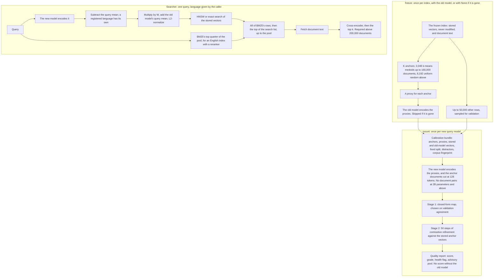

# SpaceBridge: design and benchmark

This document describes the system as implemented: how it works, what it was measured on, and what those measurements show. Designs that were tried or planned and aren't in the code are listed in [§11](#11-designs-not-in-the-system), each with its reason. The story of how we got here is in the [final report](spacebridge_final_report.md), which data shaped each decision is in the [decision ledger](docs/decision_ledger.md), and how to use the library is in the [usage guide](docs/usage.md).

**Platform.** Every measurement comes from one Linux machine: Intel Core i5-12600K, Nvidia RTX 5070 Ti with 16 GB of video memory, 96 GB of DDR4 RAM, PyTorch built for CUDA 12.8, Python 3.12.3.

## 1. What it does, and for what

Querying a vector index with a different embedding model normally means re-embedding every document first. SpaceBridge serves a frozen index with a new query model right away: it fits a small map on the query side, on a few thousand calibration documents, and sends the mapped query to the unchanged index. A cross-encoder reranker then orders the search results, together with the best matches of BM25, a keyword search over the document text.

**Purpose: instant compatibility and migration.** Serve the frozen index with the new model now, then re-index in the background if the last few retention points justify it, or if you'd run without a reranker. It isn't a quality upgrade: to get a better model's first-stage gain, you must re-index.

**Scope.** English corpora, on the model pairs measured, up to 8.84M documents on one machine. Nothing above that size is measured or planned. A hypothesis motivated the approach: that good embedding models organize meaning with largely similar relative geometry, differing mainly by offsets, rotations and scaling ([Huh et al. 2024](https://arxiv.org/abs/2405.07987)). The project tested how far a linear map gets on that basis, and it didn't test the hypothesis itself.

**What a map can't do, stated qualitatively.** The map changes only the query. If the old model gave two documents nearly the same vector, the stored vectors can't separate them for any query. So we *expect* a mapping from a small model into a large index to retain more than the reverse. That is a motivation, not a theorem: it hasn't been stated as a precise probabilistic model, and it doesn't make any baseline an upper bound. A better query mapping can rank a frozen index better than the old model's own queries do, and BM25 and the reranker also read the document text, which the vectors don't hold.

### Terms

| Term | Meaning here |
| --- | --- |
| **Old model, index model, source** | The embedding model that produced the stored vectors |
| **New model, query model, target** | The embedding model queries are encoded with |
| **Native** | The old model's own queries on its own index |
| **Re-index** | Every document re-embedded with the new model, searched with the new model's queries |
| **Bridge** | The new model's queries, mapped, on the old index |
| **First stage** | The vector search, before any reranking |
| **Pool, candidate budget** | The number of candidates sent to the reranker |
| **End to end** | The final ranking after the reranker. This is retrieval quality: no answer generation or downstream task was evaluated |
| **Anchors, K** | The K documents the map is calibrated on |
| **Proxy** | Short text from an anchor document that stands in for a query, usually its title |
| **Same family** | `bge-base-en-v1.5` and `bge-large-en-v1.5`, in either direction. Records and scripts call it Tier 1 |
| **Across families** | `bge-large-en-v1.5` with `Qwen3-Embedding-0.6B` or `harrier-oss-v1-0.6b`, in either direction. Records and scripts call it Tier 3 |
| **Pair, cell** | A pair is an (old model, new model) direction. A cell is a pair, a size and a seed |
| **Seed** | Changes the anchors, the train/validation split and the distractors. It doesn't change the evaluation queries |
| **Own-doc MRR** | How high a proxy ranks its own anchor document |
| **Agree@10** | Share of the old model's top 10 that a mapped proxy also returns |
| **Teacher** | The old model's embedding of a proxy, used as a training signal |
| **Retention point** | 0.01 of retention. A point of absolute `nDCG@5` is 0.01 of `nDCG@5`. The two are always named, since they differ |
| **Grade, score** | See [§7](#7-the-quality-report) |

## 2. Overview of the system

## 3. How results are defined

### Metrics

Each metric is computed per query, then averaged over queries with equal weight, then over seeds, then over pairs within a family (`spacebridge_bench/metrics.py`).

- **Recall@k:** the share of a query's positives (relevance above 0) in the first k rows. On a list shorter than k, such as a reranked pool, this is recall of that list.
- **nDCG@k:** linear gain (the relevance grade itself), discount `1 / log2(rank + 1)`, normalized by the ideal order of that query's judged positives.
- **Unjudged documents** count as not relevant. This matters when comparing dense and lexical search, since they surface different unjudged documents, so a system can be penalized for finding something no assessor looked at.
- **Queries** with no positive in the corpus are dropped by the loaders. **Self-matches:** a corpus row whose text is exactly a query's text is removed from that query's results and can't be an anchor (ArguAna). Near duplicates and paraphrases are not removed. A loader refuses a query whose exact text is in several rows, which no corpus measured has.

### Retention

Three comparison statistics, all ratios of means:

| Name | Formula | Answers |
| --- | --- | --- |
| **Retention** (relative to the weaker baseline) | bridge with BM25 ÷ min(native, re-index), both baselines without BM25 | The lines below are on this one. A comparison statistic, not an upper bound on anything |
| **Strict retention** | bridge with BM25 ÷ min(native with BM25, re-index with BM25) | Retention when the baselines get the same BM25 |
| **Direct retention** | bridge with BM25 ÷ re-index with BM25 | What migrating to a full re-index would gain. This is the tradeoff a user faces |

All systems are reranked at the same pool. **Retention above 1 doesn't mean better than native as a retrieval system**, since with BM25 the bridge has a channel plain native lacks. A ratio is a relative figure, not absolute quality: absolute `nDCG@5` is always given beside it.

### Intervals

Results come with a 95% percentile bootstrap over queries (`scripts/retention_ci.py`): each replicate resamples queries once, shared by every pair and seed, retakes the weaker baseline in each cell, and recomputes the whole average. The interval is conditional on these models, this corpus and these seeds. It says nothing about other corpora. Seed spread is reported separately, as a standard deviation over the seeds' means; seeds don't change the queries, so three seeds don't replicate the evaluation sample.

### Lines

| Line | Applies at | Same family | Across families |
| --- | --- | --- | --- |
| **Approved targets** | Up to 1M documents | 98% | 94% |
| **Stretch line** | Above 1M, up to 8.84M | 95% | 90% |

Each is on end-to-end `nDCG@5` retention, the mean over pairs on one corpus, at a pool of at most 300, with `bge-reranker-v2-m3`.

- **Best range:** the largest measured size where every corpus measured there meets the approved targets.
- **Supported range:** the largest measured size where every corpus measured there meets the stretch line.
- A pass means the **point estimate** reached the line on the configurations measured. Where the interval also clears it, the tables say so. Neither is a guarantee for an unseen corpus, and isolated sizes don't make a continuous guarantee between them.

First-stage targets apply only up to 171K documents, mean over pairs per corpus: same family `Recall@30` retention at least 88% at K = 2,048, across families at least 82%. Above that, large indexes are judged end to end, and recall at the rerank depth is reported.

## 4. The map

### 4.1 Anchors, proxies, split

**How many anchors.** `default_anchor_count(N)`: K = min(2,048, N) up to and including N = 160,000, K = 8,192 above it. The line follows the mount budget ([§4.7](#47-mount-cost)). K is a calibration-size choice. More rows than columns doesn't guarantee a well-conditioned fit, and effective ranks fall well short of full: 540 to 650 of 1,024 on FiQA at K = 2,048 for the Stiefel map.

**Which anchors.** Up to 160,000 documents, k-means medoids: spherical k-means with k-means++ seeding and at most 20 Lloyd steps, then each centroid's closest unused document (`select_anchors`), or farthest-point sampling below 5,000 documents. Above 160,000, a uniform random sample, which reads no vectors. An index with fewer distinct directions than K raises `ValueError`. `freeze` also refuses fewer than 50 documents or 20 anchors. Nothing below 5,183 documents was measured.

**Proxies** (`make_query_proxies`). A document's title alone, if the title has at least 4 tokens (cut at 16) and no other anchor has the same title. Otherwise the title plus lead sentences, extended to at least 32 tokens and cut at 64. **Token** here means the library's tokenizer-free count, not a model's: one per CJK character, word or punctuation mark.

**Split.** 20% of the anchors are held out for validation, once at `freeze`, so all query models are validated on the same anchors: 1,638 and 410 at K = 2,048.

**Distractors.** Up to 50,000 rows that aren't anchors, uniformly sampled, for validation scoring. At 2,048 documents or fewer every document is an anchor, so there are none, and the cone-angle diagnostic uses the anchors' mean.

**Benchmarks only:** rows that are test queries can't be anchors, and on the nested corpora used for size curves neither can test positives.

### 4.2 Query-side centering and mean restore

Stored vectors are never changed. Subtracting a document mean wouldn't change an inner-product ranking anyway: $\hat q \cdot (e_j - \mu) = \hat q \cdot e_j - \hat q \cdot \mu$, and the last term is constant over documents.

On the query side, using training anchors only, with $X^{(q)}$ the old model's proxy embeddings, $Y^{(q)}$ the new model's, and means $\mu_X, \mu_Y$:

$$\hat q_{\text{src}} = \text{Normalize}\left(\mu_X + (q_{\text{tgt}} - \mu_{Y, L_q})\, W\right)$$

Restoring $\mu_X$ puts the mapped query where the old model's queries live. Dropping it adds a document-dependent term, $-\mu_X \cdot e_j$, which changes rankings. Rows are centered but not normalized, so the map carries the right residual scale.

**Residual norm matching.** Least-squares maps shrink the mapped residual, so after the mean is restored, queries drift toward the average query. Each Stage-1 candidate is therefore rescaled so the mean norm of its mapped training residuals equals the native one. On FiQA this adds about 3 retention points of first-stage `Recall@30`, at no query-time cost.

**Identity check.** With identical training embeddings on both sides and $\lambda \to 0$, ridge tends to the projector onto the training span. That is the identity on the whole space only if the anchors have full rank in it, which centering limits to at most $K_{\text{train}} - 1$. So the identity is exact on the training span, and on a query only as far as it lies in that span. The benchmark's identity row measures this: bridging a model to itself through the whole pipeline reads at least 0.99 of native on every corpus checked.

### 4.3 Stage 1: closed-form maps

The candidates are one Stiefel map and five ridge maps. The one with the highest teacher agreement on validation proxies is kept, scored on a fixed 10,000-row subsample: all anchors, then random distractors.

**Stiefel map.** With the cross-covariance $M = \bar Y^T \bar X = U \Sigma V^T$, keep the modes with $\sigma_i \ge 10^{-3} \sigma_1$, so dimensions the anchors don't support map to 0 rather than to noise:

$$W_{\text{stiefel}} = s\, U_r V_r^T$$

It's a partial isometry, not a full-rank Stiefel element, once modes are cut or dimensions differ. It's computed from a float64 eigendecomposition of the smaller Gram matrix, which matches the SVD form to about $10^{-5}$ and is several times faster on the GPU. Float64 matters: kept modes reach eigenvalue ratios of $10^{-6}$.

**Its scale.** The default $s = \sum_{i \le r} \sigma_i / \|\bar Y\|_F^2$ is a heuristic: it's the least-squares scale only if the kept modes span the target space. For this fixed map the least-squares scale is $\sum_{i \le r} \sigma_i / \|\bar Y U_r\|_F^2$, which `objective_scale=True` gives, and which a fit with residual norm matching off uses. In the default pipeline, residual norm matching replaces whichever scalar is there, so the choice doesn't affect it.

**Ridge map.** For $\lambda_{\text{rel}} \in \{0.01, 0.1, 1, 5, 20\}$:

$$W_{\text{ridge}} = (\bar Y^T \bar Y + \lambda I)^{-1} \bar Y^T \bar X = \bar Y^T (\bar Y \bar Y^T + \lambda I)^{-1} \bar X$$

The two forms are the same for any $\lambda > 0$; the code inverts the smaller matrix. $\lambda = \lambda_{\text{rel}} \|\bar Y\|_F^2 / \min(d_t, K_{\text{train}})$, a chosen nominal normalization. It's not the mean nonzero eigenvalue, since centering and duplicates can lower the numerical rank.

**Why agreement selects Stage 1.** Fitting every candidate on FiQA, SciDocs and NQ (36 fits each, 3 seeds), agree@10 ranks real `Recall@30` retention with a within-fit Spearman of 0.88 to 0.94 in the full-length-document study, and a perfect selector would gain 0.2 to 0.7 retention points after Stage 2. The table in [§9.6](#96-the-stage-1-selector-at-128-tokens) repeats this with 128-token anchor documents.

**Degenerate inputs.** Constant or non-finite calibration embeddings raise `ValueError` before any solver runs, and a zero cross-covariance raises in the solver.

### 4.4 Document pairs

Besides (proxy, document) pairs, the anchors also give (document, document) pairs: the new model encodes the anchor document, cut at 128 tokens, and maps to its stored vector, each kind centered on its own mean. They double the rows of both stages. They are related rows, not twice the independent information.

Query models of at least 2B parameters skip them (`size_class = "large"`). Only 0.6B and 4B models were measured, not those between. At 4B the pass cost 51 s at K = 2,048 and gained +0.1 ± 3.0 retention points on one pair. Below that, they gain +1.6 to +7.4 points of first-stage `Recall@30` across FiQA, TREC-COVID and truncated-dimension models.

Cutting anchor documents at 128 tokens rather than using their full length costs at most 0.8 retention points of first-stage `Recall@30` (Tier 3 at K = 2,048 on TREC-COVID, whose anchor documents are long), and nothing on short passages. A 128-token pass takes about 1.3 times the proxy pass. A full-length pass took about 3 times, on the same models and corpora. The length is a parameter (`doc_pair_tokens`).

### 4.5 Stage 2: contrastive refinement

Starting from the Stage-1 map, 50 AdamW steps (learning rate 0.003, cosine decay) optimize retrieval scores against the anchor documents as stored, using the map deployed online:

$$S_{\text{student}}(W) = \tfrac{1}{\tau} \text{Normalize}(\mu_X + \bar Y W)\, (X^{(d)})^T, \qquad S_{\text{teacher}} = \tfrac{1}{\tau} X^{(q)} (X^{(d)})^T$$

$$\mathcal{L}(W) = (1 - \alpha)\, \text{InfoNCE}(S_{\text{student}}) + \alpha\, \text{KL}\big(\text{softmax}(S_{\text{teacher}}) \,\|\, \text{softmax}(S_{\text{student}})\big) + \beta \|W - W_0\|_F^2$$

with $\alpha = 0.5$. The usual $\tau^2$ factor on KL is left out: both terms share one temperature, so it would shrink KL about 400 times against InfoNCE.

- **Penalty:** $\beta = 10^{-3}$, or $10^{-2}$ when $d_t$ exceeds the number of training anchors. That count doesn't double with document pairs.
- **Temperature:** $\tau = 0.05$, a cosine scale, so it depends on how spread out scores are. When the mean per-row standard deviation of teacher scores is under 0.04, $\tau = 0.6$ times it. Every index measured had 0.057 to 0.092, except `multilingual-e5-large` at 0.020 to 0.027, where this rule took one pair from 0.684 to about 0.87 of first-stage retention. It also raises the health flag.
- **Which checkpoint comes back.** Validation signals are scored every 10 steps: own-doc MRR and teacher agree@10. If the average of the checkpoints from step 20 on keeps agree@10 at or above $a_0 - 0.25(1 - a_0)$, with $a_0$ Stage 1's agree@10, that average is returned. Otherwise, the checkpoint with the best own-doc MRR above that floor, which may be Stage 1 itself. All 50 steps always run: this selects a result, it doesn't stop early. Ties in own-doc MRR count against the proxy, so collapsed scores read as failure.
- **Mini-batches:** with more than 1,638 candidate anchors, each step trains on a random 1,638 and the rows whose positive is among them. For indexes wider than 1,024 dimensions the number shrinks by $\sqrt{1024 / d_s}$.

**Known limit.** Stage 2 can hurt with no label-free signal noticing: on TREC-COVID with lead-sentence proxies it cost 2.5 retention points while own-doc MRR rose. Title proxies avoid this on titled corpora. Untitled corpora with short questions remain the risk case, though MS MARCO, the one measured, doesn't show it.

### 4.6 The source-free fit

`freeze(index, None)` keeps no old-model embeddings, and `mount` calls `fit_source_free`, which uses only the stored vectors and the new model. Stage 1 is the Stiefel map on document pairs. Queries are centered on the new model's *document* mean and restored on the stored document mean, so the map carries the new model's query-to-document relation across. Stage 2 is InfoNCE only, on proxy and document rows. Its status is `NO_TEACHER`, with measurements but no score, NaN confidence and a pool of 100. It trails the with-old-model fit on NQ: by 0.38 and 0.18 retention points at pool 300, and up to 2.6 on one pair at pool 60.

### 4.7 Mount cost

The budget is on **token volume**: tokens encoded at `mount` (proxies plus anchor documents) divided by tokens encoded to re-index, at most 10%. This is an accounting measure, and it doesn't say the same share of wall-clock time holds: padding, attention cost by length, model loading, language banks and solver work all differ. It's a design budget for the size rule on the corpora measured, not a guarantee for every corpus.

At the line, on real mounts: 8.8% to 9.8% of re-index tokens at 160,001 MS MARCO passages, by query model, and 9.4% to 10.5% at 150,001. Those short passages are the tight case.

Setup time on the GPU, one run per pair:

| Corpus | Documents | K | Query model | Mount seconds | Share of re-index tokens, low | Share, high |
| --- | --- | --- | --- | --- | --- | --- |
| FiQA | 57.6K | 2,048 | `bge-base-en-v1.5` | 1.6 | 3.4% | 4.0% |
| FiQA | 57.6K | 2,048 | `bge-large-en-v1.5` | 4.2 | 3.4% | 4.0% |
| FiQA | 57.6K | 2,048 | `Qwen3-Embedding-0.6B` | 8.4 | 3.4% | 4.0% |
| MS MARCO | 1M | 8,192 | `bge-base-en-v1.5` | 5.5 | 1.4% | 1.5% |
| MS MARCO | 1M | 8,192 | `bge-large-en-v1.5` | 14.8 | 1.4% | 1.5% |
| MS MARCO | 1M | 8,192 | `Qwen3-Embedding-0.6B` | 34 | 1.4% | 1.5% |

The solver is the map's own fit, on embeddings already encoded. 250 ms on the GPU is a reference for spotting regressions, not a promise: it reads 143 to 176 ms at K = 2,048 up to 1,024 dimensions and 173 ms into a 2,560-dimension index, and **exceeds the reference at K = 8,192, at 239 to 263 ms**. Freezing is separate: k-means anchors take 2 s on FiQA and 11 s on TREC-COVID at K = 4,096, and random anchors take no vector reads.

Query time for the projection alone, as a matrix multiply of $d_t \times d_s$ operations per query, is 24 to 54 µs on the CPU. That's the one operation. The `project` stage in [§9.4](#94-speed) reads about 11 ms on the CPU and 1 ms on the GPU, because it also computes confidence, converts between libraries and moves data.

## 5. BM25 in the pool

`LexicalIndex` holds BM25 ($k_1 = 0.9$, $b = 0.4$) over title and text, on lowercased `[a-z0-9]+` tokens with a short stop list, as one sparse matrix on the CPU. At a pool of $B$, `merge_pool` sends the reranker all of BM25's top $B/4$, then the top of the mapped list up to $B$, with no repeats. Mapped rows come first, so a reranker tie keeps first-stage order. There's no score fusion: this implementation leaves comparing the two lists to the reranker. So BM25 stays off without one.

**Why it's there.** On the multi-hop corpus, HotpotQA, the map alone misses at every size from 10,000 documents up, and the tested calibration changes didn't recover that loss. BM25 doesn't use the map, so it holds much of what the map loses ([§8](#8-where-the-map-loses-and-what-was-tested)).

**When it's on.** At any size, for an index with `src_lang="en"` and a reranker. That's a judgment: a small, sure loss on corpora like SciDocs against a large one on corpora like HotpotQA, with nothing at mount that tells them apart. See the [corpora it costs](#92-what-bm25-costs).

**Cost.** Building takes 14 to 22 s at 1M documents and 128 s at 8.84M, on one thread, at 214 to 361 MB and 2.2 GB on disk. A query takes 2 to 3 ms at 1M and 24 ms at 8.84M on one CPU thread when measured alone.

**Limits.** English only: Chinese text yields no tokens, and a Chinese query matches only numbers and Latin names. $k_1$, $b$, stemming and other tokenizers weren't tuned.

**Across languages.** `Searcher(translate=callable)`, off by default, lets BM25 read a translation of a query in another language. The bridge and the reranker keep the original. Measured Chinese to English only.

## 6. Serving

`Searcher` runs encode, project, search, BM25, fetch and rerank, and returns a timing breakdown per query. The [usage guide](docs/usage.md) has the input contract, deployment steps, and the table of what sets the pool.

| Situation | BM25 | Pool, unless `pool=` is set |
| --- | --- | --- |
| English index, a reranker | On | 60. 100 for a source-free fit or a Stage-2 health flag |
| No reranker, an index not in English, or `lexical=None` | Off | Up to 200,000 documents: 60 for grade A or B, 100 for C or D, a health flag or a source-free fit. Above 200,000: 300, with a warning |
| A `LexicalIndex` passed in | On, in any language | As the first row |
| A query in another language, no `translate=` | Skipped for it | Its language's `rerank_pool` if it has a per-language score, otherwise the second row |
| A query in another language, with `translate=` | On | As the first row |

**Why the grade doesn't widen the pool with BM25 on.** Across 21 pairs at 1M and above, Spearman of the score against what a pool of 100 gains over 60 is -0.01. **Why 300 above 200,000 with BM25 off.** Pool 200 passes on MS MARCO and NQ at 1M, but HotpotQA misses at 200 and at 300, so no pool up to 300 is one a plain bridge can rely on.

**A reranker is required above 200,000 documents**: `Searcher` raises `ValueError` without one, unless `allow_no_reranker=True`. First-stage results lose far more there: MS MARCO at 1M reads `nDCG@5` 0.33 to 0.44 without one, against 0.66 to 0.69 with one.

**Search backends.** `ExactBackend` is exact, in memory, on the CPU or GPU, and raises `ValueError` if the vectors won't fit on the GPU. `HnswBackend` is FAISS HNSW, `ef_search = 500` by default. Built with $M = 32$ and `efConstruction = 200`, on the CPU.

**Artifacts.** A bundle, a bridge and a BM25 index are each a directory of `arrays.npz`, `meta.json` and `manifest.json`, which holds a kind, a format version and checksums. The manifest is written last and every file atomically, so an interrupted save fails to load and saving again repairs it. A bridge holds what serving needs. Validation data stays behind, so `validate_query_language` needs a fresh fit. Each artifact stores a fingerprint of its corpus, and each fitted map stores what the encoders said they were. See the [usage guide](docs/usage.md#deploying-build-once-serve-from-a-new-process).

**Python interface.** `freeze`, `mount`, `Searcher`, `LexicalIndex`, `build_hnsw` are the public API. The fitting code depends on two small protocols, `QueryEncoder` and `IndexReader`, rather than a model library. `SentenceTransformerEncoder` and `CrossEncoderReranker` are optional adapters in the same package. `SpaceBridge.fit` remains available for the benchmark's ablation rows.

### Other languages

**A query language other than the index's (the new model reads both).** The map is calibrated on the index's language. Queries in another language are centered on a shifted mean:

$$\mu_{Y, L_q} = \mu_{Y, L_{\text{src}}} + (\mu_{\text{bank}, L_q} - \mu_{\text{bank}, L_{\text{src}}})$$

The bank is parallel sentences, encoded with the new model's query prompt. The default is the FLORES `dev` split with sentences that appear in Belebele or in `devtest` removed, which leaves 94 for Chinese (all used, at most 256), or, when FLORES is out of reach, 256 Tatoeba pairs, for Chinese only. The default banks need an English index. A registered language can also get its own experimental score from `devtest` sentences.

**A new model that can't read the index's language at all.** `freeze(parallel_bank=...)` replaces corpus anchors with parallel sentences: the whole FLORES bank, 2,009 pairs, unless Belebele is an evaluation set. Measured once: 0.822 ± 0.015 of native `Recall@30`, MLQA, English queries into a Chinese index. With the 338 filtered pairs it reads 0.587.

**The caller supplies the language.** Nothing detects it, `src_lang` defaults to English, and `query_lang` defaults to the index's language.

## 7. The quality report

**An unmet objective.** The goal was a system that's never silently bad on an unseen corpus. It doesn't reach that: known failures go unflagged, listed below. What exists is a set of label-free signals, useful as a rough warning. `bridge.quality_report()` gives:

| Field | Meaning |
| --- | --- |
| `score` | A prediction of first-stage `Recall@30` retention, in percent: linear in validation agree@10, from `quality_calibration.json`. Not clamped: it can exceed 100 |
| `band` | Score ± the leave-one-dataset-out RMSE, 4.3 points. A rough error size, not a prediction interval with stated coverage |
| `grade` | A: score at least 95. B: at least 85 and under 95. C: at least 70 and under 85. D: under 70 |
| `rerank_pool` | Advisory: 60 for A or B, 100 for C or D. 300 above 200,000 documents. `Searcher` with BM25 reads its own rule instead |
| `details["stage2"]` | The health flag: Stage 2 kept step 0 with the floor rejecting at least half its checkpoints, or the temperature rule fired |
| `details` | Fidelity, recoverability, fit health, difficulty and coverage measurements, as diagnostics. Only agree@10 enters the score |
| `by_language` | For a validated language: a score scaled by counterpart `Recall@10` in that language over the index's, its grade and pool. Experimental: Wikipedia question-answering sets only |
| `notes` | Warnings in words |

`experimental: false` in the calibration file means only that the dataset-level error was within the band on at least 4 of 6 datasets. It isn't a reliability claim. The file states its date, datasets and limits.

**How it was fitted, and its error.** On 306 fits over six corpora, up to 171K documents. Agree@10 alone transfers best between datasets. That 4.3-point error is model-selection cross-validation: the same held-out labels helped choose the feature and regularization. With the feature and regularization chosen inside each fold, nested cross-validation reads 4.9 points. Within one dataset, rank correlation with retention runs from 0.94 on NQ down to about 0.1 on ArguAna and TREC-COVID.

**What it can't see, measured:**

- **Size.** It has no size input. It over-predicts by 8 to 20 points on 1M-passage fits, and by 15 to 27 on a small old model queried with a large new one. Calibration ends at about 171K documents, and the report warns above 200K: between those, the score is outside its calibration with no warning.
- **A failed Stage 2.** `T2Retrieval` with a `multilingual-e5-large` index is over-predicted by 12 points. The health flag catches this one.
- **Another query language.** Over-predicted by 5.5 to 12.3 points on seven sets. The per-language score cuts the error to 5.1 points (RMSE), experimentally.
- **BM25.** It still grades HotpotQA B and C, where the served result passes by 7.5 to 12.5 retention points.

**Per-query confidence** is the query's mean cosine to its 5 nearest training proxies, mapped by an isotonic fit to per-proxy agree@10. It's a proxy-agreement diagnostic: the top quintile of support had higher real `Recall@30` retention than the bottom on 82 of 102 fits. Spearman with per-query overlap against native is 0.31 to 0.70. It's NaN for a source-free fit. `Searcher` reports it and doesn't act on it, though a caller could send low-confidence queries to a wider pool.

**Label-free fixes tried for the size problem, none of which worked:** scoring over the whole index, own-doc retrieval over the whole index, and nine corpus-difficulty features. Real-query top-30 overlap with native correlates far better (+0.90) on one corpus but doesn't carry across corpora: RMSE 8.3 against 5.7 when fitted on two corpora and judged on five.

## 8. Where the map loses, and what was tested

These are empirical statements about the experiments run. Failure of the tested fixes doesn't prove the loss can't be recovered.

**Retention falls as the index grows.** The same map on growing subsets of MS MARCO, K = 2,048, first-stage `Recall@30`:

| Documents | Same family | Across families |
| --- | --- | --- |
| 50K | 0.970 | 0.921 |
| 200K | 0.933 | 0.855 |
| 500K | 0.890 | 0.790 |
| 1M | 0.860 | 0.732 |

NQ replicates it, at 0.970 and 0.944 at 50K and 0.844 and 0.745 at 1M. There's no bug: the identity row stays at 0.998 to 1.000. Most of it is near misses, with a positive's median rank going from 0 to 2 to 8. Small subsets also flatter the bridge, since native `Recall@30` is 0.99 at 50K and 0.94 at 1M. Real queries instead of proxies add 2 to 5 points at K = 2,048, and 32,768 real query pairs reach only 0.83 to 0.91.

**The map class, as far as tested.** One residual MLP, trained on cosine with 84,000 real query pairs, gained under 0.02 of cosine and read lower on retrieval. That rules out this architecture, objective and data, not nonlinear maps in general: since selecting on cosine can itself lower retrieval (below), a map trained directly on a ranking loss remains untested.

**Don't judge a map by cosine to the native query.** Real-query fits chosen by cosine raise it from 0.723 to 0.798 and lower `Recall@300` retention from 0.938 to 0.914, because shrinkage pulls queries toward the mean.

**HotpotQA at 1M, K = 8,192, first stage.** Among native's top 1,000 per query, the map adds the same score noise as on MS MARCO (0.031 and 0.038, by family), but HotpotQA's top scores sit closer together (spread 0.022, against 0.029 and 0.025), and a positive keeps less of its score lead (0.64 and 0.60, against 0.69 to 0.79). HotpotQA loses twice MS MARCO's share of native's top 300.

**An intervention on names, and its limits.** For a query that names a positive's title, let $c = q - q_{\text{without title}}$, re-encoding the query with the title removed. That difference isn't an isolated "name component", since removing a title changes the whole embedding. Two interventions on the mapped query, each an oracle using the native model and the known relevant title:

- Replace only the mapped $c$ with the native $c$: brings back 97% to 99% of lost title positives.
- Keep the mapped $c$, and make the rest native: brings back -2% to +15%.

On queries naming both positives' titles, repairing both recovers 96% to 100% of all lost positives, and repairing one raises the other's losses by 62% to 258%. **Population:** these are positives whose title the query contains, 42% of HotpotQA's positives, measured as a share of those lost, at 1M. So within this construction, the weakened title contribution accounts for the loss on those positives. It doesn't explain the other 58%, or show that names are the whole-dataset cause.

**What didn't explain the gap, as tested.** Low-variance directions: the tail is at most 7% of HotpotQA's shortfall against NQ. How often the corpus mentions a name. Word rarity: 1% to 19% of the gap, in a regression. Query length: removes 10% and 7% when reweighted to NQ's mix. Why names transfer worse on HotpotQA than NQ (about 0.65 against 0.82, as a slope on document scores) remains open.

**A query-side boost.** $q + g\,(q - q_{\text{without spans}})$ through the map, as tested, at its best setting read -0.05 to -0.51 retention points of `Recall@300`, and at most +0.32 with the true titles. This family of query-side amplification didn't help. Others weren't tested.

**What that leaves.** Calibration changes didn't recover the loss, and adding BM25 did, as far as retention goes. Those aren't the same as identifying BM25 as the unique mechanism: BM25 changes the candidates that reach the reranker. The component comparison is [§9.3](#93-the-bridge-against-bm25-and-the-reranker-alone), and it shows that on HotpotQA, BM25 and the reranker do most of the work without the bridge.

## 9. Results

**Status of this evidence.** The configuration was developed on these benchmarks, with decisions made after looking at results. The [decision ledger](docs/decision_ledger.md) records which data informed which choice. So everything in §9.1 to §9.5 is exploratory: point estimates reaching chosen thresholds on the configurations measured. Only §9.7 is a confirmation run. Records behind the tables are in [`results/`](results/README.md).

**Positive-preserving corpora.** Most sizes below the full corpora keep every positive of the evaluation queries, then add uniformly sampled distractors. That makes sizes comparable, but it's a condition on evaluation labels: these aren't ordinary random corpora of that size. At 10K documents, positives are 21% to 42% of the rows. Full-corpus measurements are SciFact, ArguAna, SciDocs, FiQA, TREC-COVID, and the 8.84M MS MARCO and 5.23M HotpotQA rows.

**Queries.** Sizes up to 500K use the first 500 queries of the same list that 1M and above use, so they aren't independent samples. MS MARCO, HotpotQA and NQ are the same corpora at each size. At these sizes, same family is one direction up to 500K and both directions at 1M and above, and across families is `bge-large-en-v1.5` ← `Qwen3-Embedding-0.6B`, `Qwen3-Embedding-0.6B` ← `bge-large-en-v1.5` and, on MS MARCO up to 1M, `harrier-oss-v1-0.6b` ← `bge-large-en-v1.5`.

### 9.1 Retention by corpus and size

The served configuration: BM25 in a pool of 60, `bge-reranker-v2-m3`, exact search. The interval is defined in [§3](#intervals). A blank means not measured, and each value is the mean over that family's pairs: `results/retention.csv` gives the pair counts.

<!-- table:retention -->
| Corpus | Documents | Queries | Same family | Low | High | Across families | Low | High | Same family, strict | Across families, strict | Same family, absolute | Across families, absolute | Native, absolute | Re-index, absolute |
| --- | --- | --- | --- | --- | --- | --- | --- | --- | --- | --- | --- | --- | --- | --- |
| MS MARCO | 10K | 500 | 1.000 | 0.993 | 1.007 | 1.001 | 0.995 | 1.007 | 0.998 | 0.998 | 0.986 | 0.987 | 0.988 | 0.988 |
| MS MARCO | 20K | 500 | 1.003 | 0.998 | 1.011 | 1.004 | 0.996 | 1.012 | 1.001 | 1.001 | 0.977 | 0.977 | 0.977 | 0.977 |
| MS MARCO | 30K | 500 | 1.004 | 0.996 | 1.013 | 1.003 | 0.994 | 1.012 | 0.999 | 0.998 | 0.966 | 0.965 | 0.967 | 0.967 |
| MS MARCO | 50K | 500 | 1.000 | 0.993 | 1.009 | 1.000 | 0.992 | 1.008 | 0.996 | 0.996 | 0.955 | 0.955 | 0.959 | 0.959 |
| MS MARCO | 100K | 500 | 1.000 | 0.990 | 1.009 | 0.996 | 0.988 | 1.004 | 0.995 | 0.995 | 0.929 | 0.929 | 0.934 | 0.935 |
| MS MARCO | 150K | 500 | 1.002 | 0.992 | 1.013 | 0.997 | 0.989 | 1.005 | 0.997 | 0.996 | 0.909 | 0.908 | 0.912 | 0.914 |
| MS MARCO | 160K | 500 | 1.002 | 0.992 | 1.013 | 0.996 | 0.988 | 1.004 | 0.996 | 0.995 | 0.905 | 0.904 | 0.909 | 0.910 |
| MS MARCO | 160,001 | 500 | 1.003 | 0.993 | 1.014 | 0.998 | 0.991 | 1.004 | 0.997 | 0.997 | 0.906 | 0.906 | 0.909 | 0.910 |
| MS MARCO | 200K | 500 | 0.998 | 0.988 | 1.008 | 0.995 | 0.987 | 1.004 | 0.997 | 0.996 | 0.893 | 0.893 | 0.899 | 0.898 |
| MS MARCO | 500K | 500 | 0.996 | 0.986 | 1.006 | 0.989 | 0.978 | 0.999 | 0.995 | 0.989 | 0.819 | 0.817 | 0.826 | 0.828 |
| MS MARCO | 1M | 2000 | 0.995 | 0.989 | 1.002 | 0.982 | 0.976 | 0.989 | 0.994 | 0.983 | 0.722 | 0.715 | 0.728 | 0.728 |
| MS MARCO | 2M | 2000 | 0.986 | 0.980 | 0.995 | 0.972 | 0.963 | 0.982 | 0.985 | 0.973 | 0.632 | 0.622 | 0.640 | 0.640 |
| MS MARCO | 4M | 2000 | 0.985 | 0.975 | 0.995 | 0.962 | 0.950 | 0.975 | 0.982 | 0.958 | 0.530 | 0.517 | 0.539 | 0.539 |
| MS MARCO | 8.84M | 2000 | 0.979 | 0.966 | 0.993 | 0.946 | 0.930 | 0.964 | 0.981 | 0.945 | 0.419 | 0.405 | 0.429 | 0.429 |
| NQ | 10K | 500 | 1.000 | 0.998 | 1.005 | 1.002 | 0.999 | 1.007 | 1.000 | 1.001 | 0.964 | 0.964 | 0.963 | 0.963 |
| NQ | 20K | 500 | 1.002 | 0.998 | 1.008 | 1.003 | 0.999 | 1.008 | 1.001 | 0.999 | 0.964 | 0.963 | 0.962 | 0.962 |
| NQ | 30K | 500 | 1.002 | 0.998 | 1.007 | 1.000 | 0.995 | 1.005 | 1.000 | 0.997 | 0.959 | 0.955 | 0.957 | 0.957 |
| NQ | 50K | 500 | 1.000 | 0.995 | 1.007 | 1.000 | 0.996 | 1.005 | 1.000 | 0.998 | 0.948 | 0.946 | 0.947 | 0.947 |
| NQ | 100K | 500 | 0.996 | 0.987 | 1.006 | 0.999 | 0.992 | 1.008 | 0.995 | 0.997 | 0.925 | 0.926 | 0.928 | 0.928 |
| NQ | 150K | 500 | 0.994 | 0.985 | 1.003 | 0.996 | 0.988 | 1.005 | 0.993 | 0.993 | 0.908 | 0.906 | 0.912 | 0.912 |
| NQ | 160K | 500 | 0.999 | 0.989 | 1.007 | 0.994 | 0.985 | 1.003 | 0.996 | 0.990 | 0.910 | 0.904 | 0.912 | 0.912 |
| NQ | 160,001 | 500 | 0.997 | 0.986 | 1.007 | 1.000 | 0.992 | 1.008 | 0.995 | 0.996 | 0.909 | 0.909 | 0.912 | 0.912 |
| NQ | 200K | 500 | 0.995 | 0.986 | 1.006 | 0.996 | 0.989 | 1.005 | 0.998 | 0.992 | 0.896 | 0.894 | 0.900 | 0.900 |
| NQ | 500K | 500 | 0.989 | 0.976 | 1.000 | 0.988 | 0.974 | 1.001 | 0.993 | 0.985 | 0.831 | 0.820 | 0.838 | 0.838 |
| NQ | 1M | 2000 | 0.985 | 0.979 | 0.993 | 0.979 | 0.971 | 0.987 | 0.985 | 0.975 | 0.772 | 0.761 | 0.781 | 0.781 |
| HotpotQA | 10K | 500 | 1.004 | 1.001 | 1.009 | 1.005 | 1.001 | 1.011 | 1.003 | 1.001 | 0.958 | 0.958 | 0.954 | 0.954 |
| HotpotQA | 20K | 500 | 1.003 | 0.999 | 1.008 | 1.008 | 1.003 | 1.016 | 1.002 | 1.001 | 0.958 | 0.958 | 0.953 | 0.953 |
| HotpotQA | 30K | 500 | 1.006 | 1.001 | 1.012 | 1.011 | 1.003 | 1.019 | 1.002 | 0.999 | 0.957 | 0.956 | 0.950 | 0.950 |
| HotpotQA | 50K | 500 | 1.005 | 1.000 | 1.011 | 1.010 | 1.003 | 1.019 | 1.000 | 0.999 | 0.954 | 0.952 | 0.947 | 0.947 |
| HotpotQA | 100K | 500 | 1.000 | 0.992 | 1.008 | 1.012 | 1.003 | 1.022 | 0.995 | 0.997 | 0.943 | 0.938 | 0.937 | 0.937 |
| HotpotQA | 150K | 500 | 0.997 | 0.990 | 1.005 | 1.014 | 1.004 | 1.025 | 0.993 | 0.996 | 0.935 | 0.930 | 0.929 | 0.929 |
| HotpotQA | 160K | 500 | 0.997 | 0.990 | 1.005 | 1.015 | 1.005 | 1.026 | 0.992 | 0.997 | 0.934 | 0.928 | 0.927 | 0.927 |
| HotpotQA | 160,001 | 500 | 1.003 | 0.996 | 1.011 | 1.018 | 1.008 | 1.029 | 0.998 | 1.000 | 0.939 | 0.931 | 0.927 | 0.927 |
| HotpotQA | 200K | 500 | 1.000 | 0.993 | 1.008 | 1.018 | 1.007 | 1.029 | 0.999 | 0.999 | 0.934 | 0.928 | 0.924 | 0.924 |
| HotpotQA | 500K | 500 | 0.997 | 0.988 | 1.007 | 1.016 | 1.003 | 1.031 | 0.994 | 0.993 | 0.912 | 0.900 | 0.903 | 0.903 |
| HotpotQA | 1M | 2000 | 0.995 | 0.990 | 1.000 | 1.020 | 1.012 | 1.029 | 0.989 | 0.988 | 0.882 | 0.866 | 0.869 | 0.869 |
| HotpotQA | 2M | 2000 | 0.994 | 0.988 | 1.000 | 1.020 | 1.011 | 1.029 | 0.982 | 0.981 | 0.857 | 0.837 | 0.845 | 0.845 |
| HotpotQA | 5.23M | 2000 | 0.985 | 0.977 | 0.993 | 1.009 | 0.999 | 1.021 | 0.967 | 0.961 | 0.808 | 0.783 | 0.803 | 0.803 |
| SciFact | 5.2K | 300 | 1.008 | 0.993 | 1.028 | 1.008 | 0.995 | 1.032 | 1.002 | 1.001 | 0.721 | 0.721 | 0.715 | 0.715 |
| ArguAna | 8.7K | 1401 | 1.066 | 1.051 | 1.081 | 1.073 | 1.060 | 1.088 | 1.054 | 1.062 | 0.391 | 0.394 | 0.378 | 0.378 |
| SciDocs | 25.7K | 1000 | 0.984 | 0.967 | 1.006 | 0.970 | 0.956 | 0.986 | 1.012 | 1.007 | 0.149 | 0.147 | 0.152 | 0.152 |
| FiQA | 57.6K | 648 | 1.018 | 0.999 | 1.039 | 0.981 | 0.967 | 0.997 | 1.023 | 0.996 | 0.420 | 0.417 | 0.427 | 0.427 |
| TREC-COVID | 171.3K | 50 | 1.001 | 0.968 | 1.049 | 0.987 | 0.958 | 1.023 | 0.994 | 0.994 | 0.831 | 0.827 | 0.850 | 0.848 |
<!-- /table:retention -->

**Best range: up to 1M documents,** on MS MARCO, NQ and HotpotQA at each point estimate. At 1M, the interval's low end also clears the line for five of the six corpus and family combinations. NQ same family is the exception, with 0.985 and a low end of 0.979, against 0.98.

**Supported range: up to 8.84M, exact search.** The largest size per corpus is thinly replicated: 8.84M rests on MS MARCO alone, HotpotQA is measured to its whole corpus, 5.23M, 2M has two corpora, 4M one, and NQ isn't measured above 1M. MS MARCO across families falls steadily through 0.982, 0.972, 0.962 to 0.946.

**Absolute quality falls with size for every system.** At 8.84M MS MARCO reads `nDCG@5` of 0.419 and 0.405 with the bridge, against 0.429 for native and re-index. At 1M it reads 0.72.

**Through HNSW,** MS MARCO only, one index per size: at 1M, ef 500, it costs at most 0.08 absolute points against exact search, reading retention 0.995 and 0.978. At 8.84M, ef 500, one direction per family, it reads 0.978 and 0.945, costing 0.01 and 0.06. The share of the exact top 60 found is 0.989 and 0.990. One index on one corpus, so the supported range stays stated as exact search.

**With a small old index:** `all-MiniLM-L6-v2` queried with `bge-large-en-v1.5` reads 0.981 at MS MARCO 1M, and with `Qwen3-Embedding-0.6B` 0.975. Other kinds of pair aren't measured above 171K.

**The source-free fit,** at its pool of 100, one pair per family, 500 queries: 0.997 and 1.020 on HotpotQA at 1M, 0.997 and 0.982 on MS MARCO at 1M.

**With BM25 off,** at pool 300 above 200K: MS MARCO 1M 0.986 and 0.957, NQ 1M 0.989 and 0.972, and HotpotQA 1M misses at 0.956 and 0.898. At pool 60, K = 2,048 misses across families from 100K to 160K on MS MARCO (0.933, 0.918, 0.905) and at 150K to 160K on NQ (0.938, 0.936). `freeze(index, old_model, K=4096)` reads 0.947 and 0.940 on MS MARCO, and 0.961 on NQ, at 100K and 150K. That's what a bridge with BM25 off should use there, and it fits the mount budget from 80K. An index not in English has no BM25, so that concern applies to it too, and it hasn't been measured there.

**Scenarios measured below 171K only, first stage, retention of `Recall@30`:**

| Scenario | Corpus | K | Retention | First-stage line | Reached? |
| --- | --- | --- | --- | --- | --- |
| Chinese, across families, mean of two directions (`bge-large-zh-v1.5`, `multilingual-e5-large`) | T2Retrieval | 2,048 | 0.885 | 0.88 | Yes. One direction reads 0.871 |
| 384 and 2,560 dimensions, up | FiQA | 2,048 | 1.042 | 0.80 | Yes |
| 384 and 2,560 dimensions, down | FiQA | 2,048 | 0.937 | 0.85 | Yes |
| Truncated query model, 768 dimensions, into 1,024 | FiQA | 2,048 | 0.90 | 0.80 | Yes |
| Truncated, 512 | FiQA | 2,048 | 0.89 | 0.80 | Yes |
| Truncated, 256 | FiQA | 2,048 | 0.82 | 0.80 | Yes |
| Truncated, 128 | FiQA | 2,048 | 0.70 | 0.80 | **No** |
| Chinese queries into an English index | XQuAD | 2,048 | 0.911 | 0.78 | Yes |
| Chinese queries into an English index | MLQA | 2,048 | 0.843 | 0.78 | Yes |
| English queries into a Chinese index | MLQA | Whole bank | 0.822 of native | 0.78 | Yes, on one pair |

End to end on those: T2Retrieval misses the 96% line at pool 60 (0.952) and reaches it at 100 (0.965). 2,560-dimension queries into 384 on FiQA read 0.992 at pool 60. XQuAD Chinese queries read 0.944 at pool 60, and the line was 90%.

A second Chinese corpus to check for contamination from model training data was planned and not run, so these Chinese retention ratios have no such check.

### 9.2 What BM25 costs

These five corpora didn't help choose BM25. They split:

<!-- table:bm25 -->
| Corpus | Documents | Queries | Models | Retention, BM25 off | Retention, BM25 on | Absolute, BM25 off | Absolute, BM25 on | Cells that gain | Cells |
| --- | --- | --- | --- | --- | --- | --- | --- | --- | --- |
| SciFact | 5,183 | 300 | Same family | 0.991 | 1.008 | 0.709 | 0.721 | 3 | 3 |
| SciFact | 5,183 | 300 | Across families | 0.999 | 1.008 | 0.715 | 0.721 | 5 | 6 |
| ArguAna | 8,674 | 1401 | Same family | 1.046 | 1.066 | 0.384 | 0.391 | 3 | 3 |
| ArguAna | 8,674 | 1401 | Across families | 1.053 | 1.073 | 0.387 | 0.394 | 6 | 6 |
| SciDocs | 25,657 | 1000 | Same family | 1.013 | 0.984 | 0.153 | 0.149 | 0 | 3 |
| SciDocs | 25,657 | 1000 | Across families | 1.018 | 0.970 | 0.154 | 0.147 | 0 | 6 |
| FiQA | 57,638 | 648 | Same family | 1.027 | 1.018 | 0.423 | 0.420 | 0 | 3 |
| FiQA | 57,638 | 648 | Across families | 0.995 | 0.981 | 0.423 | 0.417 | 0 | 6 |
| TREC-COVID | 171,332 | 50 | Same family | 1.015 | 1.001 | 0.843 | 0.831 | 0 | 3 |
| TREC-COVID | 171,332 | 50 | Across families | 1.009 | 0.987 | 0.845 | 0.827 | 0 | 6 |
<!-- /table:bm25 -->

"Gain in cells" counts (pair, seed) cells, which share queries and models: they're dependent, not independent trials. SciDocs' relevance is citation links rather than words. MS MARCO and NQ prefixes below 50K pass both ways.

### 9.3 The bridge against BM25 and the reranker alone

The no-bridge system is BM25's top 60, reranked. It doesn't use the old index at all.

<!-- table:nobridge -->
| Corpus | Documents | Models | No bridge, retention | Low | High | Bridge, retention | Bridge adds, absolute points | Low | High |
| --- | --- | --- | --- | --- | --- | --- | --- | --- | --- |
| MS MARCO | 1M | Same family | 0.905 | 0.888 | 0.922 | 0.995 | +6.5 | +5.4 | +7.7 |
| MS MARCO | 1M | Across families | 0.903 | 0.887 | 0.920 | 0.982 | +5.7 | +4.6 | +6.9 |
| MS MARCO | 2M | Same family | 0.892 | 0.873 | 0.911 | 0.986 | +6.0 | +4.9 | +7.3 |
| MS MARCO | 2M | Across families | 0.894 | 0.875 | 0.913 | 0.972 | +5.0 | +3.8 | +6.2 |
| MS MARCO | 4M | Same family | 0.880 | 0.857 | 0.901 | 0.985 | +5.7 | +4.5 | +6.9 |
| MS MARCO | 4M | Across families | 0.881 | 0.858 | 0.903 | 0.962 | +4.3 | +3.2 | +5.5 |
| MS MARCO | 8.84M | Same family | 0.874 | 0.849 | 0.900 | 0.979 | +4.5 | +3.4 | +5.6 |
| MS MARCO | 8.84M | Across families | 0.873 | 0.848 | 0.899 | 0.946 | +3.1 | +2.1 | +4.2 |
| NQ | 1M | Same family | 0.863 | 0.847 | 0.881 | 0.985 | +9.6 | +8.3 | +10.9 |
| NQ | 1M | Across families | 0.870 | 0.853 | 0.888 | 0.979 | +8.5 | +7.2 | +9.7 |
| HotpotQA | 1M | Same family | 0.958 | 0.950 | 0.966 | 0.995 | +3.3 | +2.7 | +3.9 |
| HotpotQA | 1M | Across families | 1.001 | 0.991 | 1.011 | 1.020 | +1.6 | +1.1 | +2.1 |
| HotpotQA | 2M | Same family | 0.951 | 0.942 | 0.959 | 0.994 | +3.7 | +3.0 | +4.4 |
| HotpotQA | 2M | Across families | 0.999 | 0.988 | 1.009 | 1.020 | +1.8 | +1.2 | +2.4 |
| HotpotQA | 5.23M | Same family | 0.945 | 0.935 | 0.955 | 0.985 | +3.3 | +2.6 | +4.0 |
| HotpotQA | 5.23M | Across families | 1.000 | 0.988 | 1.013 | 1.009 | +0.7 | +0.0 | +1.4 |
<!-- /table:nobridge -->

So on multi-hop questions, BM25 and the reranker do most of the work, and HotpotQA's readings say more about BM25 than about the map. On MS MARCO and NQ the map adds far more. If an old index could be dropped, that baseline is worth trying first on questions that name things.

### 9.4 Speed

One query at a time, on an idle machine, warm: this excludes the first query, model loading and index loading. CPU means 10 threads, `fp32`. GPU means models on the RTX 5070 Ti in `bf16`. Above 1M, a GPU row's exact search runs on the CPU, since the vectors don't fit in video memory. Throughput under simultaneous requests is not measured. MS MARCO runs are `bge-large-en-v1.5` ← `Qwen3-Embedding-0.6B`, reranker `bge-reranker-v2-m3` with a 512-token limit, BM25 in a pool of 60.

**Measured** means that exact configuration was timed. p95 on few queries is close to the slowest query seen. Estimated rows aren't a measured tail: percentiles don't add, so an estimate shifts a measured total by differences in median search and BM25 times, and says only roughly what to expect.

<!-- table:speed -->
| Documents | Corpus | Documents' length | Search | CPU p50, s | CPU p95, s | CPU queries | GPU p50, s | GPU p95, s | GPU queries | Tokens per pair | Status |
| --- | --- | --- | --- | --- | --- | --- | --- | --- | --- | --- | --- |
| 100K | MS MARCO | Short | Exact | 10.4 | 12.6 | 30 | 0.16 | 0.17 | 200 | 98 | Measured |
| 171.3K | TREC-COVID | Long | Exact | 36.3 | 43.3 | 30 | 0.29 | 0.34 | 49 | 310 | Measured |
| 382.5K | Touché 2020 | Long | Exact | 34.1 | 41.2 | 20 | 0.30 | 0.37 | 48 | 303 | Measured |
| 1M | MS MARCO | Short | HNSW | 10.6 | 12.4 | 30 | 0.16 | 0.18 | 200 | 99 | Measured |
| 2M | MS MARCO | Short | Exact | 10.9 | 12.8 | 30 | 0.34 | 0.36 | 100 | 97 | Measured |
| 4M | MS MARCO | Short | Exact | 11.2 | 13.4 | 30 | 0.55 | 0.57 | 100 | 97 | Measured |
| 5.23M | HotpotQA | Medium | Exact | 14.8 | 18.9 | 30 | 0.71 | 0.75 | 100 | 138 | Measured |
| 8.84M | MS MARCO | Short | Exact | 11.3 | 14.0 | 30 | 1.07 | 1.11 | 100 | 97 | Measured |
| 8.84M | MS MARCO | Short | HNSW | 10.5 | 13.1 | 30 | 0.19 | 0.21 | 200 | 98 | Measured |
| 1M | TREC-COVID's rerank time, this size's search | Long | HNSW | 36.3 | 43.3 |  | 0.30 | 0.35 |  |  | **Estimated** |
| 8.84M | TREC-COVID's rerank time, this size's search | Long | HNSW | 36.3 | 43.3 |  | 0.34 | 0.39 |  |  | **Estimated** |
<!-- /table:speed -->

**On a CPU the reranker dominates:** at 1M with HNSW, about 11 s of 11 s. Per-stage medians are in `results/timing.csv`. Peak memory on the GPU is 2.4 GB on short passages and 3.0 GB on long documents, with `Qwen3-Embedding-0.6B`.

**A CPU query taking 10 to 36 seconds is a real constraint,** though under the project's one-minute line at a pool of 60. A pool of 100, which a source-free fit or a health flag gets, took 17.5 s on short passages and 60.6 s on long documents on a CPU: that reaches the line. With BM25 off above 200K, the pool of 300 takes 51 s and 171 s on a CPU, and 0.40 s and 1.15 s on a GPU.

**HNSW at 8.84M:** 38.6 GB on disk, built on the CPU in about 1.8 hours on 12 threads, loaded in about 30 s from a warm page cache, and 45 to 47 GB resident while serving with text and BM25, against 60 to 62 GB with exact search.

**Reranker alternatives, measured and not in the library.** An int8 export of `bge-reranker-v2-m3` is 2.4 to 3.7 times faster on this CPU (AVX-VNNI), and differs from `fp32` by -0.17 to +1.20 absolute `nDCG@5` points on 50 to 100 queries per corpus, with intervals of about ±2. That's no loss seen on too few queries, not no loss shown. `bge-reranker-base` and `ms-marco-MiniLM-L6-v2` are faster and lose up to 43.9 and 11.9 absolute points, depending on the corpus.

**Precision and device.** The benchmarks score in `bf16` on the GPU, and CPU serving runs `fp32`. The table below holds the same candidates, the index model's own top 60, with no bridge, scored three ways (`scripts/check_reranker_precision.py`, `outputs/review/followup/`). The CPU's scores differ from the GPU's `fp32` scores by at most 0.00003, on 17,995 pairs, and no top 5 changed. The quality measured on the GPU therefore holds for CPU serving on these corpora, up to `bf16`'s differences of at most 0.07 absolute points.

<!-- table:precision -->
| Corpus | Queries | Tokens per pair | GPU fp32 | CPU fp32 | CPU minus GPU, absolute points | Low | High | Top-5 overlap, CPU and GPU | GPU bf16 | bf16 minus GPU fp32, absolute points |
| --- | --- | --- | --- | --- | --- | --- | --- | --- | --- | --- |
| MS MARCO 1M | 100 | 95 | 0.8053 | 0.8053 | +0.00 | +0.00 | +0.00 | 1.000 | 0.8046 | -0.07 |
| NQ 1M | 100 | 164 | 0.7719 | 0.7719 | +0.00 | +0.00 | +0.00 | 1.000 | 0.7719 | +0.00 |
| FiQA | 50 | 237 | 0.4022 | 0.4022 | +0.00 | +0.00 | +0.00 | 1.000 | 0.4022 | +0.00 |
| TREC-COVID | 50 | 279 | 0.8385 | 0.8385 | +0.00 | +0.00 | +0.00 | 1.000 | 0.8380 | -0.05 |
<!-- /table:precision -->

**Harness encoding speed.** Sorting by exact token count under a per-model token budget gains 1.24 to 1.63 times over a fixed batch size. A fresh encode can move `Recall@30` retention by up to about 0.3 points, so use one encoding method within a comparison.

### 9.5 Re-index or bridge

**The direct comparison.** How much a migrated system would gain, against re-indexing with the same BM25 and reranker:

<!-- table:reindex -->
| Corpus | Documents | Models | Bridge | Re-index with BM25 | Difference, absolute points | Low | High | Direct retention | Low | High |
| --- | --- | --- | --- | --- | --- | --- | --- | --- | --- | --- |
| MS MARCO | 100K | Same family | 0.929 | 0.934 | -0.5 | -1.2 | +0.0 | 0.995 | 0.988 | 1.000 |
| MS MARCO | 100K | Across families | 0.929 | 0.936 | -0.7 | -1.4 | -0.1 | 0.993 | 0.985 | 0.999 |
| MS MARCO | 500K | Same family | 0.819 | 0.823 | -0.4 | -1.2 | +0.3 | 0.995 | 0.986 | 1.004 |
| MS MARCO | 500K | Across families | 0.817 | 0.828 | -1.1 | -2.0 | -0.2 | 0.987 | 0.975 | 0.998 |
| MS MARCO | 1M | Same family | 0.722 | 0.728 | -0.5 | -0.9 | -0.2 | 0.993 | 0.988 | 0.997 |
| MS MARCO | 1M | Across families | 0.715 | 0.727 | -1.2 | -1.7 | -0.8 | 0.983 | 0.976 | 0.989 |
| MS MARCO | 2M | Same family | 0.632 | 0.642 | -1.0 | -1.4 | -0.6 | 0.985 | 0.979 | 0.991 |
| MS MARCO | 2M | Across families | 0.622 | 0.641 | -1.9 | -2.4 | -1.3 | 0.971 | 0.962 | 0.979 |
| MS MARCO | 4M | Same family | 0.530 | 0.539 | -1.0 | -1.4 | -0.5 | 0.982 | 0.973 | 0.990 |
| MS MARCO | 4M | Across families | 0.517 | 0.540 | -2.3 | -2.9 | -1.7 | 0.958 | 0.946 | 0.969 |
| MS MARCO | 8.84M | Same family | 0.419 | 0.428 | -0.9 | -1.5 | -0.4 | 0.978 | 0.966 | 0.989 |
| MS MARCO | 8.84M | Across families | 0.405 | 0.429 | -2.4 | -3.1 | -1.7 | 0.944 | 0.929 | 0.959 |
| NQ | 100K | Same family | 0.925 | 0.929 | -0.4 | -1.4 | +0.4 | 0.995 | 0.985 | 1.004 |
| NQ | 100K | Across families | 0.926 | 0.930 | -0.4 | -1.0 | +0.2 | 0.996 | 0.989 | 1.002 |
| NQ | 500K | Same family | 0.831 | 0.838 | -0.6 | -1.6 | +0.4 | 0.993 | 0.981 | 1.004 |
| NQ | 500K | Across families | 0.820 | 0.836 | -1.6 | -2.6 | -0.7 | 0.981 | 0.969 | 0.992 |
| NQ | 1M | Same family | 0.772 | 0.785 | -1.2 | -1.7 | -0.8 | 0.985 | 0.979 | 0.990 |
| NQ | 1M | Across families | 0.761 | 0.783 | -2.2 | -2.7 | -1.7 | 0.972 | 0.966 | 0.979 |
| HotpotQA | 100K | Same family | 0.943 | 0.948 | -0.5 | -1.0 | +0.0 | 0.995 | 0.990 | 1.000 |
| HotpotQA | 100K | Across families | 0.938 | 0.945 | -0.7 | -1.1 | -0.3 | 0.993 | 0.988 | 0.997 |
| HotpotQA | 500K | Same family | 0.912 | 0.918 | -0.6 | -1.4 | +0.1 | 0.994 | 0.985 | 1.001 |
| HotpotQA | 500K | Across families | 0.900 | 0.916 | -1.6 | -2.4 | -0.8 | 0.983 | 0.974 | 0.991 |
| HotpotQA | 1M | Same family | 0.882 | 0.895 | -1.2 | -1.6 | -0.9 | 0.986 | 0.982 | 0.990 |
| HotpotQA | 1M | Across families | 0.866 | 0.887 | -2.1 | -2.5 | -1.7 | 0.976 | 0.972 | 0.981 |
| HotpotQA | 2M | Same family | 0.857 | 0.875 | -1.8 | -2.2 | -1.4 | 0.980 | 0.975 | 0.984 |
| HotpotQA | 2M | Across families | 0.837 | 0.865 | -2.8 | -3.2 | -2.4 | 0.968 | 0.963 | 0.973 |
| HotpotQA | 5.23M | Same family | 0.808 | 0.838 | -3.0 | -3.4 | -2.5 | 0.965 | 0.959 | 0.970 |
| HotpotQA | 5.23M | Across families | 0.783 | 0.827 | -4.5 | -5.0 | -3.9 | 0.946 | 0.940 | 0.953 |
<!-- /table:reindex -->

**The compute question depends on what the re-indexed system would do.** A scenario estimate, with this equation:

$$\text{break-even queries} = \frac{\text{re-index setup} - \text{bridge setup}}{\text{bridge cost per query} - \text{re-indexed cost per query}}$$

where setup is the wall-clock to re-encode the corpus and build an HNSW index, against the mount and BM25 build, on this machine, one job at a time. It assumes search costs match, and it isn't energy or money. Encoding time is extrapolated from token rate, and HNSW build times are the 1M and 8.84M builds. Where the mount wasn't timed on that device, the bridge's setup counts only BM25, which changes break-even by well under 1%, since the mount takes minutes against hours of encoding. If the re-indexed system would also rerank and use BM25, the per-query difference is only the projection. If it wouldn't rerank, the per-query difference includes the reranker, and you'd get less. At 1M, dense search alone on a re-indexed system reads `nDCG@5` 0.683, 0.651 and 0.811 on MS MARCO, NQ and HotpotQA, against 0.722, 0.772 and 0.882 for the bridge with BM25 and the reranker, same family.

<!-- table:breakeven -->
| Query model | Documents | Device | Re-index setup | Bridge setup | Per query, if it also reranks | Break-even queries | Per query, if it doesn't | Break-even queries |
| --- | --- | --- | --- | --- | --- | --- | --- | --- |
| `all-MiniLM-L6-v2` | 1M | GPU | 13 min | 27 s | 1.1 ms | 682K | 0.15 s | 5.0K |
| `all-MiniLM-L6-v2` | 1M | CPU | 1.6 h | 2 min | 10.2 ms | 565K | 10.48 s | 549 |
| `all-MiniLM-L6-v2` | 8.84M | GPU | 2.1 h | 2 min | 1.1 ms | 6.6M | 0.18 s | 42K |
| `all-MiniLM-L6-v2` | 8.84M | CPU | 14.6 h | 4 min | 9.7 ms | 5.4M | 10.43 s | 5.0K |
| `bge-base-en-v1.5` | 1M | GPU | 16 min | 31 s | 1.1 ms | 827K | 0.15 s | 6.1K |
| `bge-base-en-v1.5` | 1M | CPU | 10.2 h | 22 s, BM25 only: mount not timed here | 10.2 ms | 3.6M | 10.48 s | 3.5K |
| `bge-base-en-v1.5` | 8.84M | GPU | 2.5 h | 2 min | 1.1 ms | 7.9M | 0.18 s | 50K |
| `bge-base-en-v1.5` | 8.84M | CPU | 89.9 h | 2 min, BM25 only: mount not timed here | 9.7 ms | 33.2M | 10.43 s | 31K |
| `bge-large-en-v1.5` | 1M | GPU | 23 min | 35 s | 1.1 ms | 1.2M | 0.15 s | 9.0K |
| `bge-large-en-v1.5` | 1M | CPU | 35.2 h | 22 s, BM25 only: mount not timed here | 10.2 ms | 12.4M | 10.48 s | 12K |
| `bge-large-en-v1.5` | 8.84M | GPU | 3.6 h | 2 min | 1.1 ms | 11.4M | 0.18 s | 72K |
| `bge-large-en-v1.5` | 8.84M | CPU | 311.7 h | 2 min, BM25 only: mount not timed here | 9.7 ms | 115.3M | 10.43 s | 108K |
| `Qwen3-Embedding-0.6B` | 1M | GPU | 39 min | 59 s | 1.1 ms | 2.1M | 0.15 s | 15K |
| `Qwen3-Embedding-0.6B` | 1M | CPU | 56.3 h | 22 s, BM25 only: mount not timed here | 10.2 ms | 19.9M | 10.48 s | 19K |
| `Qwen3-Embedding-0.6B` | 8.84M | GPU | 6.0 h | 3 min | 1.1 ms | 19.2M | 0.18 s | 121K |
| `Qwen3-Embedding-0.6B` | 8.84M | CPU | 497.8 h | 2 min, BM25 only: mount not timed here | 9.7 ms | 184.1M | 10.43 s | 172K |
<!-- /table:breakeven -->

### 9.6 The Stage-1 selector at 128 tokens

The selector comparison, repeated under the current default: anchor documents at 128 tokens.

<!-- table:stage1 -->
| Corpus | Fits | Mean Spearman, agreement against real retention | Lowest | Highest | Agreement's pick, after Stage 2 | Best candidate, after Stage 2 | Retention points a perfect selector would gain |
| --- | --- | --- | --- | --- | --- | --- | --- |
| FiQA | 6 | 0.97 | 0.94 | 1.00 | 0.897 | 0.903 | 0.61 |
| SciDocs | 6 | 0.92 | 0.83 | 1.00 | 0.960 | 0.965 | 0.51 |
| NQ | 6 | 0.96 | 0.83 | 1.00 | 0.955 | 0.955 | 0.00 |
<!-- /table:stage1 -->

### 9.7 Fresh confirmation

The system above, frozen, on data that chose nothing, by [rules fixed in advance](docs/fresh_confirmation_plan.md).

<!-- table:fresh -->
| Data | Documents | Queries | Models | Retention | Low | High | Line | Verdict | No bridge, retention | Bridge, absolute `nDCG@5` |
| --- | --- | --- | --- | --- | --- | --- | --- | --- | --- | --- |
| MS MARCO, unused queries | 8.84M | 2000 | Same family | 0.971 | 0.959 | 0.985 | 0.95 | Confirmed | 0.862 | 0.428 |
| MS MARCO, unused queries | 8.84M | 2000 | Across families | 0.956 | 0.940 | 0.974 | 0.90 | Confirmed | 0.870 | 0.418 |
| HotpotQA, unused queries | 5.23M | 2000 | Same family | 0.978 | 0.970 | 0.986 | 0.95 | Confirmed | 0.949 | 0.801 |
| HotpotQA, unused queries | 5.23M | 2000 | Across families | 0.999 | 0.989 | 1.010 | 0.90 | Confirmed | 0.999 | 0.777 |
| LoTTE technology | 638.5K | 2000 | Same family | 0.989 | 0.976 | 1.002 | 0.98 | Point pass | 0.838 | 0.302 |
| LoTTE technology | 638.5K | 2000 | Across families | 0.964 | 0.951 | 0.977 | 0.94 | Confirmed | 0.818 | 0.301 |
| FEVER | 1M | 2000 | Same family | 0.997 | 0.993 | 1.001 | 0.98 | Confirmed | 0.977 | 0.947 |
| FEVER | 1M | 2000 | Across families | 0.994 | 0.991 | 0.999 | 0.94 | Confirmed | 0.977 | 0.944 |
| Touché 2020 | 382.5K | 49 | Same family | 1.021 | 0.976 | 1.087 | 0.98 | Point pass | 1.096 | 0.380 |
| Touché 2020 | 382.5K | 49 | Across families | 1.034 | 0.989 | 1.101 | 0.94 | Confirmed | 1.096 | 0.384 |
| MS MARCO, unused queries, HNSW | 8.84M | 2000 | Same family, one direction | 0.973 | 0.958 | 0.987 | 0.95 | Confirmed |  | 0.429 |
| MS MARCO, unused queries, HNSW | 8.84M | 2000 | Across families, one direction | 0.961 | 0.943 | 0.980 | 0.90 | Confirmed |  | 0.420 |
<!-- /table:fresh -->

**How to read it.** No fresh result missed a line. Eight of the ten verdicts with an interval are confirmed and two are point passes: LoTTE same family reads 0.989 with a low end of 0.976, against 0.98, and Touché same family reads 1.021 with a low end of 0.976, on only 49 queries. Through the HNSW index, MS MARCO reads 0.973 and 0.961 against 0.95 and 0.90, with low ends of 0.958 and 0.943, so both are confirmed. That interval was computed after the point estimates were known, from per-query scores saved by a rerun of the same configuration. Four things qualify the result:

- **New queries are not a new corpus.** The MS MARCO and HotpotQA rows are new queries on corpora that shaped the system. LoTTE, FEVER and Touché are the new corpora.
- **On some corpora BM25 does the work.** On FEVER, BM25 and the reranker with no bridge read 0.977, close to the bridge's 0.997 and 0.994. On HotpotQA they read 0.949 and 0.999. **On Touché, no bridge reads 1.096, above the bridge's 1.021 and 1.034: there the bridge lowers quality against BM25 alone**, on 49 queries. Where the map earns its place: LoTTE, 0.838 and 0.818 with no bridge against 0.989 and 0.964, and MS MARCO, 0.862 and 0.870 against 0.971 and 0.956.
- **Re-indexing still gains at the largest sizes.** Direct retention against a re-index with the same BM25 and reranker reads 0.968 and 0.945 on MS MARCO at 8.84M, 0.958 and 0.943 on HotpotQA at 5.23M, and 0.980 to 0.996 on the three new corpora.
- **It's one confirmation, on four model pairs and three seeds.** It shows the frozen system reaching its lines on these data. It doesn't make the lines a guarantee for an unseen corpus.

## 10. The benchmark

### 10.1 Corpora

All are public, fetched at runtime and never committed. `flores_plus` and `belebele` are CC BY-SA 4.0 and FLORES is gated. Other datasets carry their own terms, including FEVER's CC BY-NC-SA 3.0 on the Hugging Face card, so no text or embeddings are redistributed here.

| Corpus | Repository | Documents | Queries | Role |
| --- | --- | --- | --- | --- |
| SciFact | `mteb/scifact` | 5,183 | 300 | Smoke test. K is 40% of the corpus |
| ArguAna | `mteb/arguana` | 8,674 | 1,401 | Queries are corpus arguments |
| SciDocs | `mteb/scidocs` | 25,657 | 1,000 | Relevance is citations |
| FiQA | `mteb/fiqa` | 57,638 | 648 | Finance; no titles |
| NFCorpus | `mteb/nfcorpus` | 3,633 | 323 | Calibration of the score only |
| Quora | `mteb/quora` | 50,000 subsample | 2,000 | Feature checks only |
| TREC-COVID | `mteb/trec-covid` | 171,332 | 50 | Long documents |
| MS MARCO | `mteb/msmarco` | 8,841,823; nested prefixes; 1M and 50K subsamples | 2,000 of 6,980 dev | Real short queries, no titles |
| NQ | `mteb/nq` | 1M subsample of 2.68M; 50K subsample; prefixes | 3,452, with 2,000 or 500 of them at most sizes | Real questions |
| HotpotQA | `mteb/hotpotqa` | 5,233,329; 1M; 50K | 2,000 of 7,405 | Multi-hop questions |
| T2Retrieval | `mteb/T2Retrieval` | 50,000 subsample | 2,000 | Chinese |
| XQuAD, MLQA | `google/xquad`, `facebook/mlqa` | 20,958; 10,894 and 4,989 | 1,190; 5,137 | Across languages. XQuAD's six other languages share its questions and contexts: they test language transfer, and aren't separate corpora |
| LoTTE technology | `mteb/LoTTE` | 638,509 | 2,000 forum questions | Fresh confirmation |
| FEVER | `mteb/fever` | 1M subsample of 5.42M | 2,000 claims | Fresh confirmation |
| Touché 2020 | `mteb/touche2020` | 382,545 | 49 | Fresh confirmation, long documents |

**Preparation.** Titles and text are joined as `title\ntext`, except for models with a structured document prompt. Anchors come from the corpus and never from test queries, though the text of a test positive can be an anchor on the non-nested corpora: at the sizes measured these add about 0.6 retention points. Sampling a corpus keeps every positive of its evaluation queries.

**Queries:** the 500-query runs take a fixed list's first 500, not a fresh sample, and a 2,000-query run contains those same 500.

**Grades:** a `score` above 0 counts as a positive, and nDCG uses the score as its gain.

### 10.2 Models and prompts

Each model gets its own prompts, as in `spacebridge_bench/models.py`. `{task}` is the dataset's retrieval instruction, also in the registry.

| Model | Query input | Document input | Notes |
| --- | --- | --- | --- |
| `bge-base-en-v1.5`, `bge-large-en-v1.5` | `Represent this sentence for searching relevant passages: {q}` | `{d}` | |
| `bge-large-zh-v1.5` | `为这个句子生成表示以用于检索相关文章：{q}` | `{d}` | |
| `multilingual-e5-large` | `query: {q}` | `passage: {d}` | |
| `Qwen3-Embedding-0.6B`, `-4B` | `Instruct: {task}\nQuery:{q}`, no space after the colon | `{d}` | Left padding |
| `harrier-oss-v1-0.6b` | `Instruct: {task}\nQuery: {q}` | `{d}` | |
| `embeddinggemma-2` | `task: search result \| query: {q}` | `title: {title or "none"} \| text: {d}` | |
| `all-MiniLM-L6-v2` | `{q}` | `{d}` | 256-token limit |

`{d}` is `title\ntext`. Others have a 512-token limit. Embeddings are L2-normalized in `fp32` after `bf16` GPU inference. Embedding and reranker revisions on the benchmark machine are in [`data/README.md`](data/README.md), and each run's are in its manifest in `results/`. Rerankers measured: `bge-reranker-v2-m3` is the one all lines use, and `Qwen3-Reranker-0.6B` was compared on FiQA.

**GPU inference is in `bf16`, and CPU serving in `fp32`** (`spacebridge.encoders.default_dtype`).

### 10.3 Benchmark rows

`spacebridge_bench.run` runs a chosen pair through chosen rows. Not every pair ran every row: the matrix was selective, and the records in `results/` list what ran.

| Row | Configuration | Isolates |
| --- | --- | --- |
| `0a` | Re-index | The new model's own quality |
| `0b` | Native | The old model's own quality |
| `0c` | Across languages: the old model on the raw foreign query | The no-bridge case |
| `1` | The old model through the whole pipeline | Catches centering, prompt and normalization bugs. At least 0.99 of native |
| `2` | Uncentered Procrustes on anchors, no truncation | The naive baseline |
| `3s`, `3r`, `3b` | Centered Stiefel or ridge, on documents. `3b` drops the mean restore | Centering and the mean restore |
| `6`, `6b`, `6n` | Query proxies, best Stage-1 map. Without mean restore, or without norm matching | Proxies |
| `7` | `8` plus the language shift | The shift |
| `8`, `8s`, `8n` | `6` plus Stage 2. Without mean restore, or norm matching | Stage 2 |
| `8b` | `8` plus document pairs: **the default first stage** | Document pairs |
| `7b` | `8b` plus the language shift: **the default across languages** | The shift on the default |
| `6f`, `8f` | Source-free, without or with Stage 2 | The retired-model fit |
| `9t`, `9u`, `9n`, `9`, `9w`, `9p`, `9q`, `9x`, `9y`, `9z` | `8b` or `7b`, reranked at pool 10, 20, 30, 60, 100, 150, 200, 300, 500, 1,000 | Pool depth |
| `9h`, `9hw`, `9hx` | `8b` with BM25 in a pool of 60, 100, 300: **`9h` is what's served** | BM25 |

Native and re-index are reranked at the same pool, with and without BM25. `--no-bridge` adds BM25 alone. Each result records the configuration's identity, and a resume refuses another configuration's records. Each run writes a manifest with the commit, dependency lock hash, model and dataset revisions.

**What each result can be traced to.** The `results/` release keeps retention records and per-query scores for the published cells. The `rerank_ms_first_query_min3` field in a record is a warm microbenchmark, the fastest of three repeats of one query. It isn't typical latency: `scripts/query_timing.py` measures that. The caches' limits are in [`data/README.md`](data/README.md#before-you-rely-on-a-cached-file): filenames don't cover model revisions, device or precision.

### 10.4 Crash safety of the harness

Every long job writes through `spacebridge_bench.durable` and continues from what's on disk when rerun.

| Job | What a crash costs, at most | Tested with |
| --- | --- | --- |
| Encoding | 2 minutes of saved parts, plus the batch in progress | `kill -9` |
| Reranker scores | 30 s, plus the chunk in progress | `kill -9` |
| Benchmark results | The cell in progress, which can take minutes | `kill -9` |
| HNSW build | 10 minutes since the last save, checked after each batch, plus the batch in progress | `kill -9` during a 400K build and the real 8.84M build |

A real power loss wasn't tested and rests on `fsync`. **`scripts/steps.sh`** gives drivers restartable steps and a synced progress log, and sets `PYTORCH_CUDA_ALLOC_CONF=expandable_segments:True`, without which exact search at 8.84M ran out of video memory on its second shard.

### 10.5 Statistical conventions in scripts

Older summary scripts describe (pair, seed) cells, which share queries. Their intervals describe that table, and don't say what happens on new queries or corpora. `ci()` in `scripts/summarize_m3.py` averages cell bounds, and its label says so. Correlations use average ranks for ties and treat a constant side as undefined.

## 11. Designs not in the system

| Design | Why it isn't in the system |
| --- | --- |
| **Candidate-scoped relative-representation rescorer** with rank fusion | Designed and never built. BM25 in the pool solved the problem it was meant for, with no new model |
| **Automatic query language detection** | Designed and never built. The caller states the language |
| **`.slice` containers and SSD or HDD tiering** | Deferred from the start, and never needed for the benchmarks |
| **Score-based routing thresholds** (0.58 and 0.40 on agreement) | Fitted on SciFact, didn't transfer to FiQA. They now only name the `bridge.status` label, which routes nothing |
| **Fixed mount seconds by model size** | Can't hold across corpora and machines. Replaced by a share of re-index tokens |
| **K capped at N/10** | Cost SciFact about 5 retention points. Fit quality follows K against dimensions, not K against N |
| **K = 4,096 as a default between 80K and 160K** | With BM25 on it reads level with K = 2,048: at most 0.37 retention points at 75K, 100K and 150K. Still available through `freeze(K=4096)` for a bridge with BM25 off |
| **scikit-learn `MiniBatchKMeans`** | 47 s at K = 2,048, against 2 s for the torch version |
| **K-means anchors above 160,000** | No better than random at 1M (+1.5 retention points for random on MS MARCO, +0.4 on NQ) and costs reads of the index |
| **Lead-sentence proxies by default** | Stage 2 hurt on short-question corpora. Titles gained +4.7 to +8.6 retention points on TREC-COVID |
| **Shared titles as proxies** | Pair one query with several documents. Cost XQuAD up to 6 points |
| **Early stop on teacher agreement** | Stopped at step 0 in about 85% of fits while Stage 2 improved real retention |
| **A single 90% agreement floor, picking one checkpoint** | A cliff on hard pairs, and selecting on noise where own-doc MRR saturates |
| **An own-doc MRR guard on the average** | Fired on none of about 370 fits at slack 0.01, cost 0.5 points when strict, and missed the one known harmful case |
| **Hard negatives in Stage 2** | No gain |
| **Full-length anchor documents** | 128 tokens costs at most 0.8 points and saves about 2.3 to 2.5 times the pass. 256 is a parameter |
| **Own-anchor recall as the validation signal** | Read 1.000 for every configuration, including one with 82% real retention |
| **Pool 30 for grade A** | Across families misses on FiQA at 30, and the score can't detect hard corpora |
| **Pool 200 as the plain default above 200K** | Passes on MS MARCO and NQ, misses on HotpotQA |
| **The grade widening the pool with BM25 on** | Spearman against what it gains: -0.01 over 21 pairs |
| **A BM25 size line at 50,000 documents** | Nothing measured places a line, and HotpotQA misses without BM25 from 10K up |
| **`bridge.check` with a predicted retention from real queries** | Overlap doesn't carry across corpora. `real_query_overlap` is a raw reading for watching one index |
| **A residual MLP map** | One architecture, trained on cosine, gained under 0.02 of cosine and read lower on retrieval. Other nonlinear maps are untried |
| **Query-side title amplification** | The tested versions didn't help, even with the true titles |
| **BM25 on the raw Chinese query, and across languages with no bridge** | Under the 2-point rule fixed in advance. Only numbers and Latin names match |
| **Machine translation in calibration** | Excluded by design so that alignment isn't confounded with translation artifacts. A translator can feed BM25 at query time |
| **`vec2vec` and adversarial alignment** | Excluded from the start, for instability. Never tested here |
| **A GPU graph index (cuVS)** | Couldn't be installed under the project's dependency-date rule. No result either way |
| **int8 reranker in the library** | Faster, and quality checked on too few queries. Measured and left out |
| **`bge-reranker-base`, `ms-marco-MiniLM-L6-v2` as rerankers** | Lost up to 43.9 and 11.9 absolute points |
| **Contamination check on `MedicalRetrieval` or `EcomRetrieval`; `MKQARetrieval`; Belebele as an evaluation set** | Planned and not run. There are no results for them |
| **`Qwen3-Embedding-8B`, 4B and 8B rerankers** | Don't fit in 16 GB beside the rest |

## 12. References

- Huh, Cheung, Wang, Isola. *The Platonic Representation Hypothesis.* ICML 2024. [arXiv:2405.07987](https://arxiv.org/abs/2405.07987)
- Schönemann. *A generalized solution of the orthogonal Procrustes problem.* Psychometrika 1966.
- van den Oord, Li, Vinyals. *Representation Learning with Contrastive Predictive Coding.* 2018. [arXiv:1807.03748](https://arxiv.org/abs/1807.03748)
- Hinton, Vinyals, Dean. *Distilling the Knowledge in a Neural Network.* 2015. [arXiv:1503.02531](https://arxiv.org/abs/1503.02531)
- Kusupati et al. *Matryoshka Representation Learning.* NeurIPS 2022. [arXiv:2205.13147](https://arxiv.org/abs/2205.13147)
- Moschella et al. *Relative Representations Enable Zero-Shot Latent Space Communication.* ICLR 2023. [arXiv:2209.15430](https://arxiv.org/abs/2209.15430)
- Robertson, Zaragoza. *The Probabilistic Relevance Framework: BM25 and Beyond.* 2009.
- Malkov, Yashunin. *Efficient and Robust Approximate Nearest Neighbor Search Using HNSW Graphs.* IEEE TPAMI 2020. [arXiv:1603.09320](https://arxiv.org/abs/1603.09320)
- Thakur et al. *BEIR.* NeurIPS Datasets 2021. [arXiv:2104.08663](https://arxiv.org/abs/2104.08663)
- Santhanam et al. *ColBERTv2* (LoTTE). NAACL 2022. [arXiv:2112.01488](https://arxiv.org/abs/2112.01488)
- Thorne et al. *FEVER.* NAACL 2018. [arXiv:1803.05355](https://arxiv.org/abs/1803.05355)
- Bajaj et al. *MS MARCO.* 2016. [arXiv:1611.09268](https://arxiv.org/abs/1611.09268)
- Yang et al. *HotpotQA.* EMNLP 2018. [arXiv:1809.09600](https://arxiv.org/abs/1809.09600)
- Kwiatkowski et al. *Natural Questions.* TACL 2019.

Each model's and dataset's license is on its Hugging Face card, as read on 2026-11-05. This project makes no statement about them beyond that. Models' and datasets' exact revisions are in [`data/README.md`](data/README.md).
