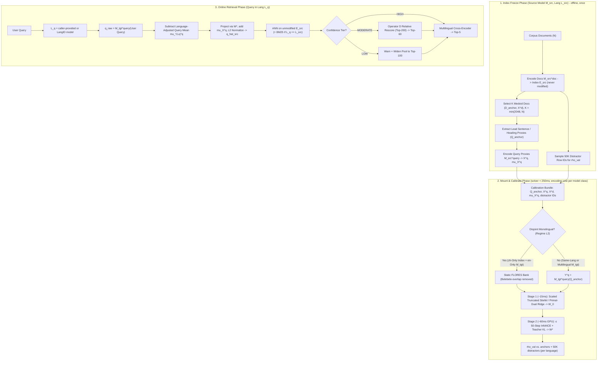

# Technical Design Document (v2.4): `SpaceBridge` Cross-Model Alignment Engine & Benchmark Suite

**Status:** Revised Draft — Scoped MVP (Core Engine + Multi-Dimensional & Cross-Lingual Validation)  
**Target Environment:** Local Linux Host (Intel i5-12600K, NVIDIA RTX 5070 Ti 16GB VRAM, PyTorch built for CUDA $\ge 12.8$ / `sm_120`)  
**Scope:** Phase 0 — Zero-Reindexing Cross-Model, Cross-Dimension, and Cross-Language Query Alignment  

> [!NOTE]
> **Changes since v2.3**
> 1. **Index is never touched:** removed per-document re-centering / re-normalization of $E_{\text{src}}$ (it required rebuilding the ANN index). Document-side centering is now handled implicitly (§4.2).
> 2. **Affine query map:** projected queries add back the source query mean $\mu_X^{(q)}$ so they live where the index expects native queries; Stiefel solver gains a Procrustes scale $s$ (§4.2–4.3).
> 3. **Retention denominators:** targets are now stated against the *ceiling* $\min(\text{M}_{\text{src}}\text{ native}, \text{M}_{\text{tgt}}\text{ oracle})$; oracle retention is still reported (§2.1).
> 4. **Mount budget** split into solver time (any model) and per-model-class end-to-end time; 2 s is not achievable for 4B-class targets (§2.1).
> 5. **Eval/calibration leakage fixed:** Belebele passages are FLORES-200 passages, so Tier 5 now evaluates primarily on `XQuADRetrieval` / `MKQARetrieval`, and FLORES sentences overlapping Belebele are removed from all anchor/shift banks (§7.1).
> 6. **$\rho_{\text{val}}$ defined** against a 50K-document distractor pool, with per-language validation and thresholds to be calibrated empirically (§5, §7.4).
> 7. **Operator D** now compares like with like (both sides against the same reference *documents*); latency corrected to ~1–3 ms (§4.3).
> 8. **Models:** added `microsoft/harrier-oss-v1-0.6b` and `google/embeddinggemma-2` as target query models, `Qwen3-Reranker-0.6B` as second reranker; switched all inference to `bf16` (§7.1–7.2).
> 9. New ablation rows: $M_{\text{src}}$-native ceiling, identity sanity check, mean-strip variant, doc↔doc refinement term (§7.3).
> 10. Wording: "human-translated (no MT)" instead of "native human-authored"; Up-Projection advantage stated as an expectation, not a theorem.
> 11. **No dataset text in the repo:** FLORES (CC BY-SA 4.0, gated) is downloaded at runtime and cached under git-ignored `data/` instead of bundled as static JSON (§4.4, §7.1).

---

## 1. Overview & Motivation

Upgrading an embedding model, querying a massive pre-computed vector dataset ($10\text{M}+$ chunks) with a tiny on-device model, or searching a legacy monolingual English index in another language normally requires re-embedding every document from scratch.

**Working hypothesis** (motivated by the *Platonic Representation Hypothesis*): high-performing embedding models organize semantic neighborhoods with largely isomorphic relative geometry, differing primarily by anisotropic cone offsets (including query/document and language-ID shifts), orthogonal rotations, and spectral scaling. Phase 0 exists to *test* how far this holds across model families, dimensions, and languages.

`SpaceBridge` aligns a **target query encoder** $M_{\text{tgt}}$ directly into an existing, **unmodified source document index** $M_{\text{src}}$ using $K$ pre-bundled calibration anchors ($K \ll N$). Solver time is **under 250 ms**; end-to-end mount time is dominated by encoding the anchors with $M_{\text{tgt}}$ and depends on its size (§2.1). Phase 0 defers custom file container packaging (`.slice` / hot-cold disk tiering) to rigorously benchmark alignment across **architectural families, extreme dimensional ratios ($128\text{d} \leftrightarrow 2560\text{d}$), and language boundaries (`zh` $\leftrightarrow$ `en`)**.

> [!IMPORTANT]
> **Theoretical Boundary (Source-Capacity Ceiling):** By the Data Processing Inequality, projecting $q_{\text{tgt}} \to \text{Space}(M_{\text{src}})$ provides $M_{\text{tgt}}$'s query understanding (including multilingual comprehension) *bounded above by $M_{\text{src}}$'s document separability*. `SpaceBridge` cannot recover distinctions that $M_{\text{src}}$ collapsed at index creation time. We therefore **expect** **Up-Projection** (lightweight/multilingual $M_{\text{tgt}} \to$ high-capacity $M_{\text{src}}$) to retain more than **Down-Projection**; this is an empirical claim tested in Tier 4, not a theorem.

---

## 2. Goals & Non-Goals

### 2.1 Tiered Performance Goals

**Retention definitions** (computed per metric, per test pair):
* **Oracle retention** $\rho_{\text{oracle}} = \text{metric}_{\text{bridge}} / \text{metric}_{\text{oracle}}$, where the oracle re-embeds all $N$ docs with $M_{\text{tgt}}$ (Ablation Row 0a).
* **Ceiling retention** $\rho_{\text{ceil}} = \text{metric}_{\text{bridge}} / \min(\text{metric}_{\text{src-native}}, \text{metric}_{\text{oracle}})$, where *src-native* is $M_{\text{src}}$ queries on the $M_{\text{src}}$ index (Row 0b; for Tier 5 this uses the parallel query in the index language). By the source-capacity ceiling, $\rho_{\text{ceil}}$ is the achievable quantity; **all targets below are on $\rho_{\text{ceil}}$** and $\rho_{\text{oracle}}$ is always reported alongside.

| Migration Tier | Example Test Case | Pure Vector `Recall@30` $\rho_{\text{ceil}}$ | End-to-End `NDCG@5` $\rho_{\text{ceil}}$ (RRF + Reranker) |
| :--- | :--- | :--- | :--- |
| **Tier 1: Intra-Family Moderate Dim** | `bge-base-en-v1.5 (768d)` $\leftrightarrow$ `bge-large-en-v1.5 (1024d)` | **$\ge 88\%$** at $K = 2,048$; **$\ge 90\%$** at $K = 4,096$ † | **$\ge 98\%$** |
| **Tier 2: Cross-Family Same-Dim** | `bge-large-zh-v1.5 (1024d)` $\leftrightarrow$ `multilingual-e5-large (1024d)` | **$\ge 88\%$** (`6–12%` loss) | **$\ge 96\%$** |
| **Tier 3: Encoder $\leftrightarrow$ Decoder-LLM** | `bge-large-en-v1.5 (1024d)` $\leftrightarrow$ `Qwen3-Embedding-0.6B` / `harrier-oss-v1-0.6b (1024d)` | **$\ge 82\%$** at $K = 2,048$; **$\ge 87\%$** at $K = 4,096$ † | **$\ge 94\%$** |
| **Tier 4: Extreme Low $\leftrightarrow$ High Dim** | `MiniLM (384d)` / MRL $(128\text{–}768\text{d})$ $\leftrightarrow$ `Qwen3-4B (2560d)` ($6.7\times$–$20\times$) | **$\ge 80\%$** (Up-Proj) / **$\ge 85\%$\*** (Down-Proj, ceiling = $384\text{d}$ native) | **$\ge 92\%$** |
| **Tier 5: Cross-Language (`zh` $\leftrightarrow$ `en`)** | `zh` Query (`Qwen3`/`mE5`/`harrier`/`EmbeddingGemma 2`) $\to$ Monolingual `en` Index (`bge-en`) *(BM25 = 0)* | **$\ge 78\%$** | **$\ge 90\%$** *(via Cross-Lingual Reranker)* |

† **Revised and approved 2026-10-30** after Milestone 1, stated for a hard domain (`fiqa`). The original Tier 1 target ($\ge 95\%$) proved out of reach for a linear query map on `fiqa` (observed 89.4–92.2% at $K = 2,048$; 90.4–92.3% at $K = 4,096$ with doc pairs), while it is met on the easy `scifact` corpus (96.8–97.3%). Tier 3 meets its target (83.1–91.1% at $K = 2,048$). **All tiers additionally target `Recall@100` $\rho_{\text{ceil}} \ge 90\%$** (reranker recoverability; observed 92.8% mean on `fiqa`). End-to-end targets are unchanged; **Row 9 was measured in Milestone 2** (`fiqa`, $K = 2,048$, dense first stage + cross-encoder, no BM25): mean `nDCG@5` $\rho_{\text{ceil}}$ is 0.96 when reranking the bridged top-30, 0.99 at top-60 and 0.99–1.00 at top-100, with `bge-reranker-v2-m3` and `Qwen3-Reranker-0.6B` agreeing within noise. Tier 1 meets 98% from top-60; Tier 3 meets 94% at top-100 on all pairs; at top-60 it meets it on 4 of 4 pairs with `bge-reranker-v2-m3` (worst 0.941) and 3 of 4 with `Qwen3-Reranker-0.6B` (worst 0.930). The first-stage loss is therefore mostly reordering that a reranker over a wider pool recovers. **Re-measured on the shipped default engine** (doc↔doc pairs, M2 follow-up): first-stage `nDCG@5` 0.80 (was 0.77); after reranking 0.97 / 0.99 / 1.00 at top-30 / 60 / 100 with either reranker, and Tier 3 now meets 94% at top-60 on all 4 pairs with both rerankers (worst 0.964 / 0.949). Tier 5a (`xquad-zh`, Row 7b, `bge-reranker-v2-m3`): 0.916 / 0.945 / 0.959, meeting 94% on 3 of 4 models at top-60 and top-100 (worst `harrier-oss-v1-0.6b` 0.923 / 0.938). Tiers 2, 4 and 5 keep their original targets until first measured. As the benchmark broadens (§7.1), targets should be read as the median across datasets, with the worst dataset reported alongside.

\* Provisional: re-baseline after Stage 1 smoke test. In v2.3 this target was stated against the $2560\text{d}$ oracle, which can exceed the source-capacity ceiling itself.

* **Solver Budget (any model):** Stage-1 + Stage-2 + validation on precomputed embeddings must complete in **$< 250\text{ ms}$** on the RTX 5070 Ti.
* **End-to-End Mount Budget (anchor encoding in `bf16` + solver):** encoding $K = 2,048$ proxies at 32–64 tokens is $\approx 1.3 \times 10^5$ tokens, i.e. $\approx 2 \cdot P \cdot 1.3 \times 10^5$ FLOPs for a $P$-parameter encoder. Provisional budgets, to be replaced by measurements in Stage 0:

| $M_{\text{tgt}}$ size class | Examples | End-to-end mount budget |
| :--- | :--- | :--- |
| $\le 0.35\text{B}$ | `MiniLM`, `bge-*`, `EmbeddingGemma 2` (text path) | **$< 2.0\text{ s}$** |
| $\approx 0.6\text{B}$ | `Qwen3-Embedding-0.6B`, `harrier-oss-v1-0.6b`, `mE5-large` | **$< 4.0\text{ s}$** |
| $\approx 4\text{B}$ | `Qwen3-Embedding-4B` | **$< 20\text{ s}$** (one-time per mount) |

> [!NOTE]
> **Measured (M3, `fiqa`, $K = 2,048$, idle RTX 5070 Ti, bf16; budgets above unchanged pending a decision).** Mount = proxy encoding + anchor-doc encoding for doc↔doc pairs (§4.3) + solver:
>
> | $M_{\text{tgt}}$ | Proxies | Anchor docs (full / 128 tokens) | Solver | Mount without doc pairs | Mount, default |
> | :--- | :--- | :--- | :--- | :--- | :--- |
> | `all-MiniLM-L6-v2` | 0.2 s | 0.5 s | 0.26 s | 0.5 s | 1.0 s |
> | `bge-large-en-v1.5` | 1.8 s | 5.1 s / 2.2 s | 0.16 s | 2.0 s | 7.1 s |
> | `Qwen3-Embedding-0.6B`, `harrier-oss-v1-0.6b` | 3.5–4.0 s | 11.5 s / 4.7 s | 0.17 s | 4.2 s | 15.7 s |
> | `Qwen3-Embedding-4B` | 19.0 s | 51.1 s / ~20 s (projected) | 0.16 s | 19.1 s | 70 s (doc pairs off for this class, §4.3) |
>
> Proxies alone are within budget for every class except at the 0.6B boundary; the doc-pair pass is ~3× the proxy pass (anchor docs average 160–280 tokens vs. ~60). Encoding anchor docs truncated to 128 tokens cuts that pass 2.3–2.5× at a cost of 0.3–0.5 points of `Recall@30` retention (3 seeds, `fiqa`). Up-projection into a 2560-d index exceeds the solver budget (262 ms at $K = 2,048$; Stage 2's logits scale with $d_s$).

* **Online Overhead:** Query-time projection must take **$< 0.1\text{ ms}$** on CPU (one $d_t \times d_s$ mat-vec, $\le 10^6$ MACs) with **zero duplicate or rewritten vector indices** on disk. Operator D rescoring (only on `MODERATE_DRIFT`) adds **$\approx 1\text{–}3\text{ ms}$** on CPU.

### 2.2 Non-Goals (Phase 0)
* **Custom Container Packaging & Storage Tiering:** Portable `.slice` archives and SSD/HDD tiering are deferred until Phase 0 benchmark targets are met.
* **Any Index Rewrite:** Indices are immutable read-only snapshots. This includes re-centering, re-normalizing, or re-quantizing stored vectors; all alignment happens on the query side.
* **Machine Translation in the Loop:** No MT models or LLM translators are used during calibration or evaluation. Cross-lingual anchors and test queries come from **professionally human-translated** parallel data (FLORES, XQuAD, MKQA), so alignment quality is not confounded with MT artifacts.
* **GAN / Unsupervised Adversarial Alignment:** Unstable iterative adversarial methods (`vec2vec`) are excluded in favor of closed-form SVD/Ridge initialization plus deterministic contrastive refinement.

---

## 3. Architecture & Dual-Manifold Data Flow

Modern asymmetric embedding models map **queries** (with task instructions or `"query: "` prefixes) and **documents** (with `"passage: "` or raw text) onto **separate cones** ($\mu^{\text{query}} \neq \mu^{\text{doc}}$), and multilingual models add a **language-identity cone shift** ($\mu_{\text{zh}}^{\text{query}} \neq \mu_{\text{en}}^{\text{query}}$).

`SpaceBridge` handles all three shifts on the query side only:



---

## 4. Core Algorithms & Mathematical Formulation

### 4.1 Full-Rank Anchor Selection (`AnchorSelector`)
To prevent rank deficiency on $1024\text{d}$–$1536\text{d}$ models, the default anchor budget is **$K = \min(2,048, N)$** ($K_{\text{train}} = 1,638$, $K_{\text{val}} = 410$). Fit quality depends on $K$ relative to the embedding dimensions, not on $K/N$: v2.4 briefly capped $K \le N/10$, which on `scifact` forced $K = 518$ and cost Tier 1 about 5 points of `Recall@30` retention (91% vs. 96% at $K = 2,048$), so the cap was removed. Small corpora such as `scifact` remain smoke tests; `fiqa` ($K/N = 3.6\%$) is the authoritative benchmark.

1. **Medoid Sampling ($N \ge 5,000$):** Partition document embeddings into $K$ clusters with spherical k-means (k-means++ seeding, then full-batch Lloyd steps on the GPU) and select the actual document $d_k$ closest in cosine similarity to each centroid, yielding $(D_{\text{anchor}}, X^{(d)} \in \mathbb{R}^{K \times d_s})$, with $X^{(d)}$ read **exactly as stored in the index**. (Use Farthest Point Sampling when $N < 5,000$.)

   > **Implementation finding (anchor selection cost):** sklearn `MiniBatchKMeans` spent nearly all its time in its greedy k-means++ init ($2 + \ln K$ candidate trials per center over $3 \times$ `batch_size` $\ge 12\text{K}$ samples, with `batch_size` $= 4K$), so cost grew with $K^2$: 47 s at $K = 2,048$ and 209 s at $K = 4,096$ on `fiqa` (idle CPU; tens of minutes under contention). A torch implementation (single-trial k-means++ over all $N$ docs, ≤ 20 Lloyd steps) takes 2.0 s / 3.9 s, 11 s for `trec-covid` (171K docs, $K = 4,096$), with slightly better coverage (mean cosine of each doc to its nearest anchor 0.786 vs. 0.785 at $K = 2,048$; random anchors 0.768).
2. **Zero-LLM Query-Proxy Extraction:** Extract each medoid's title/heading plus first sentence ($32$–$64$ tokens) as paired query proxy $q_k \in Q_{\text{anchor}}$, and encode $X^{(q)} = M_{\text{src}}^{\text{query}}(Q_{\text{anchor}}) \in \mathbb{R}^{K \times d_s}$ using $M_{\text{src}}$'s native query prompt/prefix (§7.1 prompt table).
3. **Distractor Pool:** Sample $\min(N, 50\text{K})$ row IDs of $E_{\text{src}}$ uniformly at random (excluding anchors) for $\rho_{\text{val}}$ (§5). No re-encoding is needed; vectors are read from the index.
4. **Fixed Split:** $\mathcal{I}_{\text{train}} / \mathcal{I}_{\text{val}}$ is drawn once at freeze time and stored in the bundle so every target model is validated on the same anchors.

### 4.2 Query-Side Centering & Affine Mean Restore (Index Untouched)

**Document side: no transformation.** For any query vector $\hat{q}$ and doc mean $\mu_X^{(d)}$:

$$\hat{q} \cdot (e_j - \mu_X^{(d)}) = \hat{q} \cdot e_j - \underbrace{\hat{q} \cdot \mu_X^{(d)}}_{\text{constant over } j}$$

so subtracting the document mean never changes the ranking of an inner-product search and can be skipped. Likewise, softmax over documents is invariant to a per-query constant, so Stage-2 losses (§4.3) computed against raw $X^{(d)}$ are identical to those against centered docs. (v2.3 additionally re-normalized each centered document, which *does* change rankings and would require rebuilding the ANN index; that step is removed.) $\mu_X^{(d)}$ is still computed at freeze time for diagnostics (cone angles, §7.4).

**Query side: center, map, restore.** Using the training split only:

$$\mu_X^{(q)} = \frac{1}{K_{\text{train}}} \sum_{i \in \mathcal{I}_{\text{train}}} X_i^{(q)}, \qquad \mu_Y^{(q)} = \frac{1}{K_{\text{train}}} \sum_{i \in \mathcal{I}_{\text{train}}} Y_i^{(q)}$$

$$\bar{X}^{(q)} = X^{(q)} - \mu_X^{(q)}, \qquad \bar{Y}^{(q)} = Y^{(q)} - \mu_Y^{(q)}$$

where $Y^{(q)} = M_{\text{tgt}}^{\text{query}}(Q_{\text{anchor}}) \in \mathbb{R}^{K \times d_t}$. Rows are centered but **not** re-normalized, so the fitted map carries the correct residual scale. The online map is **affine**:

$$\hat{q}_{\text{src}} = \text{Normalize}\!\left(\mu_X^{(q)} + (q_{\text{tgt}} - \mu_{Y, L_q}^{(q)})\, W\right)$$

Restoring $\mu_X^{(q)}$ puts the projected query on the source query cone, where the index was trained to be searched; dropping it adds a document-dependent term $-\mu_X^{(q)} \cdot e_j$ that alters native rankings. **Identity check:** with $M_{\text{tgt}} = M_{\text{src}}$ and ridge $\lambda \to 0$, $W \to I$ and $\hat{q}_{\text{src}} = x^{(q)}$ exactly, so the pipeline must reproduce native retrieval (Ablation Row 1). The v2.3 behavior (no mean restore) is retained as Ablation Row 3b.

**Residual norm matching (implementation finding).** Least-squares maps (ridge, and Procrustes with $s < 1$) shrink the mapped residual $(q_{\text{tgt}} - \mu_Y)W$ toward zero, so after restoring $\mu_X^{(q)}$ the mean dominates and every query drifts toward the "average query". This made stripping the mean look better at small $K$, while restoring was clearly better with more data. Each Stage-1 candidate $W$ is therefore rescaled so the mean norm of mapped training residuals equals that of native source residuals $\|\bar{X}^{(q)}_{\text{train}}\|$. On `fiqa` this adds about 3 points of Stage-1 `Recall@30` retention, at zero query-time cost (the scale is folded into $W$). Ablation Rows 6n / 8n disable it.

---

### 4.3 Alignment Solvers & Extreme Dimensional Conversion ($d_t \ll d_s$ vs. $d_t \gg d_s$)

When converting across large dimensional gaps (e.g., $384\text{d} \leftrightarrow 2560\text{d}$), the two directions behave asymmetrically:
* **Up-Projection ($d_t \ll d_s$, e.g., $384\text{d} \to 2560\text{d}$):** Expected to be favorable. Because $K_{\text{train}} = 1,638 \gg d_t = 384$, the input covariance $(\bar{Y}^{(q)})^T \bar{Y}^{(q)} \in \mathbb{R}^{384 \times 384}$ is $4.3\times$ oversampled and well-conditioned (estimation variance scales with $d_t / K_{\text{train}}$, independent of $d_s$). $\hat{q}_{\text{src}}$ maps into at most a $384$-dimensional subspace of the $2560\text{d}$ index, analogous to Matryoshka (MRL) retrieval.
* **Down-Projection ($d_t \gg d_s$, e.g., $2560\text{d} \to 384\text{d}$):** Both rank-constrained ($d_t > K_{\text{train}}$) and bounded by the $384\text{d}$ index's lower semantic capacity. Handled via Spectral Truncation (Operator A) and Dual Woodbury Ridge (Operator B).

#### Operator A: Scaled Spectral-Truncated Stiefel Procrustes (Any $d_t, d_s$)
Thin SVD on the cross-covariance $M = (\bar{Y}_{\text{train}}^{(q)})^T \bar{X}_{\text{train}}^{(q)} \in \mathbb{R}^{d_t \times d_s}$ computes the optimal rectangular semi-orthogonal map without lossy marginal PCA:

$$U, \Sigma, V^T = \text{SVD}_{\text{thin}}\!\left((\bar{Y}_{\text{train}}^{(q)})^T \bar{X}_{\text{train}}^{(q)}\right)$$

Singular modes below $\tau_{\sigma} = 10^{-3} \cdot \sigma_1$ are truncated ($r = \max\{i : \sigma_i \ge \tau_{\sigma}\}$) so nullspace dimensions when $K_{\text{train}} < \max(d_t, d_s)$ map to $0$ instead of random orthogonal noise. Because the affine restore (§4.2) needs residuals at the right scale, the closed-form Procrustes scale is included:

$$W_{\text{stiefel}} = s\, U_{:, :r} V_{:, :r}^T \in \mathbb{R}^{d_t \times d_s}, \qquad s = \frac{\sum_{i \le r} \sigma_i}{\|\bar{Y}_{\text{train}}^{(q)}\|_F^2}$$

**Implementation note (Milestone 2):** $W_{\text{stiefel}}$ is computed as a polar decomposition from a float64 eigendecomposition of the smaller Gram matrix of $M$ ($M^T M$ or $M M^T$), which equals the SVD form to $\sim 10^{-5}$ and is several times faster than `gesvd` on GPU. Float64 is required: kept modes reach $\sigma_r / \sigma_1 = 10^{-3}$, eigenvalue ratios of $10^{-6}$, where float32 errs by ~15%. Effective ranks on `fiqa` at $K = 2,048$ are only 540–650 of 1024.

#### Operator B: Adaptive Primal / Dual (Woodbury) Ridge Projection
To support non-uniform spectral scaling at any target dimension $d_t$, including ultra-wide models ($d_t = 2560$ or $4096 > K_{\text{train}}$), `SpaceBridge` switches automatically between Primal and Dual (Woodbury) forms:

$$W_{\text{ridge}}(\lambda) = \begin{cases} \left(\bar{Y}_{\text{tr}}^T \bar{Y}_{\text{tr}} + \lambda I_{d_t}\right)^{-1} \bar{Y}_{\text{tr}}^T \bar{X}_{\text{tr}} & \text{if } d_t \le K_{\text{train}} \text{ (Primal: inverts } d_t \times d_t\text{)} \\[8pt] \bar{Y}_{\text{tr}}^T \left(\bar{Y}_{\text{tr}} \bar{Y}_{\text{tr}}^T + \lambda I_{K_{\text{train}}}\right)^{-1} \bar{X}_{\text{tr}} & \text{if } d_t > K_{\text{train}} \text{ (Dual: inverts } K_{\text{train}} \times K_{\text{train}}\text{)} \end{cases}$$

The two forms are algebraically identical for every $\lambda > 0$ (the switch is purely computational), and the column space of $W_{\text{ridge}}$ lies in the row space of $\bar{Y}_{\text{tr}}$. Since rows are no longer unit-norm, $\lambda$ is swept relative to the mean eigenvalue: $\lambda = \lambda_{\text{rel}} \cdot \|\bar{Y}_{\text{tr}}\|_F^2 / \min(d_t, K_{\text{train}})$ with $\lambda_{\text{rel}} \in \{0.01, 0.1, 1.0, 5.0, 20.0\}$, selected on $K_{\text{val}}$.

#### Operator C: GPU Contrastive-Distillation Refinement (`~80ms` Stage-2 Booster)
Initialized from $W_0 \in \{W_{\text{stiefel}}, W_{\text{ridge}}\}$, `SpaceBridge` runs $T = 50$ steps of AdamW (`lr=3e-3`, cosine decay) directly optimizing retrieval logits against the anchor documents **as stored in the index**, using the same affine map that is deployed online:

$$S_{\text{student}}(W) = \frac{1}{\tau} \text{Normalize}\!\left(\mu_X^{(q)} + \bar{Y}_{\text{train}}^{(q)} W\right) \left(X_{\text{train}}^{(d)}\right)^T, \qquad S_{\text{teacher}} = \frac{1}{\tau} X_{\text{train}}^{(q)} \left(X_{\text{train}}^{(d)}\right)^T$$

$$\mathcal{L}(W) = (1 - \alpha)\, \mathcal{L}_{\text{InfoNCE}}\!\left(S_{\text{student}}(W)\right) + \alpha\, \text{KL}\!\left(\text{softmax}(S_{\text{teacher}}) \;\|\; \text{softmax}(S_{\text{student}}(W))\right) + \beta \|W - W_0\|_F^2$$

(The Hinton $\tau^2$ factor is omitted: it compensates for a KL computed at a *higher* temperature than the CE term, but here both share $\tau = 0.05$, so $\tau^2$ would shrink the KL term $\sim 400\times$ relative to InfoNCE. Exposed as `RefineConfig.kl_scale`.)

with $\tau = 0.05$, $\alpha = 0.5$, $\beta = 10^{-3}$ (upgraded to $\beta = 10^{-2}$ when $d_t > K_{\text{train}}$ to prevent high-dimensional overfitting), early-stopped on held-out **own-doc MRR** of the $K_{\text{val}}$ proxies, subject to keeping $\ge 90\%$ of Stage 1's teacher agree@10 (evaluated every 10 steps; Stage-1 selection and Stage-2 stopping score on a fixed 10K-row subsample of the $\rho_{\text{val}}$ pool, all anchors plus random distractors, which keeps the solver at 114 / 122 ms mean / max for $K = 2,048$ on `fiqa`, 164 / 174 ms with the default doc↔doc pairs, idle GPU). The teacher is the native source ranking, i.e. exactly what the index would return for $M_{\text{src}}$ queries. **Large $K$ (M3):** Stage 2 is full-batch, so its cost grows with $K_{\text{train}}^2$ (Row 8b at $K = 4,096$: 454 ms). When there are more than 1,638 candidate anchor docs (the $K_{\text{train}}$ of $K = 2,048$), each step trains on a random 1,638 of them and on the rows whose positive is among them: Row 8b at $K = 4,096$ takes 199 / 209 ms mean / max on `fiqa`, at −0.4 ± 0.1 / +0.1 ± 0.1 points `Recall@30` on `fiqa` / `scidocs` (3 seeds). Nothing changes at the default $K$.

> [!WARNING]
> **Proxy-positive shortcut:** each query proxy is the lead sentence of its own positive document, so InfoNCE positives are lexically easy and may not transfer to real queries. Mitigations evaluated in the ablation: the teacher-KL term (which spreads mass over semantically related anchors), and a **doc↔doc term** (Row 8b; **on by default since M2**, see the note below) that encodes the anchor docs with $M_{\text{tgt}}^{\text{doc}}$ and adds $\mathcal{L}_{\text{InfoNCE}}$ over $\left(\text{Normalize}(\mu_X^{(d)} + \bar{Y}^{(d)} W_d)\right)(X^{(d)})^T$, doubling calibration pairs at the cost of a second encoding pass.

> [!NOTE]
> **Implementation finding (Stage-2 stopping, `fiqa`, M2 P4):** v2 early-stopped Stage 2 on teacher agree@10 and stopped at step 0 in ~85% of fits. Run for a fixed 50 steps, Stage 2 improved real $\rho_{\text{ceil}}$ `Recall@30` on 6 of 6 pairs at $K = 2,048$ (mean +1.9 points, `nDCG@10` +2.3) while *lowering* every teacher-agreement signal (agree@10, neighbour recall, score correlation): InfoNCE pulls the bridged query toward its positive document, away from reproducing $M_{\text{src}}$'s neighbours of the proxy. Held-out own-doc MRR was the only label-free signal that rose with the real gain. Used alone it exploits the proxy-positive shortcut (on the identity map it traded 20 points of agree@10 for +0.4 MRR, Row 1 fell to 98.1% of native), hence the 90% agreement floor. With both, Row 8 − Row 6 on `fiqa` is +2.2 points `Recall@30` / +2.5 `nDCG@10` at $K = 2,048$ (6 of 6 pairs positive), +1.8 / +1.2 at 4,096, +0.8 / +0.1 at 1,024; Row 1 stays ≥ 99.2% of native. Hard negatives (Row 8h) did not help (+1.5 vs. +1.9 at a fixed 50 steps). `SpaceBridge(stage2_signal="agree@10")` restores the v2 behaviour.
>
> **Default change (2026-10-31): doc↔doc pairs are on.** Across the six M2 BEIR sets, Row 8b was the best first-stage configuration on every dataset except `arguana` (a tie) and on all four Tier 5a pairs, and it recovered most of the `trec-covid` Tier 1 miss (+5.9 points `Recall@30` over Row 8). Cost: one extra $M_{\text{tgt}}^{\text{doc}}$ encoding pass over the $K$ anchor docs at mount (3–30 s for 0.6B-class models) and +50 ms solver time (164 / 174 ms mean / max at $K = 2,048$ on `fiqa`, inside the 250 ms budget). `fit(mode="auto")` therefore requires `Y_doc_raw`; `SpaceBridge(doc_pairs=False)` opts out (ablation Rows 6–8). The identity check (Row 1) now runs with doc pairs ($Y^{(d)} := X^{(d)}$).
>
> **Size-dependent (M3, Tier 4).** For 4B-class query models the doc-pair pass costs 51 s at $K = 2,048$ (70 s mount vs. a 20 s budget) and gives no measurable gain: `Qwen3-Embedding-4B` queries into a MiniLM index, Row 8b − Row 8 = +0.1 ± 3.0 points `Recall@30` (3 seeds; +2.6 ± 0.4 at $K = 4,096$). The mount protocol is therefore doc pairs for query models up to ~0.6B (gains of +1.6 to +7.4 points across `fiqa`, `trec-covid` and the MRL sweep, for seconds of encoding) and `doc_pairs=False` for 4B-class models.

#### Operator D: Candidate-Scoped Relative Representation Rescorer (Zero Extra Index)
Applied strictly in-memory over `Top-200` first-stage candidates $\mathcal{C}_{200}$ against $K_{\text{ref}} = 512$ reference anchor **documents** when moderate drift is detected. Both sides are profiled against the *same* 512 documents, so profile coordinates are comparable across spaces:

1. **Lazy setup (first `MODERATE_DRIFT` mount only):** encode the 512 reference anchor docs with $M_{\text{tgt}}^{\text{doc}}$ to get $Y_{\text{ref}}^{(d)}$; $X_{\text{ref}}^{(d)}$ is already in the bundle.
2. **ZCA statistics:** target-side mean/covariance from the profiles $Y_{\text{train}}^{(q)} (Y_{\text{ref}}^{(d)})^T$; source-side from $X_{\text{train}}^{(d)} (X_{\text{ref}}^{(d)})^T$ (anchors in $\mathcal{I}_{\text{ref}}$ excluded). Each side is whitened with its own statistics, which removes the query-vs-doc offset between the two profile populations.
3. Target query profile: $r_{\text{tgt}}(q) = \text{ZCA}_{\text{tgt}}\!\left(q_{\text{tgt}} (Y_{\text{ref}}^{(d)})^T\right) \in \mathbb{R}^{512}$.
4. For $e_j \in \mathcal{C}_{200}$: $r_{\text{src}}(e_j) = \text{ZCA}_{\text{src}}\!\left(e_j (X_{\text{ref}}^{(d)})^T\right) \in \mathbb{R}^{512}$ ($200 \times d_s \times 512 \approx 10^8$ MACs, **$\approx 1\text{–}3\text{ ms}$** CPU, $< 0.1\text{ ms}$ GPU).
5. Fuse linear cosine rank, relative cosine rank, and BM25 rank (when monolingual) via RRF before Cross-Encoder reranking.

---

### 4.4 Cross-Language Conversion (`SpaceBridge` Lingual Modes)

`SpaceBridge` supports two distinct cross-language scenarios, including a capability the original monolingual index *could not perform natively*:

#### Regime L1: Zero-Translation Cross-Lingual Unlock (Monolingual Index + Multilingual Query Model)
* **Scenario:** A large corpus of **English** documents was indexed with an **English-only** model $M_{\text{src}}$ (`bge-large-en-v1.5` or `all-MiniLM-L6-v2`). A user wants to query it in **Chinese (`zh`), Japanese (`ja`), or Spanish (`es`)** without re-indexing or translating the corpus.
* **Calibration (Zero Translation Required):** Mount the index with a **multilingual** query encoder $M_{\text{tgt}}$ (`Qwen3-Embedding-0.6B`, `harrier-oss-v1-0.6b`, `multilingual-e5-large`, or on-device `EmbeddingGemma 2`). Because $M_{\text{tgt}}$ understands English, `SpaceBridge` calibrates $W^*: \text{Space}(M_{\text{tgt}}) \to \text{Space}(M_{\text{src}})$ directly on the existing **English** anchors $Q_{\text{anchor}}^{\text{en}}$.
* **Fixing the Language-Identity Cone Shift ($\Delta \mu_{\text{lang}}$):** Even in strong multilingual encoders, vectors contain a language-identity mean offset: $y_{L_q}(q) \approx \mu_{Y, L_q}^{(q)} + \delta y_{\text{semantic}}(q)$ with $\mu_{Y, \text{zh}}^{(q)} \neq \mu_{Y, \text{en}}^{(q)}$. Subtracting $\mu_{Y, \text{en}}^{(q)}$ from a Chinese query leaves residual bias $(\mu_{Y, \text{zh}}^{(q)} - \mu_{Y, \text{en}}^{(q)})$.
  * **Solution (`< 80ms` one-time setup per language for $\le 0.6\text{B}$ models):** Use $256$ parallel sentences from the filtered FLORES `dev` split (Belebele-overlapping sentences removed, §7.1). FLORES text is **not committed to the repo** (see the licensing note in §7.1); a build script downloads `flores_plus` with the user's HF token and caches the filtered subset (`~30KB` JSON) under the git-ignored `data/` directory. Encode both language sides with $M_{\text{tgt}}$ **using its query prompt/instruction** (otherwise the estimated shift mixes in the query/document cone offset). When a query arrives in language $L_q \neq L_{\text{src}}$, compute the language-adjusted query center:

$$\mu_{Y, L_q}^{(q)} = \mu_{Y, L_{\text{src}}}^{(q)} + \left(\mu_{\text{FLORES}, L_q}^{(q)} - \mu_{\text{FLORES}, L_{\text{src}}}^{(q)}\right)$$

  * Centering $q_{\text{raw}}$ by $\mu_{Y, L_q}^{(q)}$ strips the language-ID vector so Chinese/Japanese queries land on the aligned semantic subspace before multiplying by $W^*$.
* **Query Language Detection:** $L_q$ is taken from the caller when provided; otherwise from a lightweight language-ID model (e.g. fastText `lid.176`). Unregistered languages fall back to $L_{\text{src}}$ centering **with a warning** (§6).

> [!NOTE]
> **Default change (2026-10-31): $\Delta\mu$ is registered at mount for every expected query language**, on top of the default engine (doc↔doc pairs + Stage 2); queries tagged with a registered $L_q$ are centered on $\mu_{Y, L_q}^{(q)}$. Measured on Tier 5a (`xquad-zh`, 1,190 Chinese questions into an English `bge-large-en` index, 4 multilingual query models; $\Delta\mu$ from 256 Tatoeba `cmn-eng` pairs because FLORES is gated and no token was available), ρceil `Recall@30`, mean over models:
>
> | | $K = 2,048$ | $K = 4,096$ |
> | :--- | :--- | :--- |
> | Row 8 (Stage 1 + 2) | 0.890 | 0.879 |
> | Row 7 (Row 8 + $\Delta\mu$) | 0.892 | 0.907 |
> | Row 8b (+ doc pairs) | 0.907 | 0.898 |
> | **Row 7b (Row 8b + $\Delta\mu$, new default)** | **0.914** | **0.925** (all 4 models ≥ 0.902) |
>
> $\Delta\mu$ never hurt a model beyond noise (7b − 8b from −0.1 to +6.6 points). The gain is concentrated in `multilingual-e5-large` (+2.5 / +6.6 points; at 4,096 the 95% CIs do not overlap) and at larger $K$, where Stage-1 selection picks lightly regularized maps that fit English-proxy structure; for `Qwen3-Embedding-0.6B` it is zero. With it, more anchors help again (0.914 → 0.925 instead of 0.907 → 0.898). The quality score graded all of these fits **A** while real retention was 0.87–0.94: English-proxy validation does not see the language shift, which is one more reason routing stays advisory (§5) and $\rho_{\text{val}, L_q}$ is still needed.

> [!TIP]
> **Cross-Lingual Retrieval Routing:** Whenever $L_q \neq L_{\text{src}}$, lexical BM25 overlap is near zero (`BM25` weight is automatically disabled or down-weighted), candidate pool widens to `Top-60`, and a **multilingual Cross-Encoder** (`BAAI/bge-reranker-v2-m3` or `Qwen/Qwen3-Reranker-0.6B`) scores `(zh_query, en_doc)` pairs directly.

#### Regime L2: Disjoint Monolingual-to-Monolingual Bridge (e.g., `zh`-Only Index $\leftrightarrow$ `en`-Only Query Model)
* **Scenario:** $M_{\text{src}}$ is Chinese-only (`bge-large-zh-v1.5`) and $M_{\text{tgt}}$ is English-only (`bge-large-en-v1.5`), so neither model can natively encode the other's corpus text.
* **Zero-Translation Static Human Anchor Bank:** Because `SpaceBridge` aligns the two models' global coordinate systems rather than fitting a specific corpus, it uses the **FLORES `dev` + `devtest` parallel sentences** (nominally $2,009$; after de-duplicating sentences that appear in both splits and removing Belebele overlap, $K_{\text{FLORES}} < 2,009$, exact count recorded per run) as a static, corpus-independent anchor bank:
  1. At export (or once per model), `bge-large-zh-v1.5` encodes the Chinese sentences with its query instruction $\to X_{\text{FLORES}}^{(q)}$ and without it $\to X_{\text{FLORES}}^{(d)}$.
  2. At mount time, `bge-large-en-v1.5` encodes the corresponding English sentences with its query instruction $\to Y_{\text{FLORES}}^{(q)}$.
  3. Stage-1 + Stage-2 alignment solves $W^*: \text{Space}(M_{\text{tgt}}^{\text{en}}) \to \text{Space}(M_{\text{src}}^{\text{zh}})$ using only human-translated text and zero machine translation.
* **Caveat:** FLORES sentences are single sentences from Wikinews/Wikivoyage/Wikibooks, so the anchor docs are shorter and narrower in domain than typical corpus passages; Ablation Row 5 quantifies the cost.

---

## 5. Automated Confidence Routing Policy

**Definition.** For each of the $K_{\text{val}} = 410$ held-out proxies, retrieve from the pool $\mathcal{P}$ = all $K$ anchor docs $\cup$ the $\le 50\text{K}$ distractor rows (§4.1), scoring with raw stored vectors. Then $\rho_{\text{val}}$ is the **top-10 agreement with the teacher**:

$$\rho_{\text{val}} = \frac{1}{K_{\text{val}}} \sum_{i \in \mathcal{I}_{\text{val}}} \frac{\left|\text{Top10}_{\mathcal{P}}(\hat{q}_{\text{src}, i}) \cap \text{Top10}_{\mathcal{P}}(X_i^{(q)})\right|}{10}$$

where the student uses $\hat{q}_{\text{src}}$ and the teacher uses native $X^{(q)}$. The same score selects the Stage-1 operator / $\lambda_{\text{rel}}$; Stage 2 early-stops on own-doc MRR under an agreement floor (§4.3, Operator C).

> [!NOTE]
> **Implementation finding (Stage-1 selection, M3):** unlike Stage 2, Stage-1 selection is not misled by teacher agreement. Fitting every candidate (Stiefel, five ridge $\lambda_{\text{rel}}$) through the default pipeline on `fiqa`, `scidocs` and `nq` (36 fits each, 3 seeds), agree@10 ranks the candidates' real `Recall@30` retention with a within-fit Spearman of 0.88–0.94, and a perfect selector would gain only 0.2–0.7 points after Stage 2. Own-doc MRR and "always Stiefel" each win on one dataset and lose as much on another (e.g. Stiefel +0.6 ± 0.3 on `fiqa`, −0.6 ± 0.2 on `scidocs`); regression-type signals (held-out $R^2$, residual cosine) pick clearly worse maps (−0.6 to −1.1). The selection signal is unchanged (`scripts/stage1_study.py`).

> [!NOTE]
> **Implementation finding (Stage 1, `scifact`):** the v2.4 draft defined $\rho_{\text{val}}$ as a ratio of own-anchor-doc `Recall@10`. Because each proxy is the lead sentence of its own anchor doc, both teacher and student hit it almost always, so that ratio was $1.000$ for every configuration (including ones with 82% real retention). Solver selection and Stage-2 early stopping were then decided by ties. Own-doc recall is still logged as a diagnostic.

**Per-language validation (Regime L1).** English-anchor $\rho_{\text{val}}$ says nothing about Chinese queries. For each registered $L_q$, a second score $\rho_{\text{val}, L_q}$ uses FLORES `devtest` pairs (disjoint from the 256 `dev` sentences used for $\Delta\mu$): $L_q$ sentences are projected as queries and must retrieve their $L_{\text{src}}$ counterparts, encoded once by $M_{\text{src}}^{\text{doc}}$ and mixed into $\mathcal{P}$. Routing uses $\rho_{\text{val}, L_q}$ for queries in $L_q$.

**Interim routing** (used until the §5.1 quality score is calibrated; the §5.1 grade table is the approved target design):

| Validation Retention $\rho_{\text{val}}$ | Alignment Status | Online Retrieval Pipeline Action |
| :--- | :--- | :--- |
| **$\rho_{\text{val}} \ge 0.58$** | `HIGH_CONFIDENCE` | Linear ANN ($W^*$) + BM25 (if $L_q == L_{\text{src}}$) (`rerank_pool = 30`) $\to$ Cross-Encoder Top-5. |
| **$0.40 \le \rho_{\text{val}} < 0.58$** | `MODERATE_DRIFT` | Fetch `Top-200` $\to$ in-memory **Operator D Relative Rescorer** $\to$ Cross-Encoder on `rerank_pool = 60`. |
| **$\rho_{\text{val}} < 0.40$** | `LOW_ALIGNMENT_WARN` | Emit warning, widen `rerank_pool = 100`, and recommend background native re-indexing if sustained. |

The thresholds come from the calibration study (§7.4): over 180 `scifact` fits (6 pairs × 6 anchor counts × 5 solver settings), real `Recall@30` ceiling retention $\approx 0.85\,\rho_{\text{val}} + 0.41$ ($R^2 = 0.87$, residual s.d. 4 points; Spearman 0.89 pooled, 0.93 within pairs), so $\rho_{\text{val}} = 0.58$ / $0.40$ correspond to $\approx 90\%$ / $75\%$ retention. Agreement is on a different scale from retention: a $\rho_{\text{val}}$ of 0.6 already means $\approx 92\%$ retention. **On `fiqa` these thresholds did not transfer** (the same fit implies 0.505 / 0.347, and no `fiqa` fit reached `HIGH_CONFIDENCE`), so the fixed-threshold table above is superseded by the calibrated quality score in §5.1.

### 5.1 Conversion Quality Report (Simple Score, Detailed Measurements, Per-Query Confidence)

Goal: the system cannot be good on every corpus, but it must **never be silently bad**. Every mount produces a quality report computed from the calibration bundle alone (no labeled queries), and every online query carries a confidence value.

**Simple mode: one score in $[0, 100]$.** The score is the **predicted ceiling retention of `Recall@30`, in percent**: "87" means "expect about 87% of the retrieval quality that re-indexing with $M_{\text{tgt}}$, or the native $M_{\text{src}}$, whichever is lower, would give". It is produced by a small calibrated regressor (linear to start) from the detailed measurements below to observed retention, fitted on all benchmark runs. It is always reported with a prediction band and a grade:

Approved routing (2026-10-30), **made advisory 2026-10-31** (after the M2 calibration below): the grade may widen the rerank pool but never shrinks it below the default of 60.

| Grade | Score | Default routing (`QualityReport.rerank_pool`) |
| :--- | :--- | :--- |
| **A** | $\ge 95$ | `rerank_pool = 60` (was 30) |
| **B** | $85\text{–}95$ | `rerank_pool = 60` (+ Operator D) |
| **C** | $70\text{–}85$ | `rerank_pool = 100`, warn |
| **D** | $< 70$ | `rerank_pool = 100`, warn and recommend native re-indexing |

Unscored reports (no calibration available) also get 60. Why advisory: the score transfers to an unseen corpus with a ±4.3-point error, about half a grade, and it over-predicts hard corpora (`trec-covid` by 8 points), so an A could put a hard corpus at `rerank_pool = 30`, where Tier 3 misses its end-to-end target even on `fiqa` (mean 0.94, worst 0.89–0.91). At 60, `fiqa` meets the Tier 1 end-to-end target on every pair, and Tier 3 on 4 of 4 pairs with `bge-reranker-v2-m3` (worst 0.941) and 3 of 4 with `Qwen3-Reranker-0.6B` (worst 0.930). Shrinking the pool for grade A should come back only with a signal that detects hard datasets.

The score is marked **experimental** until its regressor is shown to transfer to held-out datasets (leave-one-dataset-out error within the reported band on $\ge 4$ datasets, §7.1).

> [!NOTE]
> **Implementation finding (calibration, M2 P2):** fitted on 306 Stage-1/2 fits (6 pairs × 3 K × rows 6/8/8b) over six BEIR sets (`fiqa`, `nfcorpus`, `scidocs`, `arguana`, `nq`, `trec-covid`), weighted by each fit's bootstrap variance and validated leave-one-dataset-out. $\rho_{\text{val}}$ alone transfers best (LODO RMSE 4.3 points; a constant predicts with 6.5); adding all the measurements in the table below fits better in-sample but transfers worse (5.0), because the error is dominated by a per-dataset offset (e.g. `trec-covid` is over-predicted by 8 points, `nq` under-predicted by 5) that no calibration-only measurement captured. The shipped `quality_calibration.json` is therefore $\rho_{\text{val}}$-only with a ±4.3-point band; it is within its band on 4 of 6 held-out datasets (so not marked experimental), but grade boundaries are only ~2 bands apart, and within-dataset rank correlation of $\rho_{\text{val}}$ with retention ranges from 0.94 (`nq`) to ~0.1 (`arguana`, `trec-covid`). The detailed measurements are still reported as diagnostics.
>
> **Cross-lingual queries are outside the score's calibration.** Held out as a seventh dataset, `xquad-zh` (Chinese queries, English anchors) is over-predicted by 10.5 points (observed 86.6, predicted 97.0): English-proxy $\rho_{\text{val}}$ cannot see the language shift. Adding it to the training set lowers transfer for everything else (LODO RMSE 4.3 → 7.0), so the shipped calibration stays English-only, and `register_query_language` adds a note that the score does not apply to that language. Per-language $\rho_{\text{val}, L_q}$ is still the planned fix.
>
> **Per-query confidence** (support = mean top-5 cosine to centered training proxies, isotonic map to per-proxy agree@10): the top support quintile has higher real `Recall@30` retention than the bottom on 82 of 102 fits across the six datasets (e.g. `fiqa` 0.83 → 0.90, `trec-covid` 0.72 → 0.92); Spearman with per-query native overlap@30 is 0.31–0.70. Useful for routing low-support queries to a wider rerank pool, not as a per-query guarantee.

**Detailed mode: measurements grouped by what they diagnose.**

| Group | Measurement (on held-out anchors unless noted) | Diagnoses |
| :--- | :--- | :--- |
| **Fidelity** | $\rho_{\text{val}}$ (teacher top-10 agreement); share of the teacher's top-10 non-own neighbors in the student's top-30 | How closely the bridge reproduces native rankings |
| **Recoverability** | Share of the teacher's top-10 non-own neighbors in the student's top-100 | Whether losses are reorderings a reranker can fix, or missing documents |
| **Fit health** | Held-out explained variance of the map; train-vs-val fidelity gap; effective rank $r / \min(d_t, d_s)$; Stage-2 gain | Whether the map is sound, data-starved, or overfitting |
| **Corpus difficulty** | Native neighborhood crowding (score gap between the teacher's top-1 and top-30); query/doc cone angle | Whether the corpus is intrinsically fragile to small query errors |
| **Coverage** | $K / d_t$; per-language fidelity $\rho_{\text{val}, L_q}$ (Regime L1) | Calibration-data sufficiency, cross-lingual readiness |

**Per-query confidence $c(q) \in [0, 1]$.** Computed online for each query at $\approx 10\,\mu\text{s}$ extra cost, from how well the query is supported by the calibration anchors: the similarity of the centered target query $\bar{y}_q$ to its nearest training anchors in target space ($\bar{Y}^{(q)}_{\text{train}}$, one $d_t \times K_{\text{train}}$ product), mapped to $[0, 1]$ by a calibration fitted on validation anchors so that low $c(q)$ predicts low per-query agreement with native. Queries far from all anchors are extrapolations of $W$; routing can widen the candidate pool and rerank **only those queries** instead of the whole workload.

```python
report = bridge.quality_report()         # computed during fit()
report.score      # 87.0  (predicted % ceiling Recall@30 retention)
report.band       # (82.0, 92.0)
report.grade      # "B"
report.details    # {"fidelity": {...}, "recoverability": {...}, "fit": {...}, "difficulty": {...}, "coverage": {...}}

q_hat, conf = bridge.transform_query(q_raw, return_confidence=True)   # conf in [0, 1] per query
```

---

## 6. Minimal Python Interface (`spacebridge.py`)

```python
import warnings
from dataclasses import dataclass
from typing import Dict, Literal, Optional
import numpy as np


@dataclass
class CalibrationBundle:
    src_lang: str                  # e.g., "en" or "zh"
    anchor_doc_texts: list[str]
    anchor_query_texts: list[str]
    X_doc_raw: np.ndarray          # (K, d_s) anchor doc vectors exactly as stored in the index
    X_query_raw: np.ndarray        # (K, d_s) source query embeddings of the proxies (native query prompt)
    train_idx: np.ndarray          # (K_train,) fixed at freeze time
    val_idx: np.ndarray            # (K_val,)
    distractor_ids: np.ndarray     # (<=50K,) index row ids used for rho_val
    mu_x_doc: Optional[np.ndarray] = None  # (d_s,) diagnostics only; the index is never re-centered


class SpaceBridge:
    def __init__(self, device: str = "cuda", restore_source_mean: bool = True, doc_pairs: bool = True):
        self.device = device
        self.restore_source_mean = restore_source_mean  # False reproduces v2.3 behavior (Ablation Row 3b)
        self.doc_pairs = doc_pairs  # default: mode="auto" requires Y_doc_raw (Row 8b); False opts out
        self.src_lang: str = "en"
        self.mu_x_query: Optional[np.ndarray] = None
        self.mu_y_by_lang: Dict[str, np.ndarray] = {}
        self.W: Optional[np.ndarray] = None
        self.status: str = "uninitialized"
        self.metrics: Dict[str, float] = {}

    def fit(
        self,
        bundle: CalibrationBundle,
        Y_raw: np.ndarray,         # (K, d_t) target query embeddings of the proxies (or of anchor docs if pairs="doc")
        mode: Literal["naive", "stiefel", "ridge", "stage1", "auto"] = "auto",  # auto = best Stage-1 + Stage-2
        pairs: Literal["query", "doc"] = "query",
        X_distractor: Optional[np.ndarray] = None,  # index vectors at bundle.distractor_ids
        Y_doc_raw: Optional[np.ndarray] = None,     # (K, d_t) anchor docs encoded with the target doc prompt
    ) -> Dict[str, float]:
        """Sets src_lang, mu_x_query, mu_y_by_lang[src_lang] and W (scaled truncated Stiefel or
        primal/dual ridge on query-proxy + doc<->doc pairs, then <= 50-step GPU InfoNCE/KL), and
        computes rho_val, status and the quality report (score, grade, advisory rerank_pool)."""
        ...

    def register_query_language(
        self, lang: str, Y_flores_src_lang: np.ndarray, Y_flores_query_lang: np.ndarray
    ) -> None:
        """Registers the language-cone shift from M_tgt query-prompt embeddings of the same
        256 FLORES dev sentences in src_lang and in lang (<80ms)."""
        if self.src_lang not in self.mu_y_by_lang:
            raise RuntimeError("fit() must be called before register_query_language()")
        shift = Y_flores_query_lang.mean(axis=0) - Y_flores_src_lang.mean(axis=0)
        self.mu_y_by_lang[lang] = self.mu_y_by_lang[self.src_lang] + shift

    def transform_query(self, q_tgt_raw: np.ndarray, query_lang: Optional[str] = None) -> np.ndarray:
        """Applies language-aware centering, linear projection W, source-mean restore, and L2 norm."""
        lang = query_lang or self.src_lang
        mu_y = self.mu_y_by_lang.get(lang)
        if mu_y is None:
            warnings.warn(
                f"query language {lang!r} not registered; using {self.src_lang!r} centering "
                "without language-cone correction"
            )
            mu_y = self.mu_y_by_lang[self.src_lang]
        q_proj = (q_tgt_raw - mu_y) @ self.W
        if self.restore_source_mean:
            q_proj = q_proj + self.mu_x_query
        return q_proj / (np.linalg.norm(q_proj, axis=-1, keepdims=True) + 1e-8)
```

---

## 7. Standalone Benchmark Suite (`SpaceBridgeBench`)

### 7.1 Datasets, Data Preparation & Hardware Setup
* **Hardware:** Local Linux Host, RTX 5070 Ti (16GB VRAM). **All inference in `bf16`** (Blackwell runs `bf16` at `fp16` speed; `EmbeddingGemma 2` does not support `fp16`). Requires a PyTorch build with CUDA $\ge 12.8$ (`sm_120`).
* **VRAM plan:** `Qwen3-Embedding-4B` ($\approx 8\text{GB}$) + a $0.6\text{B}$ reranker ($\approx 1.2\text{GB}$) fit together; 4B/8B rerankers and `Qwen3-Embedding-8B` ($\approx 16\text{GB}$) do not, and are out of scope.
* **Local Cross-Encoder Rerankers** (both run in Row 9):
  * `BAAI/bge-reranker-v2-m3` (baseline; multilingual and cross-lingual `(zh, en)`, ~0.6B, Apache-2.0).
  * `Qwen/Qwen3-Reranker-0.6B` (newer, 100+ languages, Apache-2.0; small reported edge over `bge-reranker-v2-m3` on multilingual reranking).
* **Model Prompts** (each model is evaluated with its native prompt; mismatched prompts silently degrade both oracle and bridge):

| Model | Query input | Document input |
| :--- | :--- | :--- |
| `bge-*-en-v1.5` | `Represent this sentence for searching relevant passages: {q}` | `{d}` |
| `bge-large-zh-v1.5` | `为这个句子生成表示以用于检索相关文章：{q}` | `{d}` |
| `multilingual-e5-large` | `query: {q}` | `passage: {d}` |
| `Qwen3-Embedding-*` | `Instruct: {task}\nQuery:{q}` (left padding) | `{d}` |
| `harrier-oss-v1-0.6b` | `Instruct: {task}\nQuery: {q}` | `{d}` |
| `embeddinggemma-2` | `task: search result \| query: {q}` | `title: {title or "none"} \| text: {d}` |
| `all-MiniLM-L6-v2` | `{q}` | `{d}` |

* **Hugging Face / `mteb` Dataset Mapping (human-authored or professionally human-translated; no MT):**

| Benchmark Role | Hugging Face / `mteb` ID | Scale & Purpose |
| :--- | :--- | :--- |
| **Fast Smoke Test** *(Tiers 1, 3, 4)* | `mteb/scifact` | **$5.2\text{K}$** English scientific abstracts + **$300$** queries; rapid inner-loop solver verification ($K = 2,048$ is 40% of the corpus, so results are optimistic smoke tests). |
| **Main English Benchmark** *(Tiers 1, 3, 4a, 4b)* | `mteb/fiqa` *(or `mteb/nfcorpus`)* | **$57.6\text{K}$** financial QA passages + **$648$** queries; full $K$ sweep up to $4,096$. |
| **Native Chinese Benchmark** *(Tier 2)* | `C-MTEB/T2Retrieval` *(via `mteb` `"T2Retrieval"`)* | Native Chinese web passages + real Chinese search queries; subsampled to $25\text{K}$–$50\text{K}$ passages. |
| **Chinese Contamination Check** *(Tier 2)* | `mteb` `"MedicalRetrieval"` / `"EcomRetrieval"` (Multi-CPR) | `bge-*-zh` fine-tuning data likely includes T2Ranking (source of T2Retrieval), which inflates absolute scores. A second native-Chinese set shows whether retention ratios are affected. |
| **Cross-Lingual `zh` $\leftrightarrow$ `en`** *(Tiers 5a & 5b, primary)* | `mteb` `"XQuADRetrieval"` *(primary)*, `"MKQARetrieval"` *(secondary)* | Human-translated parallel questions & passages. *(Excludes `mMARCO` due to machine-translation artifacts.)* |
| **Cross-Lingual, secondary** | `mteb` `"BelebeleRetrieval"` (`zho_Hans` $\leftrightarrow$ `eng_Latn`) | **Belebele passages are FLORES-200 passages.** Only reported with the FLORES overlap filter below applied; otherwise it evaluates on calibration text. |
| **Static Human Anchor Bank** *($\Delta\mu_{\text{lang}}$, $\rho_{\text{val}, L_q}$, Tier 5b)* | `openlanguagedata/flores_plus` *(`cmn_Hans`, `eng_Latn`)* | Gated (accept terms, use an HF token). `dev` ($997$) + `devtest` ($1,012$) row-aligned human-translated pairs before filtering. |

* **Data Preparation Rules (Preventing Silent Evaluation Bugs):**
  1. **Positive-Preserving Subsampling:** When subsampling large corpora (e.g., `T2Retrieval` or `MKQARetrieval` from $300\text{K}+$ down to $25\text{K}$ passages), always include $100\%$ of positive `doc_id`s referenced in `test` `qrels` first, then sample remaining distractor passages uniformly at random and shuffle.
  2. **Consistent `title + text` Formatting:** Concatenate `f"{title}\n{text}"` (when `title` is non-empty) consistently during document indexing, except for models with a structured document prompt (`EmbeddingGemma 2`); extract `title` + lead sentence ($32$–$64$ tokens) as zero-LLM query proxies $Q_{\text{anchor}}$.
  3. **Strict Split Hygiene:** `AnchorSelector` samples strictly from `corpus` documents (never `test` queries), keeping evaluation queries completely unseen during calibration.
  4. **Anchor Budget:** $K = \min(2,048, N)$ (§4.1); `scifact` numbers are smoke tests only.
  5. **Dataset Licensing & Redistribution:** No dataset text or embeddings are committed to the repository. `flores_plus` is CC BY-SA 4.0 and gated, `belebele` is CC BY-SA 4.0, and other `mteb` sets carry their own terms; committing extracts would attach share-alike obligations separate from the code license and sidestep the gating terms. The repo contains only download/filter scripts; all data is fetched at runtime (HF token where gated) into the git-ignored `data/` / `cache/` directories.
  6. **FLORES / Belebele Disjointness:** Drop every FLORES sentence whose `eng_Latn` text appears as a substring of any Belebele `eng_Latn` passage; drop sentences duplicated across `dev` and `devtest`. Use the filtered `dev` subset for the 256-sentence $\Delta\mu$ bank and the filtered `devtest` for $\rho_{\text{val}, L_q}$; Tier 5b uses both (with $\rho_{\text{val}}$ from its own $K_{\text{val}}$ split). Log the surviving counts.
* **Progressive Execution Order:**
  * **Stage 0 (Harness Sanity):** Identity check (Row 1) on `scifact` for `bge-large-en-v1.5`; measure anchor-encoding throughput (tokens/s, `bf16`) for every model to replace the provisional mount budgets in §2.1.
  * **Stage 1 (Smoke Test):** `mteb/scifact` ($5.2\text{K}$ docs, $K \in \{512, 2,048\}$) on Tiers 1, 3, and 4a (`< 2 min` end-to-end per pair, excluding 4B encoding).
  * **Stage 2 (Full Monolingual):** `mteb/fiqa` ($57.6\text{K}$ docs) + `C-MTEB/T2Retrieval` ($25\text{K}$ subset) + contamination-check set across Tiers 1–4.
  * **Stage 3 (Cross-Lingual):** filtered `flores_plus` + `XQuADRetrieval` / `MKQARetrieval` (and filtered `BelebeleRetrieval`) on Tiers 5a and 5b.

---

### 7.2 Five-Tier Test Matrix (Model, Dimension & Language Coverage)

Source indexes deliberately use widely deployed, older models (the realistic "legacy index you don't want to rebuild"); target query models are current.

| Suite | Direction / Symmetry | Source Index ($M_{\text{src}}$) $\leftrightarrow$ Target Query Model ($M_{\text{tgt}}$) | Key Phenomenon Tested |
| :--- | :--- | :--- | :--- |
| **Tier 1: Intra-Family** | Bidirectional ($768\text{d} \leftrightarrow 1024\text{d}$) | `BAAI/bge-base-en-v1.5 (768d)` $\leftrightarrow$ `BAAI/bge-large-en-v1.5 (1024d)` | Baseline sanity check across checkpoints of the same training recipe. |
| **Tier 2: Cross-Family** | Bidirectional ($1024\text{d} \leftrightarrow 1024\text{d}$) | `BAAI/bge-large-zh-v1.5 (1024d)` $\leftrightarrow$ `intfloat/multilingual-e5-large (1024d)` | Prefix cone shift (`"query: "` vs. `"passage: "`) across distinct encoder families. |
| **Tier 3: Cross-Paradigm** | Bidirectional ($1024\text{d} \leftrightarrow 1024\text{d}$) | `BAAI/bge-large-en-v1.5 (1024d)` $\leftrightarrow$ `Qwen/Qwen3-Embedding-0.6B (1024d)` and `microsoft/harrier-oss-v1-0.6b (1024d)` | BERT bidirectional encoder $\leftrightarrow$ instruction-tuned Decoder-LLM backbones (two independent decoder families). |
| **Tier 4a: Extreme Dim ($6.7\times$)** | **Up** ($384\text{d} \to 2560\text{d}$) vs. **Down** ($2560\text{d} \to 384\text{d}$) | `all-MiniLM-L6-v2 (384d)` $\leftrightarrow$ `Qwen/Qwen3-Embedding-4B (2560d)` | Up-Projection conditioning advantage vs. Down-Projection Dual Woodbury Ridge & Source-Capacity Ceiling (4B-class mount budget). |
| **Tier 4b: MRL Dim Sweep** | $\{128, 256, 512, 768\}\text{d} \to 1024\text{d}$ | `google/embeddinggemma-2` (MRL slices, re-normalized after truncation) and `Qwen3-Embedding-0.6B` (MRL slices) $\to$ `bge-large-en-v1.5 (1024d)` index | Retention curve as dimension ratio stretches from $1.3\times$ to $8\times$; two independent MRL families. |
| **Tier 5a: Cross-Lingual Unlock (Regime L1, Primary)** | Native `zh` Queries $\to$ Monolingual `en` Index | **Docs:** `bge-large-en-v1.5 (1024d, en)` $\leftarrow$ **Queries (`zh`):** `Qwen3-Embedding-0.6B`, `harrier-oss-v1-0.6b`, `multilingual-e5-large`, and on-device `embeddinggemma-2 (768d)` | Zero-translation cross-lingual search calibrated purely on `en` anchors (`BM25=0`), with vs. without FLORES $\Delta\mu_{\text{zh}\to\text{en}}$ de-biasing. |
| **Tier 5b: Disjoint Monolingual (Regime L2)** | `en` Queries $\to$ Monolingual `zh` Index | **Docs:** `bge-large-zh-v1.5 (1024d, zh)` $\leftarrow$ **Queries (`en`):** `bge-large-en-v1.5 (1024d, en)` | Bridges disjoint monolingual vocabularies via the filtered static FLORES human-translated anchor bank (zero MT). |

**Models considered and not used:** `Qwen3-Embedding-8B` (does not fit alongside a reranker in 16GB); `jina-embeddings-v5`, `NV-Embed-v2`, `llama-embed-nemotron-8b` (non-commercial licenses); `Nemotron-3.5-Embed-1B` (2048d, released Oct 2026, no MTEB score yet; revisit as a Tier 4 candidate). Note that `EmbeddingGemma 2` ranks below `EmbeddingGemma-300m` on MTEB retrieval; it is included for the on-device / long-context / Apache-2.0 scenario, not for peak accuracy.

---

### 7.3 Step-by-Step Ablation Table
Every test pair runs through the following configurations:

| Row | Configuration | What It Isolates & Validates |
| :--- | :--- | :--- |
| **0a** | **Oracle Full Re-index ($M_{\text{tgt}}$ Docs + $M_{\text{tgt}}$ Queries)** | Upper bound if all $N$ docs were re-embedded natively with $M_{\text{tgt}}$ (denominator of $\rho_{\text{oracle}}$). |
| **0b** | **$M_{\text{src}}$ Native ($M_{\text{src}}$ Docs + $M_{\text{src}}$ Queries)** | Source-capacity ceiling. Tier 5 uses the parallel query in the index language. Feeds $\rho_{\text{ceil}}$. |
| **1** | **Identity Sanity ($M_{\text{tgt}} := M_{\text{src}}$ through full pipeline)** | Must reach $\ge 99\%$ of Row 0b; catches centering, prompt, and normalization bugs before any real experiment. |
| **2** | Uncentered Full-SVD Procrustes ($K=512$, Doc Anchors) | Naive baseline (exposes cone bias + zero-singular-value random rotation). |
| **3** | + Anchor Centering + Affine Mean Restore + Scaled Truncated Stiefel / Dual Ridge ($K=512$) | Gain from anisotropy removal + nullspace truncation / Woodbury conditioning. |
| **3b** | Row 3 without mean restore (`restore_source_mean=False`, v2.3 behavior) | Whether stripping $\mu_X^{(q)}$ helps or hurts versus native-cone queries. |
| **4** | + Scale Anchor Count $K \in \{512, 1024, 2048, 4096\}$ | Knee of the sample-complexity curve across $384\text{d}$, $1024\text{d}$, and $2560\text{d}$. |
| **5** | **In-Domain Corpus Medoids ($K=2048$) vs. Filtered Static FLORES Bank** | How much corpus-specific anchor coverage matters vs. a universal human anchor bank. |
| **6** | + **Dual-Manifold Query-Proxy Alignment** ($\mu_Y^{(q)}, X^{(q)}$) | Gain from fixing `"query:"` / instruction cone shift (`E5`, `Qwen3`, `harrier`, `Gemma`). |
| **7** | + **FLORES Language-Cone Shift Correction ($\Delta\mu_{L_q \to L_{\text{src}}}$)** *(Tier 5a)* | Gain from stripping language-ID bias when querying an `en` index in `zh`. |
| **8** | + **Stage-2 GPU InfoNCE + Teacher KL Refinement (≤ 50 steps, own-doc MRR stopping)** | Gain from contrastive ranking optimization over Frobenius MSE (~60 ms on 5070 Ti at $K = 2,048$). |
| **8s** | Row 8 without mean restore | Whether Stage 2 changes the restore-vs-strip comparison of Rows 6 / 6b. |
| **8b** | + Doc↔Doc pairs in Stage 1 and Stage 2 (anchor docs encoded by $M_{\text{tgt}}^{\text{doc}}$, each pair type centered on its own cone mean). **Default engine since M2.** | Whether extra pairs offset the proxy-positive shortcut; costs a second, ~4–5× longer encoding pass. |
| **7b** | Row 8b + $\Delta\mu_{L_q \to L_{\text{src}}}$ *(Tier 5a)*. **Default engine on cross-lingual sets.** | Whether the language shift still helps on top of doc pairs and Stage 2. |
| **9** | + **Hybrid RRF + Candidate Relative Rescorer + Reranker** (`bge-reranker-v2-m3` and `Qwen3-Reranker-0.6B`) | End-to-end RAG `NDCG@5` & `Recall@5` recovery across all 5 tiers; reranker comparison. Implemented as rows `9n` / `9` / `9w` (rerank bridged top-30 / 60 / 100); native and oracle are reranked at the same depth so $\rho_{\text{ceil}}$ compares like with like. |

> [!NOTE]
> **Seed variance (M2 follow-up).** The seed changes the anchors, the train/val split and the distractor pool; per-run bootstrap CIs cover only query sampling. Over 3 seeds × 6 pairs on `fiqa`, the s.d. across seeds of the mean over pairs is 0.0–0.8 points (1.1–1.5 on `xquad-zh` for rows without Δμ), much less than single-pair CIs (±4). The default-engine gains are consistent across seeds: Row 8b − Row 6 +3.2 ± 0.5 points `Recall@30` at $K = 2,048$ (15/18 pair-seed cells positive) and +2.6 ± 0.3 at 4,096 (17/18). On `xquad-zh` (3 seeds × 4 models), Row 7b − Row 8b (Δμ) is +2.0 ± 1.0 at 2,048 and +2.7 ± 0.5 at 4,096 (11/12 positive at each K). `scripts/summarize_seeds.py` produces these tables.
>
> **Held-out confirmation (M3).** The defaults were chosen on `fiqa` / `xquad-zh` test queries, so they were re-tested on `hotpotqa` (2,000 test queries, positive-preserving 50K-passage subsample; never used for a decision), Tier 1 + 3, 3 seeds. Stage 2 replicates at FiQA's size: Row 8 − Row 6 = +1.2 to +2.5 points `Recall@30` and +2.5 to +4.1 `nDCG@10` across tiers and $K$ (34 of 36 pair-seed cells positive). Doc pairs replicate in direction but are smaller: Row 8b − Row 8 = +0.3 to +0.6 (28 of 36; Tier 1 alone within noise). Row 8b beats Row 6 in 36 of 36 cells and meets every tier's mean `Recall@30` target (Tier 1 0.913 / 0.932, Tier 3 0.842 / 0.889 at $K$ = 2,048 / 4,096); identity ≥ 0.997.

### 7.4 Metrics Logged per Run
* **Mount Wall-Clock Breakdown:** Anchor `bf16` encoding (`ms`, tokens/s), FLORES language shift (`ms`), Stage-1 Stiefel/Dual-Ridge (`ms`), Stage-2 GPU InfoNCE (`ms`), $\rho_{\text{val}}$ computation (`ms`), peak VRAM.
* **First-Stage Retrieval Quality:** Pure vector `Recall@{5, 10, 30, 100}` and `MRR@10`, each reported as raw value, $\rho_{\text{oracle}}$, and $\rho_{\text{ceil}}$.
* **End-to-End RAG Quality:** Post-reranker `NDCG@5`, `Recall@5`, Top-5 Jaccard agreement with Oracle, and reranker latency per query.
* **Online Latency:** projection (`µs`), Operator D rescoring (`ms`), CPU and GPU.
* **Diagnostic Geometry Stats:** Effective numerical rank $r$, Procrustes scale $s$, selected $\lambda_{\text{rel}}$, singular value decay spectrum, query-doc cone angle $\angle(\mu^{(q)}, \mu^{(d)})$, cross-lingual cone angle $\angle(\mu_{\text{zh}}^{(q)}, \mu_{\text{en}}^{(q)})$, and hold-out $\rho_{\text{val}}$ / $\rho_{\text{val}, L_q}$.
* **Routing Calibration Study (after Stage 2, refreshed after Stage 3):** across all runs, the Spearman correlation and scatter of $\rho_{\text{val}}$ (proxy queries) vs. real-query $\rho_{\text{ceil}}$ (`Recall@10`). Fit the `HIGH` / `MODERATE` / `LOW` thresholds in §5 from this data; if the correlation is weak ($< 0.6$), the proxy-query validation design must be revisited before routing is trusted.
